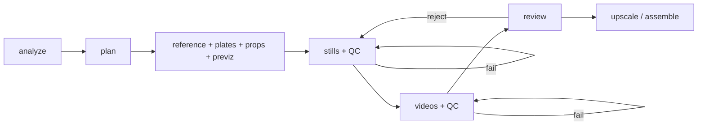

# mvdirector

Plan, generate, quality-check and assemble a lip-synced (or narrative / visual) music video from any song — a single audio track, DAW stems, or a Suno export.

You supply the audio, lyrics and a style brief (or generate stems/lyrics from a single track with `mvd prepare`, or draft lyrics and a brief with `mvd brief`). The pipeline analyzes the audio, uses any configured LLM (local or remote Ollama by default with no API key required; Claude, OpenAI, Gemini, or any OpenAI-compatible server work too) to direct a shot list, locks character sheets, turnaround videos, set plates, hero props and optional 3D camera-blocking previz, renders stills and video clips **through ComfyUI** using **whatever image, video, and lip-sync models you prefer** (open-weight models like Qwen, Z-Image, Flux, Krea, LTX, Wan, HunyuanVideo, or MOSS, or paid cloud API nodes like Nano Banana, Seedream, Seedance, Grok, Kling, or P-H3 / MiniMax), rejects and regenerates anything that fails its quality checks, and cuts the result to the beat with the original mix on top.

The orchestrator runs on macOS, Linux, or Windows and is **setup-, model-, and ComfyUI-version-agnostic**. ComfyUI is the single execution engine for all image and video generation and can run wherever you want over HTTP(S): **locally on the same machine**, **on another computer in your home network (LAN / Tailscale)**, **on a remote cloud GPU server**, or as a lightweight CPU-only instance driving paid cloud API nodes.

## Status

- **First stable release (`v1.0.0`) — single-user orchestrator:** `mvdirector` is a stable single-user orchestrator talking to local, home-LAN, or private cloud ComfyUI and LLM endpoints. The Streamlit review UI, ComfyUI, and Ollama have no built-in authentication and bind to `127.0.0.1` by default.
- **Tested end-to-end both locally and with remote ComfyUI:** The full pipeline (`mvd analyze` → `mvd plan` → reference sheets & plates → `mvd stills` → `mvd videos` → review → `mvd assemble`) has been verified end-to-end both **fully locally** (orchestrator, ComfyUI, and local LLM on one machine) and on a **remote ComfyUI setup** (orchestrator running locally against a separate ComfyUI server over HTTP/HTTPS — the same path used for a second computer on your home network or a cloud GPU host).
- **Setup-, model-, and ComfyUI-version-agnostic:** Bring whichever image, video, lip-sync, and LLM models you want — running locally or remotely — without changing Python code. `mvdirector` talks to ComfyUI through your exported `.api.json` graphs and `.bindings.json` maps over ComfyUI's core HTTP endpoints (`/system_stats`, `/upload/image`, `/prompt`, `/history`, `/view`), degrading optional endpoints (`/free`, `/object_info`, `HEAD /view`) gracefully across ComfyUI versions.
- **Automated test suite:** Extensive unit, integration, security, and pipeline tests cover audio analysis, shot timing, single- and multi-character direction, workflow templating and bindings, `ComfyClient` version compatibility, LLM backends, QC scoring and lip-sync maths, retry/review policies, MCP server hardening, path containment, safe identifier and env-var validation, schema migration, stale-lock recovery, and FFmpeg assembly.
- **You must supply the workflows:** Export your own ComfyUI API workflows (`.api.json`) and map their inputs in `<name>.bindings.json` (see [Workflows & Model Bindings](docs/workflows.md)).
- **QC thresholds are starting points:** Calibrate thresholds on 20 to 30 of your own clips with `mvd calibrate`, and inspect `mvd qc-report` before trusting the gates. The lip-sync check is advisory by default: on sung vocals it did not reliably separate in-sync clips from out-of-sync ones, so a weak score sends the clip to review instead of rejecting it, and a singing shot that runs out of attempts falls back to a performance shot (or optional Smart Cutaway rescue). See [Pipeline, Assets, Quality Checks & Review](docs/pipeline-and-qc.md).
- **Duets & bands:** the lead gets all four reference panels while secondary visible members bind their front panel (`reference_image_2`, `reference_image_3`, … when declared by the `still` workflow), so secondary members can drift more. Pin hair and signature details in `characters.<id>.invariants` for every character; they are written into every still prompt.

## How it works



Everything revolves around one file, `manifest.json`. Each stage reads it, does its work, and writes it back atomically, so any stage can be re-run alone and a run can be stopped and resumed.

| Stage | Command | What it does |
|---|---|---|
| Prepare *(optional)* | `mvd prepare <audio>` | From a single `.mp3` or `.wav` file: transcodes `inputs/mix.wav`, separates `inputs/vocals.wav` (Demucs), transcribes lyrics, and infers `[Section]`-tagged `inputs/lyrics.txt` + lip-sync-ready `inputs/style.md`. |
| Brief *(optional)* | `mvd brief` | Drafts `inputs/lyrics.txt` and `inputs/style.md` from an `--idea` prompt; `--exclude` adds things that must never appear on screen. |
| Analyze | `mvd analyze [--tune] [--mode mix]` | Tempo, beats, bars, per-bar loudness, acoustic `musical_features` (key, brightness, texture, dynamics), vocal activity, lyric timing, and `track_profile` (`analysis.json`); `--tune` persists track-specific settings to `project.yaml`. In `mix` mode, windowed per-chapter BPM, downbeat, and energy from `inputs.tracklist` or fixed intervals. |
| Tune *(optional)* | `mvd tune [--apply]` | Inspects lyrics, style cues, and `analysis.json` to preview or write recommended transcription, pacing, and lip-sync adjustments into `project.yaml` (`auto_tune: true` applies them automatically at runtime). |
| Plan | `mvd plan [--mode mix]` | Deterministic bar/phrase cuts + LLM song interpretation, visual bible, and shot direction (`manifest.json`); in `mix` mode, 1 distinct environment + 2–3 loopable visual units per track chapter (optionally guided by per-chapter lyrics excerpts). Global exclusions (`--exclude`, `inputs.exclusions`, or an `Exclusions:` line in `style.md`) become bible rules, negative prompts, and vision checks. |
| Reference | `mvd reference generate`, `lock`, `seed`, `video`, `lock-video` | Locks 4-panel character sheets (`row`/`grid`/`columns`, `white`/`grey`), derived character variants (`--from-character`), sheets seeded from 1–10 real angle photos (`seed`), and optional silent turnaround reference videos. |
| Plates & Props | `mvd plates ...`, `mvd props ...` | Locks empty set plates (including `--from-set`, `--style-ref`, `--embed-set`), 2x2 multi-angle set turnarounds (`plates turnaround`, `lock-turnaround`), and recurring hero props. |
| Previz *(optional)* | `mvd previz generate`, `refine`, `lock` | Generates and refines 3D camera-blocking clips (`previz_video`) for complex camera moves. |
| Sketch *(optional)* | `mvd sketch attach`, `clear` | Attaches a rough hand-drawn framing sketch to a shot as a lightweight alternative to previz. |
| Draft grid *(optional)* | `mvd draft-grid` | Renders per-section 2x2/3x2 storyboard contact sheets and slices them into draft stills and/or one R2V montage clip per section. |
| Generate | `mvd run` (or `mvd stills`, `mvd videos`) | Renders stills and clips (with optional `--draft` or `--chapter`), runs automated QC, and retries failures. `mvd repair-still` edits one shot's still in place; `mvd regenerate-still --strategy recreate` renders it from scratch. |
| Review & Upscale | `mvd review`, `mvd upscale` | Streamlit UI (or CLI `approve`/`reject`), plus optional video upscaling of draft/approved clips. |
| Assemble | `mvd assemble` | Trims clips to frame-exact lengths, prefers upscaled clips when present, joins them, and muxes the original mix (in `mix` mode, caches per-chapter loop segments in `assets/segments/` and writes a YouTube `.chapters.txt` sidecar). |

## Quick start

> Getting started locally or with a remote ComfyUI server? Follow the step-by-step [Quickstart Guide](docs/local-quickstart.md) or run `mvd setup` to inspect your environment and configure a project interactively.

**macOS / Linux:**

```bash
brew install ffmpeg                                         # or: sudo apt-get install ffmpeg
python3 -m venv .venv && source .venv/bin/activate
pip install -c constraints.txt -e ".[qc,align,ui,dev]"      # add "anthropic" to use Claude
ollama pull gemma3:12b                                      # default local LLM; or use any Ollama/cloud/OpenAI-compatible model (docs/setup.md)
export COMFY_URL=http://127.0.0.1:8188                      # local, home LAN/Tailscale (http://192.168.x.x:8188), or remote cloud HTTPS URL

mvd setup projects/my-song                   # or `mvd init projects/my-song` (add `--mode mix` for 30-90+ min mixes)
cd projects/my-song
```

**Windows (PowerShell):**

```powershell
winget install Python.Python.3.12 Gyan.FFmpeg               # restart terminal after installing
py -3.12 -m venv .venv
.\.venv\Scripts\Activate.ps1                                # if blocked, run: Set-ExecutionPolicy -Scope CurrentUser RemoteSigned
pip install -c constraints.txt -e ".[qc,align,ui,dev]"      # add "anthropic" to use Claude
ollama pull gemma3:12b                                      # default local LLM; or use any Ollama/cloud/OpenAI-compatible model (docs/setup.md)
$env:COMFY_URL = "http://127.0.0.1:8188"                    # local, home LAN/Tailscale (http://192.168.x.x:8188), or remote cloud HTTPS URL

mvd setup projects\my-song                                  # or `mvd init projects\my-song` (add `--mode mix` for 30-90+ min mixes)
cd projects\my-song
```

1. Put your song files in `inputs/`: `mix.wav`, `vocals.wav` (optionally a drum stem or DAW/Suno stem pack in `inputs/stems/`), `inputs/lyrics.txt` (`[Section]` tags and `(adlibs)`), and `inputs/style.md` — or start from a single `.mp3`/`.wav` file with `mvd prepare /path/to/song.mp3` (requires the `stems` and `align` extras), or draft lyrics and a brief first with `mvd brief --idea "..."`. For `mode: mix`, supply `inputs/mix.wav` and an optional `inputs/tracklist.json` (`.yaml`, `.cue`, `.csv`, or `.txt`).
2. Edit `project.yaml` (title, mode, resolution, LLM provider/model, and `video:` / `mix:` settings matching your ComfyUI workflow). With `auto_tune: true` (default), `mvd prepare`, `mvd analyze`, and `mvd plan` automatically tune default transcription (`large-v3-turbo`), pacing, and lip-sync parameters for your track (`mvd tune [--apply]` previews or writes them to `project.yaml`). For non-English and non-Latin audio caveats (such as scripts not auto-detected by `auto_tune` or audio-only code-switching), see [Language Support & Known Limitations](docs/pipeline-and-qc.md#language-support--known-limitations).
3. Export and bind your ComfyUI workflows under `workflows/` (see `workflows/README.md` and [Workflows & Model Bindings](docs/workflows.md)).

```bash
mvd validate                                              # tools, workflow bindings, ComfyUI connection
mvd llm-check                                             # verify LLM JSON + vision support
mvd analyze
mvd plan                                                  # inspect/edit manifest.json if desired
mvd reference generate                                    # base sheet candidates in assets/reference/
mvd reference lock assets/reference/cape_candidate_02.png
mvd reference generate --state bare                       # costume variants edit the locked base sheet
mvd reference lock assets/reference/bare_candidate_01.png --state bare
mvd plates generate                                       # set plate candidates in assets/plates/
mvd plates lock assets/plates/knight_floor_candidate_01.png --set "The Knight Floor"
mvd assets                                                # check what is locked and what is missing
mvd run --draft --shot s001 --shot s002                   # cheap draft preview on two shots first
mvd run                                                   # full generation (safe to interrupt & resume)
mvd review                                                # approve or send back
mvd upscale                                               # optional: upscale draft clips
mvd qc-report                                             # per-check pass / fail / skip counts
mvd clean [--yes]                                         # list (or delete) takes that lost to a selected attempt
mvd calibrate                                             # threshold suggestions from review labels
mvd assemble                                              # output/<title>.mp4
```

`mvd assemble --force` builds a draft at any time, holding stills or black for missing shots. All commands take `--project <folder>` (default: current folder); `mvd -v <command>` enables debug logs.

## Documentation

- [Running Locally: Cloudless Mode & Cloud Mode](docs/local-quickstart.md) — Step-by-step walkthrough for running on your laptop in **Cloudless Mode** (100% local Ollama + ComfyUI, rule-based no-LLM, or zero-GPU `pytest` mock harness) or **Cloud Mode** (Anthropic/Gemini/OpenAI + Split-LLM + remote cloud GPU via HTTPS/SSH tunnel or paid ComfyUI API nodes).
- [Installation, Docker & Language Models](docs/setup.md) — Supported topologies (local, home LAN, cloud), Python extras, commercial licensing (`mediapipe` vs `insightface`), Docker Compose profiles & all-in-one GPU image, Apple Silicon setup, and configuring/splitting LLM providers (`anthropic`, `openai`, `gemini`, `ollama`, `openai_compatible`, `qc.llm`, `planning.audio_llm`).
- [ComfyUI Workflows, Model Bindings & Version Compatibility](docs/workflows.md) — Mapping `.api.json` + `.bindings.json` for any open-weight or cloud API model, ComfyUI version-agnostic HTTP compatibility, `reference_notation` (`prose` vs `tags`), `audio_video` black-screen wrapper, model-family `video:` settings table, and `${ENV}` allowlist.
- [Pipeline, Assets, Quality Checks & Review](docs/pipeline-and-qc.md) — Project layout, `mvd prepare`, `mvd brief`, track auto-tuning (`mvd tune`), visual bible & deterministic rules, reference sheets & turnaround videos, derived/embedded set plates & hero props, 3D blocking previz, `--draft` & `mvd upscale`, `allow_cuts` montage, QC gates, retry ladder, calibration, `light`/`strict` review, and Long-Form Mix Mode (`mode: mix`).
- [Using mvdirector as a library](docs/library.md) — `mvdirector.api`, the public surface, and the `StateStore`, `AssetStorage` and `ComfyEndpointProvider` extension points.
- [MCP Server & Agent Integration](docs/mcp.md) — Driving `mvdirector` from Claude Code, Cursor, Antigravity, or a remote GPU workstation via `mvd mcp` (`stdio` + Streamable HTTP, async jobs, and the bundled `mvdirector://skill` guide).
- [Architecture, System Internals & Development](docs/architecture.md) — Layered architecture, end-to-end data flow, subsystem internals (state/locking, audio/diarization, Split-LLM, ComfyUI binding/pruning/cache, dependency-wave `ShotRunner`, QC/retry loop, assembly/mix mode, `mvd bench`), source code map, cloudless test harness, and extension points.
- [Engineering Guide](mvdirector_engineering_guide.md) — Deep-dive reference on data models, algorithms, error handling, and configuration defaults.
- [Changelog](CHANGELOG.md) — Versioned release notes and upgrade history.

## License

mvdirector is licensed under the [Mozilla Public License 2.0](LICENSE). You can use it in commercial and closed-source products. If you modify an MPL-covered file and distribute the result, you must make that file's source available under the MPL. Code you write that only calls the library stays yours.
