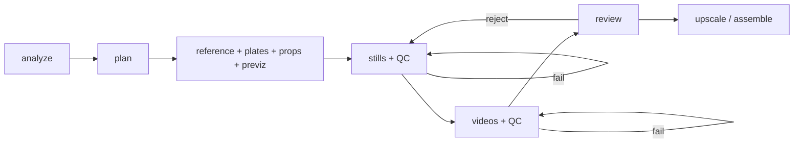

# mvdirector

Plan, generate, quality-check and assemble a lip-synced music video from a Suno song.

You supply the mix, the vocal stem, the lyrics and a style brief (or generate lyrics and a brief with `mvd brief`). The pipeline analyzes the audio, has an LLM direct a shot list (a local Ollama model by default, which needs no API key; Claude, OpenAI and Gemini work too), locks character sheets, turnaround videos, set plates, hero props and optional 3D camera-blocking previz, renders stills and video clips **through ComfyUI** (open-weight GPU models like Qwen, Z-Image, Krea, LTX, Wan, or MOSS, or paid cloud API nodes like Nano Banana, Seedream, Seedance, Grok, or P-H3 / MiniMax), rejects and regenerates anything that fails its quality checks, and cuts the result to the beat with the original mix on top.

The orchestrator runs on your Mac (or Linux/Windows machine). ComfyUI is the single execution engine for all image and video generation and can run anywhere with an HTTP address: a RunPod GPU pod, a local install, or a lightweight CPU-only ComfyUI instance when your workflows use paid cloud API nodes.

## Status

- **Alpha release — single-user local orchestrator:** `mvdirector` is designed for a single user running locally (talking to local or private ComfyUI/LLM endpoints). The Streamlit review UI, ComfyUI, and Ollama have no built-in authentication and bind to `127.0.0.1` by default.
- **Orchestration verified on live ComfyUI + Ollama:** A three-character duet project has been taken end-to-end on a RunPod ComfyUI with a local Ollama model (`gemma3:12b`) doing the vision checks: `mvd analyze`, `mvd plan`, `mvd reference generate` / `lock` (four-panel sheets), `mvd stills` (Qwen-Image and Qwen-Image-Edit 2.1), `mvd videos` (Wan 2.1 + InfiniteTalk singing clips; LTX-2.5 in an earlier run), shot-by-shot review, and `mvd assemble`. Not yet verified: a complete solo-singer song on a real pod (solo paths are covered by unit tests only). LTX-2.5's audio-conditioned workflow showed lip-sync drift on singing clips, so pair it with InfiniteTalk, LatentSync or Seedance for tight mouth sync.
- **Automated test suite:** Extensive unit and pipeline tests cover audio analysis, shot timing, single- and multi-character direction, workflow templating and bindings, `ComfyClient`, LLM backends, QC scoring and lip-sync maths, retry/review policies, path containment, safe identifier and env-var validation, schema migration, stale-lock recovery, and FFmpeg assembly (against fakes for ComfyUI and cloud LLM endpoints).
- **You must supply the workflows.** Export your own ComfyUI API workflows and map their inputs in `<name>.bindings.json` (see [Workflows & Model Bindings](docs/workflows.md)).
- **QC thresholds are starting points.** Calibrate thresholds on 20 to 30 of your own clips with `mvd calibrate`, and inspect `mvd qc-report` before trusting the gates. The lip-sync check is advisory by default: on sung vocals it did not predict what a person judged in sync, so a weak score sends the clip to review instead of rejecting it, and a singing shot that runs out of attempts falls back to a performance shot. See [Pipeline, Assets, Quality Checks & Review](docs/pipeline-and-qc.md).
- **Duets:** the lead gets all four reference panels and the second singer gets only the front panel, so the second singer drifts more. Pin hair and signature details in `characters.<id>.invariants` for every character; they are written into every still prompt.

## How it works



Everything revolves around one file, `manifest.json`. Each stage reads it, does its work, and writes it back atomically, so any stage can be re-run alone and a run can be stopped and resumed.

| Stage | Command | What it does |
|---|---|---|
| Prepare *(optional)* | `mvd prepare <audio>` | From a single `.mp3` or `.wav` file: transcodes `inputs/mix.wav`, separates `inputs/vocals.wav` (Demucs), transcribes lyrics, and infers `[Section]`-tagged `inputs/lyrics.txt` + lip-sync-ready `inputs/style.md`. |
| Brief *(optional)* | `mvd brief` | Drafts `inputs/lyrics.txt` and `inputs/style.md` from an `--idea` prompt. |
| Analyze | `mvd analyze` | Tempo, beats, bars, per-bar loudness, vocal activity, lyric timing (`analysis.json`). |
| Plan | `mvd plan` | Deterministic bar/phrase cuts + LLM visual bible (characters, wardrobes, sets, props, rules) and shot direction (`manifest.json`). |
| Reference | `mvd reference generate`, `lock`, `video`, `lock-video` | Locks 4-panel character sheets (`row`/`grid`/`columns`, `white`/`grey`), derived character variants (`--from-character`), and optional silent turnaround reference videos. |
| Plates & Props | `mvd plates ...`, `mvd props ...` | Locks empty set plates (including `--from-set`, `--style-ref`, `--embed-set`) and recurring hero props. |
| Previz *(optional)* | `mvd previz generate`, `refine`, `lock` | Generates and refines 3D camera-blocking clips (`previz_video`) for complex camera moves. |
| Generate | `mvd run` (or `mvd stills`, `mvd videos`) | Renders stills and clips (with optional `--draft`), runs automated QC, and retries failures. |
| Review & Upscale | `mvd review`, `mvd upscale` | Streamlit UI (or CLI `approve`/`reject`), plus optional video upscaling of draft/approved clips. |
| Assemble | `mvd assemble` | Trims clips to frame-exact lengths, prefers upscaled clips when present, joins them, and muxes the original mix. |

## Quick start

```bash
brew install ffmpeg
python -m venv .venv && source .venv/bin/activate
pip install -c constraints.txt -e ".[qc,align,ui,dev]"      # add "anthropic" to use Claude
ollama pull gemma3:12b                                      # default local LLM, see docs/setup.md for cloud providers
export COMFY_URL=https://<pod-id>-8188.proxy.runpod.net     # or http://127.0.0.1:8188

mvd init projects/my-song
cd projects/my-song
```

1. Put the Suno files in `inputs/`: `mix.wav`, `vocals.wav` (optionally a drum stem), `inputs/lyrics.txt` (`[Section]` tags and `(adlibs)`), and `inputs/style.md` — or run `mvd brief --idea "..."` before generating a song, or start from a single `.mp3`/`.wav` file with `mvd prepare /path/to/song.mp3` (requires the `stems` and `align` extras).
2. Edit `project.yaml` (title, resolution, LLM provider/model, and `video:` timing settings matching your ComfyUI workflow).
3. Export and bind your ComfyUI workflows under `workflows/` (see `workflows/README.md` and [Workflows & Model Bindings](docs/workflows.md)).

```bash
mvd validate                                              # tools, workflow bindings, ComfyUI connection
mvd llm-check                                             # verify LLM JSON + vision support
mvd analyze
mvd plan                                                  # inspect/edit manifest.json if desired
mvd reference generate                                    # base sheet candidates in assets/reference/
mvd reference lock assets/reference/cape_candidate_02.png
mvd reference generate --state bare                       # costume variants edit the locked base sheet
mvd reference lock assets/reference/bare_candidate_01.png --state bare
mvd plates generate                                       # set plate candidates in assets/plates/
mvd plates lock assets/plates/knight_floor_candidate_01.png --set "The Knight Floor"
mvd assets                                                # check what is locked and what is missing
mvd run --draft --shot s001 --shot s002                   # cheap draft preview on two shots first
mvd run                                                   # full generation (safe to interrupt & resume)
mvd review                                                # approve or send back
mvd upscale                                               # optional: upscale draft clips
mvd qc-report                                             # per-check pass / fail / skip counts
mvd clean [--yes]                                         # list (or delete) takes that lost to a selected attempt
mvd calibrate                                             # threshold suggestions from review labels
mvd assemble                                              # output/<title>.mp4
```

`mvd assemble --force` builds a draft at any time, holding stills or black for missing shots. All commands take `--project <folder>` (default: current folder); `mvd -v <command>` enables debug logs.

## Documentation

- [Installation, Docker & Language Models](docs/setup.md) — Python extras, commercial licensing (`mediapipe` vs `insightface`), Docker Compose profiles & RunPod image, Apple Silicon setup, and configuring/testing LLM providers (`anthropic`, `openai`, `gemini`, `ollama`, `openai_compatible`).
- [ComfyUI Workflows & Model Bindings](docs/workflows.md) — Mapping `.api.json` + `.bindings.json`, `reference_notation` (`prose` vs `tags`), `audio_video` black-screen wrapper, model-family `video:` settings table, paid cloud API nodes, and `${ENV}` allowlist.
- [Pipeline, Assets, Quality Checks & Review](docs/pipeline-and-qc.md) — Project layout, `mvd brief`, visual bible & deterministic rules, reference sheets & turnaround videos, derived/embedded set plates & hero props, 3D blocking previz, `--draft` & `mvd upscale`, `allow_cuts` montage, QC gates, retry ladder, calibration, and `light`/`strict` review.
- [Using mvdirector as a library](docs/library.md) — `mvdirector.api`, the public surface, and the `StateStore`, `AssetStorage` and `ComfyEndpointProvider` extension points.
- [Architecture, Development & Limitations](docs/architecture.md) — Source code map, manifest & event-stream conventions, dev commands (`pytest`, `ruff`, `mypy`, `mvd schema`), extension points, and known limitations.
- [Changelog](CHANGELOG.md) — Versioned release notes and upgrade history.

## License

mvdirector is licensed under the [Mozilla Public License 2.0](LICENSE). You can use it in commercial and closed-source products. If you modify an MPL-covered file and distribute the result, you must make that file's source available under the MPL. Code you write that only calls the library stays yours.
