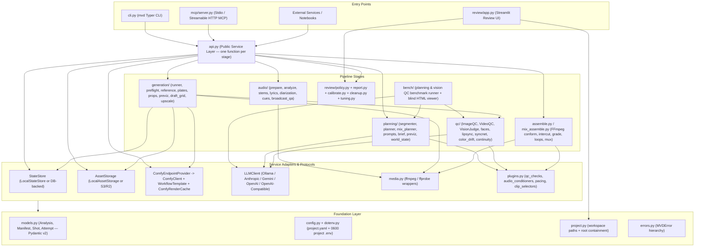
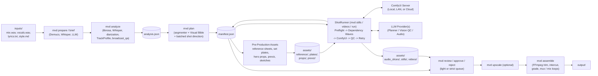
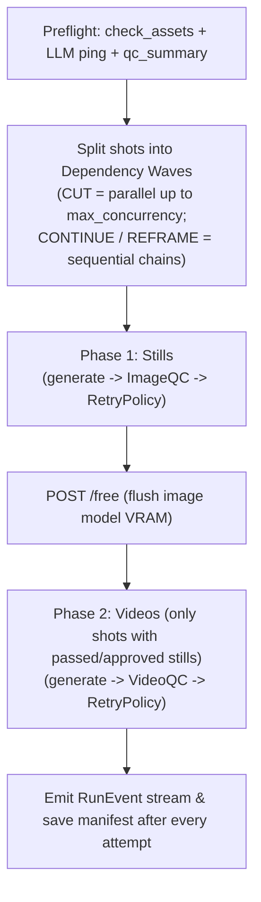

# Architecture, System Internals & Development

This document explains how `mvdirector` is built, how its subsystems fit together at runtime, and how to develop and extend it.

> For running the app locally (Cloudless Mode vs. Cloud Mode), see [Running Locally: Cloudless Mode & Cloud Mode](local-quickstart.md). For workflow bindings, see [ComfyUI Workflows & Model Bindings](workflows.md). For embedding `mvdirector` in another service, see [Using mvdirector as a library](library.md).

---

## 1. Layered System Architecture

Dependencies point strictly downward: entry points call `mvdirector.api`, `api.py` coordinates pipeline stages, pipeline stages call service adapters behind protocols, and the foundation layer (`models.py`, `config.py`, `project.py`, `store.py`, `errors.py`, `dotenv.py`) knows nothing about the layers above it.



---

## 2. End-to-End Data & Control Flow

Every stage is stateless between CLI invocations: it opens the project folder, reads `analysis.json` and/or `manifest.json`, performs one unit of work, and atomically writes the updated state back to disk.



---

## 3. How the Subsystems Fit Together

### 3.1 State, Persistence, Locking & Security (`models.py`, `project.py`, `store.py`, `dotenv.py`)

- **Two persisted state files:** `analysis.json` (`Analysis`) stores deterministic audio measurements (tempo, beats, bars, loudness, `musical_features`, `vocal_windows`, `vocal_turns`, aligned lyrics, `track_profile`, `broadcast_qa`). `manifest.json` (`Manifest`) stores the `VisualBible`, `characters`, locked reference sheets/plates/props, and the ordered `shots` list with every `Attempt`, `QCReport`, and `Review` decision.
- **Strict Pydantic models & schema migrations:** Every model uses `extra="forbid"` and `allow_inf_nan=False`. `MANIFEST_SCHEMA_VERSION` guards compatibility; breaking changes add `mode="before"` migration validators so existing projects upgrade in memory.
- **Single-writer lock & atomic writes:** `Project.edit_manifest()` and generation runs acquire a lock through `StateStore` (`LocalStateStore` uses `.run.lock` with PID-based stale-lock cleanup on dead local processes). Every write goes through `atomic_write()` (temp file + `os.replace`) so an interrupted run never corrupts `manifest.json`.
- **Storage hooks:** `AssetStorage.pull()` runs before opening workspace files on read/write stages, and `AssetStorage.push()` runs before every manifest save so remote storage (e.g. S3/R2 in a hosted service) never lags behind persisted state.
- **Security boundaries:**
  - All paths resolved via `Project` and workflow bindings enforce strict containment inside the project root (`..` traversal and symlink escapes raise `ConfigError`).
  - Shot, wardrobe, character, and plugin IDs are validated against strict allowlist regexes (`SAFE_ID`).
  - `dotenv.py` reads `<project>/.env` per project **without mutating `os.environ`** (preventing secret leakage across projects in long-lived `mvd mcp` servers). Shell env vars always take precedence over `.env`, only allowlisted keys (`ANTHROPIC_API_KEY`, `OPENAI_API_KEY`, `GEMINI_API_KEY`, `GOOGLE_API_KEY`, `COMFY_*`, safe `MVD_*`) are accepted, and `mvd setup` writes `.env` atomically with `0600` permissions and adds it to `.gitignore`.

### 3.2 Audio Analysis, Diarization & Auto-Tuning (`audio/`, `tuning.py`)

- **`mvd prepare` (`audio/prepare.py`):** Accepts a single `.mp3`/`.wav`, transcodes `inputs/mix.wav`, separates `inputs/vocals.wav` (and optional drums) via Demucs (`audio/stems.py`), transcribes via `faster-whisper` (`audio/lyrics.py`), and drafts `[Section]`-tagged `lyrics.txt` and `style.md`.
- **`mvd analyze` (`audio/analysis.py`):** Extracts beats, bars, per-bar loudness, structural energy landmarks (`audio/cues.py`), key/Camelot & acoustic `musical_features`, Whisper-refined `vocal_windows`, multi-singer `vocal_turns` (`voice_1`, `voice_2`, `both`), pre-spend alignment warnings (`audio/alignment_qa.py`), and ITU-R BS.1770-4 loudness/True Peak diagnostics (`audio/broadcast_qa.py`).
- **Auto-tuning (`tuning.py`):** Computes a `TrackProfile` (language/code-switching, vocal mode, rap density, drops, meter cues) and adjusts default transcription, pacing, and `max_lipsync_share` values when `auto_tune: true`.
- **Mix Mode (`audio/tracklist.py`, `audio/mix_analysis.py`):** Parses JSON/YAML/CUE/CSV/TXT tracklists (or falls back to fixed energy-dip chapters) and computes windowed per-chapter BPM, downbeat, and energy in bounded memory.

### 3.3 Planning & Multi-LLM Architecture (`planning/`, `llm/`)

- **Deterministic timing, creative LLM direction:** `planning/segmenter.py` computes bar-aligned (or phrase-aligned) shot boundaries, frame counts (`frame_multiple * n + frame_offset`), and initial `ShotType` (`lipsync` / `performance` / `broll`) purely from `analysis.json`. `planning/planner.py` then makes two kinds of LLM calls:
  1. **Visual Bible (1 call):** Produces `SongInterpretation`, `concept`, `characters` (with `invariants` and `wardrobe`), `settings`, `props`, `style`, `palette`, `lighting`, `negative_prompt`, and `rules`.
  2. **Batched Shot Direction (`llm.shots_per_request` shots per call):** Produces framing, set, wardrobe, `still_prompt`, and `motion_prompt` while carrying the last 4 directed shots across batch boundaries for continuity.
- **Deterministic post-guards:** Code enforces `max_lipsync_share` cutaway budgeting, `lipsync_widest_framing`, `wardrobe_monotonic`, simultaneous duet two-shot staging, `AudioSlice.mute_spans` (silencing foreign vocals and instrumental bleed), empty-scene `performance` → `broll` conversion, and global exclusions (`visual_bible.exclusions`).
- **Multi-LLM & Split-LLM routing (`llm/factory.py`, `llm/base.py`):**
  - `build_llm()` instantiates any of the 5 backends (`ollama`, `anthropic`, `openai`, `gemini`, `openai_compatible`) behind the `LLMClient` protocol (`ChatBackend`).
  - Three distinct LLM slots are supported: top-level `llm` (planning & prompt rewrites), optional `qc.llm` (Vision QC judge; defaults to `llm`), and optional `planning.audio_llm` (1-call native MP3 listen when the planner is text-only; defaults to `qc.llm` if audio-capable).
  - `ChatBackend` handles JSON-mode negotiation (`auto`/`object`/`schema`/`off`), `<think>` block stripping, single-retry JSON self-correction, SSE streaming (`llm.stream: true` for reverse proxies), `Retry-After` backoff on transient `429`/5xx, fast-fail `LLMQuotaError` on hard billing exhaustion, and a **3-consecutive-failure circuit breaker** that disables vision checks cleanly mid-run instead of stalling.

### 3.4 ComfyUI Execution Engine (`comfy/`)

- **Model- & version-agnostic workflow binding (`comfy/workflow.py`):** Every workflow is an exported `<name>.api.json` graph paired with `<name>.bindings.json` mapping logical names (`positive_prompt`, `seed`, `image`, `audio`, `audio_video`, `num_frames`, `duration`, `reference_image`, `set_image`, `prop_image`, etc.) to `node` + `field` pairs. `convert_ui_workflow()` can also convert LiteGraph UI exports, and `ComfySwitchNode` collapsing handles optional NAG nodes (`comfy.nag_enabled`).
- **Priority-ordered N-slot binding & node pruning:** For each shot, `ShotRunner` fills available reference slots in priority order (`lead > set > secondaries > props`), aligns `@imageN` handles when `comfy.reference_notation: tags`, and **prunes unused optional `LoadImage` / `LoadVideo` nodes** from the per-shot graph so missing optional inputs never leak stale placeholder filenames.
- **HTTP client & caching (`comfy/client.py`, `comfy/cache.py`, `comfy/provider.py`):**
  - Uses ComfyUI's core HTTP endpoints (`/system_stats`, `/upload/image`, `/prompt`, `/history/{id}`, `/view`) with polling instead of relying on WebSockets for job completion, ensuring reliability across local, LAN, SSH-tunnel, and cloud reverse proxies. Optional endpoints (`/free`, `/object_info`, `HEAD /view`) degrade gracefully across ComfyUI versions.
  - Supports opt-in content-addressed render caching (`comfy.cache_enabled` under `<project>/.comfy_cache`), SHA-256 upload deduplication (`comfy.dedup_uploads`), VRAM pre-checks (`comfy.min_free_vram_gb`), VRAM unloading between stills and videos (`POST /free`), and explicit opt-in Comfy.org API key forwarding (`comfy.api_key_comfy_org`).
  - `ComfyEndpointProvider.lease(project)` abstracts endpoint routing (`StaticComfyProvider` by default; swappable for GPU pod pools in hosted deployments).

### 3.5 Generation, QC & Retry Closed Loop (`generation/runner.py`, `qc/`, `retry.py`)



- **Preflight (`generation/preflight.py`):** Verifies locked character sheets, set plates (when `set_image` is bound), and hero props (when `prop_image` is bound) before spending GPU time; `mvd assets --lint` runs zero-LLM noun-phrase extraction (`lint_reference_coverage`) to catch recurring undeclared props/sets.
- **Dependency-wave parallelism:** Independent `CUT` shots run concurrently up to `comfy.max_concurrency` (`-j N`) via `ThreadPoolExecutor`, while `CONTINUE` / `REFRAME` chains execute in topological waves so each chained shot extracts its exact assembly handoff frame from the preceding clip. Budget accounting (`RunBudget`), manifest persistence, and QC stay synchronized.
- **Quality gates (`qc/`):**
  - `ImageQC` checks dimensions, sharpness, MediaPipe/InsightFace face presence & framing, `no_people` on b-roll, identity, and `VisionJudge` (`vision_spec`, `vision_artifacts`, `vision_character`, optional two-pass `vision_blind_observer`).
  - `VideoQC` checks dimensions, duration, temporal stability (static/jump-cut/flicker, relaxed for `allow_cuts`), face presence, advisory lip-sync (`MediaPipeMouthTracker` or `StableSyncNetScorer`), identity, `join_continuity`, `beat_motion`, `color_drift`, and sampled-frame `VisionJudge`.
  - Any hard-check failure rejects the attempt; otherwise the weighted average (`qc.weights`) must meet `qc.pass_score` (plus `qc.opening_threshold_margin` for shots in `planning.opening_seconds`).
- **Retry ladder (`retry.py`):** Escalates `new_seed` → `rewrite_prompt` (LLM rewrites from QC failure reasons) → `adjust_params` (e.g. higher `steps`). Supports `keep_still_on_video_fail`, targeted `in_place_repair`, `lipsync_fallback` (downgrade exhausted singing shot to `performance` or `broll`), and `smart_cutaway_rescue`.
- **Event stream:** `ShotRunner` emits typed `RunEvent` objects (`warning`, `qc_summary`, `phase_started`, `attempt_started`, `attempt_finished`, `asset_passed`, `shot_converted`, `asset_exhausted`, `run_finished`) to any `observer` callback (CLI printer, MCP async job tracker, or host service).

### 3.6 Review, Assembly & Mix Mode (`review/`, `assemble.py`, `mix_assemble.py`)

- **Review (`review/policy.py`, `review/app.py`):** `light` mode queues exhausted shots plus a deterministic sample (all close-ups, opening-hook shots, retried shots, near-threshold passes, and `other_rate` of the rest; rejecting a shot escalates its `ShotType`). `strict` mode queues only exhausted shots. The Streamlit UI is read-only while `.run.lock` is held.
- **Standard Assembly (`assemble.py`):** Trims each clip from its handles (`video.handle_seconds`, with optional `sync_delay_compensation` or `clip_selector` plugin offset) to frame-exact shot length, prefers `upscaled_path` when present, applies optional `assembly_intercut`, `color_drift_correction`, `color_grade`, `film_grain`, and transitions, and muxes the original `inputs/mix.wav` (with optional diegetic `sfx_path` ducking).
- **Long-Form Mix Assembly (`mix_assemble.py`):** Builds seamless circular loop cycles per `MixChapter` (`xfade` or `smoothstep`), applies optional BPM-synced `beat_pulse` and HUD overlay, caches rendered chapter MP4s + `.mp4.json` input stamps under `assets/segments/`, embeds chapter markers, and writes `<output>.chapters.txt`.

### 3.7 Benchmarking (`bench/`) & Plugins (`plugins.py`)

- **Model Benchmarking (`mvd bench`):** `src/mvdirector/bench/` provides a reproducible harness to compare LLM arms on planning quality and Vision QC accuracy with token/cost telemetry (`bench/telemetry.py`, `bench/config.py`):
  - `mvd bench init-config` — generate a `bench.yaml` arm matrix
  - `mvd bench plan` — run planning across arms and export `summary.csv` / `summary.md`
  - `mvd bench viewer` — generate an anonymized blind HTML review sheet (`blind_review.html`)
  - `mvd bench init-qc-dataset` & `mvd bench qc` — evaluate Vision QC arms against labeled clips (`qc_labels.csv`)
- **Entry-Point Plugins (`plugins.py`):** Four allowlisted Python entry-point groups (`mvdirector.qc_checks`, `mvdirector.audio_conditioners`, `mvdirector.pacing`, `mvdirector.clip_selectors`) let external packages extend QC, vocal conditioning, cut pacing, and clip in-point selection without modifying core code.

---

## 4. Source Code Map

```text
src/mvdirector/
  api.py              public service layer: one function per stage; CLI, MCP, and host callers use it
  cli.py              thin Typer wrapper over api.py: options in, formatted text out
  config.py           project.yaml Pydantic schema, defaults, and allowlisted ${ENV} expansion
  dotenv.py           project-scoped .env reader/writer (0600, no os.environ mutation, allowlist)
  models.py           Analysis and Manifest (persisted state, SAFE_ID, schema version migrations)
  project.py          workspace paths + strict root containment; delegates to StateStore & AssetStorage
  store.py            StateStore / AssetStorage protocols, atomic_write, and LocalStateStore PID lock
  errors.py           MVDError hierarchy for expected operational failures
  media.py            ffmpeg / ffprobe wrappers (including black-screen audio_video packaging)
  plugins.py          entry-point plugin discovery and identifier allowlisting
  setup.py            environment diagnostics (`mvd setup --check-only`) and interactive project wizard
  tuning.py           track characteristic profiling (`TrackProfile`) and parameter auto-tuning
  retry.py            retry strategy ladder (new_seed -> rewrite_prompt -> adjust_params)
  report.py           per-check tallies and rejection-aware attempt statistics (`mvd qc-report`)
  cleanup.py          superseded and orphaned asset cleanup with --retention-days (`mvd clean`)
  calibrate.py        QC threshold suggestions from review labels (`mvd calibrate`)
  assemble.py         standard-mode FFmpeg frame-exact conform, intercut, grade, and mux
  mix_assemble.py     long-form mix circular loop synthesis, HUD cards, and chapter segment cache
  audio/              analysis.py (beats, vocals, diarization, key/Camelot), cues.py, lyrics.py,
                      alignment_qa.py, broadcast_qa.py, foley.py, stems.py (Demucs), stem_pack.py,
                      prepare.py (`mvd prepare`), tracklist.py, mix_analysis.py
  planning/           segmenter.py (timing, dynamic pacing, sections), planner.py (Visual Bible &
                      shot direction), mix_planner.py, prompts.py (prompt assembly), brief.py,
                      previz.py (3D camera plans), world_state.py
  comfy/              workflow.py (templates, bindings, UI-to-API converter, optional-node & switch
                      pruning), client.py (version-agnostic HTTP client), cache.py (content-addressed
                      render cache), provider.py (ComfyEndpointProvider)
  generation/         runner.py (dependency-wave generate -> QC -> retry loop, N-slot ref binding),
                      candidates.py, reference.py, plates.py, props.py, previz.py, draft_grid.py,
                      upscale.py, preflight.py (asset checks + zero-LLM lint_reference_coverage)
  qc/                 scoring.py, common.py, image.py, video.py, continuity.py, color_drift.py,
                      lipsync.py, syncnet.py (LatentSync StableSyncNet + MediaPipe), faces.py,
                      vision.py (VisionJudge + prompts), factory.py
  llm/                base.py (LLMClient protocol, ChatBackend loop, circuit breaker), http.py
                      (shared HTTP/retry/SSE), anthropic_backend.py, gemini_backend.py,
                      openai_backend.py, ollama_backend.py, factory.py (build_llm), check.py
  mcp/                zero-dependency MCP server (stdio + Streamable HTTP), jobs.py (async jobs),
                      tools.py, SKILL.md (`mvdirector://skill`)
  review/             policy.py (light/strict queue and decisions), app.py (Streamlit UI)
  bench/              config.py, dataset.py, planning.py, vision_qc.py, blind_viewer.py, telemetry.py
  templates/          starter project.yaml, inputs/, and workflows/*.bindings.json copied by `mvd init`
```

---

## 5. Architectural Conventions

- **State lives in the manifest**, never in memory between commands. Always mutate through `Project.save_manifest()` or `Project.edit_manifest()`.
- **Progress is an event stream.** `ShotRunner` emits `RunEvent` instances to an `observer` callback; UIs, CLIs, and MCP jobs subscribe to them instead of parsing logs.
- **External systems sit behind protocols or injectable transports** (`LLMClient`, `FaceAnalyzer`, `MouthTracker`, `LipSyncScorer`, `StateStore`, `AssetStorage`, `ComfyEndpointProvider`, and `ComfyClient` via `httpx.BaseTransport`).
- **Expected operational failures raise `MVDError` subclasses** (`errors.py`); the CLI prints actionable messages without a traceback. Unexpected exceptions surface tracebacks as bugs.
- **Thresholds and prompt text are data:** `config.py`, `planning/prompts.py`, and `qc/vision.py`.

---

## 6. Development & Cloudless Testing

```bash
pip install -c constraints.txt -e ".[dev,qc,align,ui,anthropic]"
pytest                                # full test suite (needs ffmpeg; zero GPU or cloud keys required)
ruff check . && ruff format --check .
mypy                                  # static type check; keep clean
mvd schema schemas                    # regenerate JSON Schemas after changing models.py
```

**How the test suite runs cloudless:** `tests/test_pipeline.py` runs the entire pipeline end-to-end against a fake ComfyUI HTTP transport with real `ffmpeg`, and `tests/test_llm_server.py` tests socket-level HTTP against `tests/llm_server.py` (`FakeLLMServer` speaking OpenAI, Ollama, and Gemini protocols). No GPU, ComfyUI install, or API keys are needed.

When changing `src/mvdirector/models.py`, give new fields defaults, bump `MANIFEST_SCHEMA_VERSION` + add a `mode="before"` migration for breaking changes, run `mvd schema schemas`, and verify `pytest tests/test_schemas.py`.

---

## 7. Extending `mvdirector`

- **Another face or lip-sync backend:** implement `FaceAnalyzer` / `MouthTracker` (`qc/faces.py`) or `LipSyncScorer` (`qc/lipsync.py`, like `StableSyncNetScorer` in `qc/syncnet.py`) and wire it in `qc/factory.py`.
- **A new quality check:** return a `CheckResult` from `ImageQC` or `VideoQC` and add its weight under `qc.weights` (or register an external `mvdirector.qc_checks` plugin).
- **A new retry strategy:** add it to `RetryStrategy` (`models.py`) and handle it in `RetryPolicy.prepare` (`retry.py`).
- **Another LLM provider:** subclass `ChatBackend` in `llm/` (implement `_send`) and register it in `PROVIDERS` and `build_llm` (`llm/factory.py`).
- **Hosted multi-tenant integration:** implement `StateStore`, `AssetStorage`, and `ComfyEndpointProvider` (see [Using mvdirector as a library](library.md)).

---

## 8. Known Limitations

- **Beat/bar grid assumptions:** Bars assume the first detected beat is a downbeat and a fixed `beats_per_bar`. If cuts feel a beat early or late, edit `bars` in `analysis.json` and re-run `mvd plan`.
- **Section-aware pacing:** By default (`video.dynamic_pacing: false`), single-character songs use fixed bar lengths. Enable `video.dynamic_pacing: true` to scale shot length by intensity and snap to `[Section]` transitions; multi-singer lyric tags snap automatically (`video.snap_sections: auto`). Cuts still land on bar lines rather than mid-bar lyric phrases unless `video.cut_mode: phrases`.
- **Vocal bleed in AI stems:** AI-separated vocal stems (Suno/Demucs) can contain instrumental bleed; `mvd analyze` refines `vocal_windows` with Whisper speech clusters and populates `AudioSlice.mute_spans`, though non-speech vocalise can still require inspecting `vocal_windows` in `analysis.json`.
- **Costume changes & multi-image editing depend on the workflow:** Locking a separate reference sheet per wardrobe state gives each shot its own costume front panel; without it, text prompts and `vision_character` carry the load at the cost of extra retries. Multi-reference fidelity (`reference_image`, `set_image`, `prop_image`) depends on the ComfyUI image-edit model and `comfy.reference_notation` (`prose` vs `tags`).
- **Sheet panels are cut by position:** `split_sheet` slices the 4-panel sheet geometrically. Inspect `assets/reference/<state>/` after locking, or lock a hand-made portrait with `--single`.
- **Vision judge token overhead:** `vision_character` attaches the reference sheet (and optional hero prop sheet) to each call; use `qc.llm` with a fast/cheap multimodal model in Cloud Mode to keep latency and cost low.
- **Re-planning overwrites history:** `mvd plan --overwrite` discards generation history. Edit `manifest.json` directly to tweak individual shots instead.
