# Competitive Landscape, Feature Gap Analysis & Technical "Secret Sauce" Review

> **Snapshot Date:** 2026-11-22  
> **Our Baseline:** `mvdirector` **v0.7.0** (commit `47192f1`, MPL-2.0, Python 3.11+)  
> **Scope:** Deep source-code audit of 14 open-source AI music video, filmmaking workstation, and ComfyUI timeline repositories—comparing verified code implementations (explicitly flagging README-vs-code gaps) against `mvdirector` v0.7.0.

---

## 1. Executive Summary

Across the 14 open-source projects reviewed—most actively pushed in late 2026 around the open-weights LTX-2.3/2.5, FLUX 2/3 Klein, Qwen-Image-Edit, Wan 2.1/2.2, and MiniMax H3 wave—the market has split into five clear archetypes:

1. **Manifest-Driven Autonomous MV Orchestrators** (`mvdirector`, `JavaDerek/music-video-pipeline`, `multimodal-art-projection/AutoMV`)
2. **Agentic / MCP-Driven MV Studios** (`hexeosis-prime/nightshift`, `hodgemann/mondo-music-video`, `atomtanstudio/sound-and-vision`)
3. **Local All-in-One Open-Weights MV Apps & VJ Engines** (`VisualFrisson/ComfyUI-OneShotMV`, `thefullnacho/on-the-one`, `tysonfarrington-cmyk/xenoform`, `Edakuban/VocaVid`, `tsondo/musicvision`)
4. **Native ComfyUI Node Packs & Canvas Editors** (`GeekatplayStudio/ComfyUI-Music-to-Video`, `SonderSaid/ComfyUI-Sonder-Editor`)
5. **AI Cinema Workstations (Film-First, Non-Music)** (`heroesjouney/aimoviestudiov2`, `afj176/open-cinema-studio`)

### Where `mvdirector` v0.7.0 Already Leads the Entire Field
No other single open-source project matches `mvdirector` in the combination of:
- **Music-video-specific audio & vocal intelligence:** Suno/DAW multi-stem pack ingestion (`.zip`/folders/loose stems with canonical role classification), solo vs. simultaneous **duet diarization** with cosine-faded foreign-voice muting, multilingual lyric alignment, acoustic `musical_features` (key/mode, brightness, texture, dynamics, onset density), multimodal audio listening, and automatic track profiling (`mvd tune`).
- **Pre-production continuity asset pipeline:** Locked 4-panel character turnarounds (`row`/`grid`/`columns`, `white`/`grey`), derived character & wardrobe sheets, turnaround videos, empty/derived/embedded set plates, hero props, and 3D camera-blocking previz (`mvd previz`).
- **Closed-loop automated QC & self-healing retries:** Multi-layer image and video QC gates (dimensions, sharpness, MediaPipe/InsightFace face presence/framing/identity, `no_people` b-roll enforcement, temporal static/jump-cut/flicker, advisory MediaPipe or StableSyncNet lip-sync, Vision LLM spec/artifacts/character/invariants), structured retry ladder (`new_seed` → `rewrite_prompt` → `adjust_params`), lipsync-to-performance fallback, plus `mvd calibrate` and `mvd qc-report`.
- **Software engineering rigor, portability, and commercial-friendly licensing:** True model-agnostic ComfyUI execution (`.api.json` + `.bindings.json`), clean library surface (`mvdirector.api`, `StateStore`, `AssetStorage`, `ComfyEndpointProvider`, `RunEvent` stream), strict path/env/zip-bomb security, comprehensive automated tests, **Long-Form Mix Mode** (30–90+ min mixes with circular loops, beat pulse, HUD, chapter caching), and **MPL-2.0** licensing.

### Where Competitors Materially Outpace `mvdirector`
1. **Zero Finishing / Post-Production & NLE Export (Standard Mode):** `mvdirector` outputs only hard-cut raw MP4s. Top peers deliver RGB-space film grading & halation (`nightshift`, `OneShotMV`), single-encode CRF-6 DAG finishing (`mondo`), beat-preserving `xfade` tail borrowing (`on-the-one`), VAE color-drift affine cancellation (`Sonder-Editor`), diegetic AI foley/SFX mixing with song ducking (`on-the-one`, `musicvision`), face-avoiding kinetic lyric HUDs (`nightshift`), social Reels/Spotify Canvas exports (`VocaVid`, `sound-and-vision`), and **DaVinci Resolve / Premiere / FCP NLE export packs** (`xenoform`, `musicvision`, `OneShotMV`, `VocaVid`).
2. **No Shot-to-Shot Continuity Chaining or Surgical Repair:** Every `mvdirector` shot is generated independently and discarded wholesale on QC failure. Peers prove huge quality wins from **FLF2V tail-frame chaining & trim-aware handoff frames** (`ComfyUI-Music-to-Video`, `aimoviestudiov2`, `open-cinema-studio`), **surgical in-place Qwen-Edit frame repair** (`open-cinema-studio`), **FLF2V mid-clip retake splicing** (`aimoviestudiov2`), **optical-flow camera-motion join checking & smoothing** (`sound-and-vision`), and **Blind-Observer split-auditor VLM QC** (`open-cinema-studio`).
3. **Lip-Sync & Alignment Engineering Edge Cases:** Competitors solved concrete failure modes we currently leave advisory or manual: **per-take SyncNet playback offset compensation** (`OneShotMV`), **ComfyUI VAE audio front-crop rational alignment** fixing up to 46 ms LTX / 12.5 ms H3 drift (`Sonder-Editor`), **pre-spend multi-witness alignment verification** (`JavaDerek`), **`boundary_overrun`** ("quantize the work, not the boundary", `JavaDerek`), and **Audio-Freeze / Video-Edit AV latent masking** (`Sonder-Editor`).
4. **No MCP Server / Agent Surface & Minimal Review UI:** `mondo` (77 tools), `xenoform` (45 tools), and `nightshift` (39 tools, including remote HTTP MCP) all expose full MCP servers so coding/director agents drive GPU boxes directly. Meanwhile, `mvd review` is a linear Streamlit queue compared to interactive Wavesurfer.js waveform editors (`musicvision`, `mondo`), live word-scrubbable browser animatics (`on-the-one`), take wipe/A-B compare views (`Sonder-Editor`), and 4-stage SPAs (`open-cinema-studio`, `aimoviestudiov2`).
5. **High ComfyUI Onboarding Friction:** Requiring users to hand-export `.api.json` and maintain `.bindings.json` creates setup friction compared to UI-format JSON ingestion with recursive subgraph expansion + `partial_execution_targets` (`VocaVid`), static `ComfySwitchNode` collapsing (`nightshift`), pre-flight `/object_info` + SHA-256/byte-size model checks (`OneShotMV`, `open-cinema-studio`, `sound-and-vision`), and content-addressed ComfyUI render caching (`xenoform`).

---

## 2. Competitive Landscape

### 2.1 Market Taxonomy

```mermaid
flowchart TD
    Root["Open-Source AI Music Video & Cinema Landscape (15 Projects)"]

    Root --> G1["Manifest-Driven Autonomous MV Pipelines"]
    G1 --> MVD["mvdirector (v0.7.0, MPL-2.0) — OUR PRODUCT"]
    G1 --> JD["JavaDerek/music-video-pipeline (MIT)"]
    G1 --> AMV["multimodal-art-projection/AutoMV (Apache-2.0)"]

    Root --> G2["Agentic & MCP-Native MV Studios"]
    G2 --> NS["hexeosis-prime/nightshift (Apache-2.0)"]
    G2 --> MMV["hodgemann/mondo-music-video (Apache-2.0)"]
    G2 --> SV["atomtanstudio/sound-and-vision (MIT)"]

    Root --> G3["Local Open-Weights MV Apps & VJ Engines"]
    G3 --> OSMV["VisualFrisson/ComfyUI-OneShotMV (MIT)"]
    G3 --> OTO["thefullnacho/on-the-one (MIT)"]
    G3 --> XF["tysonfarrington-cmyk/xenoform (MIT)"]
    G3 --> VV["Edakuban/VocaVid (AGPL-3.0)"]
    G3 --> MV["tsondo/musicvision (Apache-2.0)"]

    Root --> G4["ComfyUI-Native Node Packs & NLEs"]
    G4 --> GAP["GeekatplayStudio/ComfyUI-Music-to-Video (MIT)"]
    G4 --> SE["SonderSaid/ComfyUI-Sonder-Editor (GPL-3.0)"]

    Root --> G5["AI Cinema Workstations (Non-Music)"]
    G5 --> AIMS["heroesjouney/aimoviestudiov2 (AGPL-3.0)"]
    G5 --> OCS["afj176/open-cinema-studio (MIT)"]
```

### 2.2 Master Feature & Positioning Matrix

*Metadata retrieved from GitHub API on 2026-11-22. Ratings reflect **code-verified** functionality (not unimplemented README roadmaps).*

| Project | Stars | License | Last Push | Primary Surface | Execution Engine | Audio / Beat / Stems | Lyric & Vocal Sync | Multi-Singer Duets | Asset & World Continuity | Automated Visual / AV QC | Finishing, FX & Audio Mix | NLE / Social Export | MCP / Agent Tools |
| :--- | :---: | :--- | :--- | :--- | :--- | :--- | :--- | :---: | :--- | :--- | :--- | :--- | :---: |
| **`mvdirector` (v0.7.0)** | — | **MPL-2.0** | 2026-11-22 | CLI, Python API, Streamlit UI | **Model-agnostic ComfyUI** (`.api.json` + `.bindings.json`) | Librosa beats/bars, musical features, Demucs + **Suno/DAW multi-stem packs**, Mix Mode | Whisper word align, audio-driven lipsync, Mix Mode | **Yes** (solo/harmony diarization + mute spans) | **Strong** (4-panel sheets, variants, plates, props, 3D previz) | **Strongest** (Face/ID, `no_people`, temporal, SyncNet/MP, VLM, retry ladder, calibrate) | Hard cuts (Std); circular loops/pulse/HUD (Mix) | YT chapters (Mix only); **None** (Std) | None |
| **ComfyUI-OneShotMV** | 29 | MIT | 2026-11-20 | ComfyUI Nodes + Embedded Studio + CLI | Hardcoded ComfyUI (Krea 2, Qwen 2.1, LTX-2.3, Gemma 3) | Pure-NumPy beats/downbeats/drops + HDemucs | Vocal/drum stems; **no lyrics**; LTX-2.3 + SyncNet offset comp | No | Crowd / Single Artist / Own-Image World; DWPose drop looks | **Strong** (Gemma critic, SCRFD/ArcFace ONNX, SyncNet v2, Smart Cutaways) | **Strong** (Drum GPU FX, 19 grades, Lab match, halation, grain) | CMX3600 EDL + FCP7 XML | None |
| **VocaVid** | 4 | **AGPL-3.0** | 2026-11-02 | Web UI + Tauri v2 Windows `.exe` | Vanilla ComfyUI UI-JSON (Z-Image, FLUX.2 Klein, LTX-2.3, Gemma 4) | Whisper on full mix + rapidfuzz; no beat grid/stems | Line timing + manual editor + LTX-2.3 A2V | No | Single global avatar (scene-first 2-image swap) | None (manual review + hang retry) | 2-track overlap luma/wipe transitions | **`.kdenlive`**, Vertical Reels, Spotify Canvas | None |
| **nightshift** | 3 | Apache-2.0 | 2026-11-22 | CLI + Web Studio + **39-tool MCP** | ComfyUI unified graphs (FLUX 3 Klein, LTX-2.3, MiniMax Music 3) | Librosa + MelBandRoFormer + Whisper DP align + **local song gen** | DP lyric align + LTX-2.3 lipsync | Basic tag | 3-panel sheets (masked face) + outfit variants | Moderate (YuNet/SFace + **PP-OCRv3 subtitle gate**) | **Strong** (RGB `gbrp` grades, bloom, lifts, **face-avoiding Canvas HUD**) | CSV EDL, A/B reels, metadata scrub | **Yes (39 tools, stdio + HTTP)** |
| **mondo-music-video** | 20 | Apache-2.0 | 2026-11-07 | Web UI + Score Editor + CLI + **77-tool MCP** | Local ComfyUI/SDK H3 + WaveSpeed H3 + **Seedance 2/2.5** | 24fps grid, **Interactive Score Editor**, Demucs stem-driven energy | Opt-in sealed-lips H3 + voice-gender advisor | Single singer | **Worlds** (versioned) + **OAP Actors / OPP Props** + BONK Dance & Instruments | Moderate (**Laya 421M 33ms**, Vision QC, freeze check) | **Strong** (CRF-6 single-encode DAG, idents, subliminals, ASS, diegetic stem, Topaz) | Editing Package + diegetic WAV | **Yes (77 tools + Skill)** |
| **on-the-one** | 0 | MIT | 2026-11-11 | Web Animatic UI + CLI | ComfyUI SDK (FLUX 3 Klein, LTX-2.5 A2V/T2A/Upscale) | NumPy onset-phase grid, `<150Hz` energy, Whisper + vocal onsets | Word-anchored cuts + LTX-2.5 A2V | No | Multi-world sheets + `extra_refs` + `chain_from` | None (manual animatic & motion tests) | **Beat-preserving `xfade`** + **AI Foley T2A & hit re-timing** | Master MP4 + foley stem | None |
| **ComfyUI-Music-to-Video** | 8 | MIT | 2026-09-10 | Native ComfyUI Nodes (23 nodes) | ComfyUI `GraphBuilder` (Z-Image/FLUX, LTX-2.5, MiniMax H3, Music 3) | Librosa + **GTZAN AST genre classifier** + htdemucs + Whisper | No real audio lip-sync (visual text only) | No | Turnaround sheets + single-ref img2img + **trim-aware FLF2V chain** | None (2 `ExecutionBlocker` human pauses) | Audio-slice pre-trim concat | MP4 only | None |
| **xenoform** | 3 | MIT | 2026-11-21 | Web Desk + ComfyUI + **Live VJ** + **45-tool MCP** | ComfyUI SDK + **Comfy Cloud** (LTX-0.9.5/2.3/2.5, H3, Wan Animate 2) | Librosa + Demucs/32 DAW stems + multi-passage pacing | No lyrics; H3 Performer + Wan Animate 2 dance | No | Z-Image still pools, Clips Mode, **4-layer Stems Mode** | Audio/motion QA (**BS.1770-4 LUFS/TP, click scan**, perm beat sync, backdrop QA) | **Strongest FX** (blue noise, 3D orbit, 6 transitions, 1/3-res delta FX, morph re-time) | **Tri-format NLE Pack** (FCP7/FCPXML/EDL `-bf 0`), OSC/MIDI | **Yes (45 tools, stdio + HTTP)** |
| **musicvision** | 8 | Apache-2.0 | 2026-10-30 | React + Wavesurfer.js UI + CLI | **Direct PyTorch / Diffusers** (no ComfyUI; FLUX/Z-Image, HuMo, LTX-2) | Librosa + AceStep JSON + MelBandRoFormer/Demucs + Whisper | Silence-midpoint sub-clips + HuMo TIA lip-sync | No | Asset CRUD + LoRA + XLabs IP-Adapter + last-frame chain | None (manual review; OOM breaker) | **Diegetic audio ducking (`build_mixed_audio`)** + per-engine upscalers | **FCPXML 1.9 + CMX3600 EDL** (Resolve) | Structured Job API |
| **music-video-pipeline** | 3 | MIT | 2026-11-07 | 2 CLIs (`mvm-author` / `music-video-maker`) + Read-only WebUI | **Hosted MiniMax H3 API** + Local ComfyUI H3 (territory-gated) | `stable-ts` forced align + **multi-witness voicing/join checks** + pyannote | DP phrase slicing + **`boundary_overrun`** + H3 A/V | Yes (`pyannote` + `[simultaneously]`) | **Irreversible `WorldState`**, face-gated I2V chain, Spoken Setups | Post-render diagnostics (`syncscore`, `desync_risk`, 2-pass `facescan`) | Basic assembly + stereo 3D SBS/anaglyph scaffold | MP4 + `provenance.json` | None |
| **sound-and-vision** | 21 | MIT | 2026-11-13 | React 19 LAN Studio + Multi-Container | ComfyUI (Krea 2, H3, YuE2/ACE-Step) + Grok/Codex/Claude + **GPU Chromium** | MelBandRoFormer + `htdemucs_6s` + **`wav2vec2` CTC** + song gen + LoRA trainer | CTC word timing + VRGDG H3 Builder | No | **Reusable Cast w/ consent**, Album Covers + House Brand | **Optical-flow join checker & smoother (`jointool.py`)** + Claude loop | **Kinetic 60fps WebGL/Canvas**, forward-only SAM 3.1 cinemagraphs | **Social Share Cutter** (`-14 LUFS`, TikTok/Reels/Shorts) | **Generic MCP Client** (OAuth PKCE) |
| **AutoMV** | 140 | Apache-2.0 | 2026-11-12 | Python Scripts (Research Repo) | Cloud Ark/Doubao (Seedream/Seedance) + Jimeng/Wan2.2-S2V + Gemini | **SongFormer** (MuQ+MusicFM) + Qwen2.5-Omni + Whisper | Screenwriter split + Wan2.2-S2V/Jimeng | Gender-only | Text-only Character Bank + sub-shot last-frame chain | Image verifier (best-of-3); *video verifier hardcoded bypassed* | MoviePy 480p concat | **M2VBench Eval Suite** (IB/CLAP/FVD/Beat/SyncNet/12-axis Judge) | None |
| **aimoviestudiov2** | 208 | **AGPL-3.0** | 2026-11-16 | Next.js 14 + Three.js Cinema Workstation | **Multi-Driver** (ComfyUI + Fal.ai + Replicate; Qwen/FLUX/LTX/Wan/H3/Seedance) | None (TTS/Foley/Music audio gen only) | Dialogue tags (`@Char says:`) | No | Scene recipes, 5-view sheets, **Interactive 3D Previs + Linear Depth**, FLF2V/Long-Take/Retake | None (1 blind retry in Long Take) | Basic browser-preview timeline (flat concat MP4) | Video-only EDL & Premiere XML *(incomplete)* | None |
| **open-cinema-studio** | 41 | MIT | 2026-11-03 | 4-Stage Web Studio + 34 ComfyUI Nodes | Local ComfyUI (HiDream-O1, FLUX.2, Qwen-Edit-2511, LTX-2.5, Gemma 4, SeedVR2) | Trailer-only PCM energy-flux onsets | LTX-2.5 native speech + Whisper coverage check | No | **Mutable State Ledger**, **Visual Memory plates**, 3-mode `cut`/`reframe`/`continue` | **Blind-Observer split VLM QC** + **in-place Qwen-Edit repair w/ anti-regression** | Dissolves, 30ms de-click, EBU R128, film finish, **AI in-world titles**, **SeedVR2 1080p** | Film / Trailer / 1080p Master | None |
| **ComfyUI-Sonder-Editor** | 55 | **GPL-3.0** | 2026-11-19 | ComfyUI Inline/Tab NLE + Standalone App | **Model-agnostic ComfyUI** (LTX, H3, Wan, Hunyuan, CogVideoX) | **Exact rational audio-grid align** + mirror tail pad (no beat/lyric AI) | **Audio-Freeze / Video-Edit AV latent masking** | No | **11 Model Reference Assembly Recipes**, multi-lane Guides/Drivers | None (manual **Compare Mode**: wipe/side-by-side/A-B audio) | **VAE color-drift affine ramp**, multi-lane opacity compositing | **ProRes 422 HQ & Lossless FFV1** (no NLE XML) | None |

---

## 3. Pros & Cons of `mvdirector` vs. the Competition

### 3.1 `mvdirector` Strengths (Our Sustainable Moat)

1. **Unmatched Music-Video Domain Depth:** Among all 14 repos, **none** combines Suno/DAW multi-stem pack ingestion (`lead_vocals` vs `backing_vocals` routing, drum-stem beat tracking, harmonic-stem key estimation, per-shot active stem summaries), solo-vs-simultaneous **duet vocal diarization** with cosine-faded foreign-voice muting, multilingual CJK/Arabic/Indic/RTL lyric alignment, acoustic `musical_features`, multimodal audio attachment, automatic track profiling (`mvd tune`), and a 30–90+ minute **Long-Form Mix Mode**.
2. **True Model-Agnostic ComfyUI Architecture:** 11 of the 14 competitors hardcode specific models, node IDs, or closed APIs (creating constant breakage as models churn from LTX 0.9.5 → 2.3 → 2.5, FLUX 1 → 2 → 3, Wan → H3 → Seedance). Only `mvdirector`, `Sonder-Editor`, and (via drivers) `aimoviestudiov2` decouple orchestration from model churn—and `mvdirector` is the only autonomous MV pipeline doing so cleanly via declarative `.api.json` + `.bindings.json`.
3. **Production-Grade Automated QC & Self-Healing Loop:** Half of the competing projects (`VocaVid`, `on-the-one`, `ComfyUI-Music-to-Video`, `musicvision`, `aimoviestudiov2`, `Sonder-Editor`) have **zero automated visual QC**; `AutoMV` even bypasses its own video verifier in released code; `JavaDerek` runs diagnostics only post-hoc. `mvdirector`'s unified image+video QC pipeline (hard technical gates + MediaPipe/InsightFace + `no_people` + temporal checks + advisory MediaPipe/StableSyncNet + Vision LLM + structured retry ladder + lipsync→performance fallback + `mvd calibrate`) is the most complete closed-loop QC engine in the cohort.
4. **End-to-End Pre-Production Asset Lock:** Locking 4-panel character turnarounds, derived costume states, turnaround videos, empty/derived/embedded set plates, hero props, and 3D blocking previz *before* spending video GPU hours solves continuity systematically rather than relying on fragile single-image img2img (`ComfyUI-Music-to-Video`) or text-only character descriptions (`AutoMV`).
5. **Clean Library Architecture, Security & Commercial License:** `mvdirector` is the only project engineered from day one as an embeddable, typed Python library (`mvdirector.api`, `StateStore`, `AssetStorage`, `ComfyEndpointProvider`, `RunEvent` observer) with strict path/symlink/zip-bomb/env-var containment, comprehensive automated tests, and **MPL-2.0** licensing (allowing closed-source commercial hosting—unlike **AGPL-3.0** `VocaVid`/`aimoviestudiov2` or **GPL-3.0** `Sonder-Editor`, and avoiding MiniMax H3's US/EU/UK/Korea regional weight exclusions).

### 3.2 `mvdirector` Weaknesses & Competitive Gaps (Where Competitors Beat Us)

1. **Raw, Unfinished Standard-Mode Output:** `mvdirector` stops at frame-exact hard-cut MP4 assembly. Creators still have to leave `mvdirector` to get color grading, halation/grain, transitions, audio-reactive polish, lyric typography/captions, diegetic SFX/foley, vertical Reels/Spotify Canvas cuts, or NLE timelines for Resolve/Premiere.
2. **Independent Shots Only (No Shot-to-Shot Continuity Chaining or Surgical Repair):** `mvdirector` has no FLF2V start/end-frame chaining, no `continue`/`reframe` modes from the previous clip's final frame, no optical-flow join smoothing, no VAE color-drift correction, no surgical in-place image repair, and no FLF2V mid-clip retake splicing. Every QC failure throws away the entire still or video take.
3. **Lip-Sync & Timing Accuracy Left on the Table:** Our lip-sync check is currently passive/advisory—we don't apply per-take SyncNet playback offset compensation (`sync_delay`), don't correct ComfyUI's VAE audio front-crop shift (up to 46 ms on LTX), don't run pre-spend alignment sanity/join-word witnesses, and don't support `boundary_overrun` ("quantize the work, not the boundary").
4. **No MCP Server or Agent-Native Interface:** While `mvdirector.api` is cleanly structured, competitors (`mondo`, `xenoform`, `nightshift`) already ship full MCP servers (39–77 tools, stdio + remote HTTP) and Agent Skills, letting users direct videos conversationally from Claude Code / Cursor / Antigravity while driving a remote GPU workstation.
5. **High First-Run Setup Friction & Weak Interactive UX:** Users must manually install ComfyUI custom nodes, download checkpoints, export API workflows, and map `.bindings.json`. `mvd review` is a basic linear Streamlit approval list—no interactive waveform/beat editor, no live animatic preview, no side-by-side/wipe take comparison, no prompt/shot editing in the browser, and no pre-flight `/object_info` model verification.
6. **Sequential Single-Endpoint Execution & No Render Cache:** Generation runs strictly sequentially against one ComfyUI endpoint with no content-addressed render cache, no prompt/LoRA-sorted execution ordering to keep text-encoder/LoRA caches warm, no live pre-shot VRAM floor guard, and no optional direct cloud driver (Fal/Replicate/WaveSpeed/Comfy Cloud) for burst rendering without running local ComfyUI.
7. **No Whole-Video Quantitative Benchmark Harness:** We evaluate shots individually (`mvd qc-report`), not full assembled videos (beat-vs-optical-flow sync, ImageBind/CLAP audio-visual alignment, LUFS/True Peak/click QA, or whole-MV holistic narrative/coherence scoring).

### 3.3 Archetype Head-to-Head Summary

| Competitor Group | Where They Beat `mvdirector` | Where `mvdirector` Beats Them |
| :--- | :--- | :--- |
| **Agentic / MCP Studios** (`nightshift`, `mondo`, `sound-and-vision`) | 39–77 MCP tools + Agent Skills, RGB film grading + finishing, face-avoiding Canvas/WebGL kinetic HUDs, optical-flow join smoothing, OAP/OPP cast protocols, dance/instrument direction, local song gen & LoRA training, social share cutters. | Model-agnostic ComfyUI bindings, multi-singer duet diarization + foreign-voice muting, Suno multi-stem packs, 4-panel sheets/plates/props/3D previz, deep multi-gate automated QC + retry ladder, Long-Form Mix Mode, lighter cross-platform install. |
| **Local Open-Weights MV Apps & VJ Engines** (`OneShotMV`, `on-the-one`, `xenoform`, `VocaVid`, `musicvision`) | SyncNet `sync_delay` offset repair, Smart Cutaway rescue, drop face match-cuts, diegetic AI foley + onset re-timing, Wavesurfer.js waveform editor, live animatic, multi-stem compositing, GPU/NumPy FX, tri-format NLE packs (`-bf 0`), UI-JSON subgraph import, zero-ComfyUI dual-GPU PyTorch, Reels/Canvas. | Lyric-grounded Visual Bible + `SongInterpretation`, full cast/wardrobe/set/prop continuity, duet diarization, automated Vision/identity/temporal QC + retry ladder, Mix Mode, clean library API + test suite, MPL-2.0 (vs AGPL `VocaVid`). |
| **Autonomous MV Peers** (`JavaDerek`, `AutoMV`) | Pre-spend multi-witness alignment (`join_witness`, voicing NCCF), DP phrase slicing + `boundary_overrun`, irreversible `WorldState`, empirical H3 prompting laws, live 16 GB VRAM floor custody, SongFormer neural structure, M2VBench evaluation harness. | Model-agnostic ComfyUI vs H3/Doubao lock-in, live closed-loop visual QC (AutoMV's video verifier is bypassed; JavaDerek is post-hoc), multi-provider LLM (Ollama default), locked visual reference sheets/plates/props/3D previz, Mix Mode, production code quality. |
| **ComfyUI Node Packs & NLEs** (`ComfyUI-Music-to-Video`, `Sonder-Editor`) | Native ComfyUI canvas/NLE UX, VAE color-drift affine ramp, exact rational audio-grid align + mirror tail pad, Audio-Freeze/Video-Edit AV latent masking, 11 model reference assembly recipes, one-pass Gemma text-encoding barrier, trim-aware cross-queue handoff, ProRes 422 HQ / FFV1 mastering, Take Compare Mode. | Full end-to-end music-video automation (beats, stems, lyrics, duets, LLM direction, Visual Bible, automated QC/retries), headless CLI + Python library API, cloud/remote worker extensibility, MPL-2.0 (vs GPL-3.0 `Sonder-Editor`). |
| **AI Cinema Workstations** (`aimoviestudiov2`, `open-cinema-studio`) | Blind-Observer split VLM QC, surgical Qwen-Edit in-place repair w/ anti-regression, Mutable State Ledger + `look_for_state()`, Visual Memory plates, 3-mode `cut`/`reframe`/`continue`, FLF2V retake splicing & long takes, interactive 3D previs w/ linear depth shader, multi-provider Fal/Replicate drivers, SeedVR2 1080p mastering, verified model auto-installer. | Built specifically for music videos (0% of their stack handles BPM/bars, stems, lyric alignment, duets, lip-sync, cutaways, or 50–80 shot full songs / 90-min mixes); biometric face/lip-sync QC; lightweight CLI/library; MPL-2.0 (vs AGPL `aimoviestudiov2`). |

> **Licensing & Clean-Room Hygiene Warning:**  
> `mvdirector` is **MPL-2.0** (file-level weak copyleft, commercially permissive). Three audited projects use **strong copyleft licenses**: `Edakuban/VocaVid` (**AGPL-3.0**), `heroesjouney/aimoviestudiov2` (**AGPL-3.0**), and `SonderSaid/ComfyUI-Sonder-Editor` (**GPL-3.0**). Any ideas adopted from those three **must be clean-room reimplemented** without copying code. Additionally, note that **MiniMax H3 local weights** carry a Community License excluding US/EU/UK/Korea territories (`JavaDerek` explicitly enforces an authorization-file lock for compliance), whereas hosted MiniMax API or Apache-2.0/permissive open weights avoid that restriction.

---

## 4. Missing Feature Matrix (What `mvdirector` Lacks)

| Category | Missing Feature | Proven By | Priority | Impact on `mvdirector` |
| :--- | :--- | :--- | :---: | :--- |
| **Lip-Sync & Timing** | **Per-take SyncNet playback offset compensation (`sync_delay`)** | `OneShotMV` | **P0** | Converts advisory SyncNet into automatic sync repair at assembly/export without extra GPU retries. |
| **Lip-Sync & Timing** | **Rational audio-grid alignment (VAE front-crop fix) + mirror tail padding** | `Sonder-Editor` | **P0** | Eliminates up to 46 ms LTX / 12.5 ms H3 audio lead drift and silence-cliff artifacts. |
| **Lip-Sync & Timing** | **Pre-spend multi-witness alignment QA** (consonant-band, NCCF voicing, ±1.5s `join_witness`) | `JavaDerek` | **P0** | Catches misaligned lyrics and mid-word cuts *before* spending GPU/API credits. |
| **Lip-Sync & Timing** | **Global DP phrase slicing + `_prefer_vocal_onset` + `boundary_overrun`** | `JavaDerek` | **P0** | Eliminates mid-phrase cuts and leading vocal dead air while respecting `8n+1`/`4n+1`/`5+17k` lattices. |
| **Lip-Sync & Timing** | **Audio-Freeze / Video-Edit AV latent masking** | `Sonder-Editor` | **P1** | Allows punch-in video retakes/extensions on joint AV models without ever shifting the song audio. |
| **Lip-Sync & Timing** | **SongFormer neural structure segmentation** & **GTZAN AST genre classification** | `AutoMV`, `ComfyUI-Music-to-Video` | **P1** | Ground-truth structural sections (`intro`/`verse`/`chorus`/`bridge`/`outro`) and learned genre grounding even without lyrics. |
| **Lip-Sync & Timing** | **`wav2vec2` CTC forced alignment** + Whisper anti-hallucination (`_collapse_repetitions`, `initial_prompt`, stall watchdog) | `sound-and-vision`, `ComfyUI-Music-to-Video` | **P1** | Tighter word timestamps on sung vocals and zero hung/looping Whisper runs. |
| **Continuity & Video** | **3-mode shot continuity (`cut` / `reframe` / `continue`) + FLF2V tail chaining & trim-aware handoff** | `open-cinema-studio`, `aimoviestudiov2`, `ComfyUI-Music-to-Video`, `musicvision` | **P0** | Unlocks continuous one-takes, seamless chorus camera sweeps, and long phrases beyond single-clip limits. |
| **Continuity & Video** | **VAE color-drift cancellation (ridge 3×4 RGB affine + dual-anchor ramp)** | `Sonder-Editor` | **P0** | Eliminates cumulative color/contrast drift across chained clips and retake splices. |
| **Continuity & Video** | **Surgical in-place frame repair (Qwen-Edit w/ anti-regression guard) & FLF2V mid-clip retake splicing** | `open-cinema-studio`, `aimoviestudiov2` | **P0** | Fixes isolated prop/continuity/glitch failures without discarding great framing or performance. |
| **Continuity & Video** | **Mutable physical state ledger (`OpenCinemaStateLedger` / `WorldState`) + `look_for_state()`** | `open-cinema-studio`, `JavaDerek` | **P1** | Extends monotonic wardrobe tracking to arbitrary irreversible story/prop/lighting states. |
| **Continuity & Video** | **Visual Memory location plates** (erasing actors from accepted shots + `ImageStitch` check) | `open-cinema-studio` | **P1** | Returning to a room later in the song matches the actual rendered room rather than drifting. |
| **Continuity & Video** | **Linear-depth pass output from `mvd previz`** + **zoomed-crop camera-path end guides** | `aimoviestudiov2`, `open-cinema-studio`, `nightshift` | **P1** | Feeds depth-control/IC-LoRA/R2V models directly from our existing 3D previz and forces real forward camera travel on wide shots. |
| **Continuity & Video** | **Dance choreography (BONK / Wan Animate 2) & stem-gated instrument performance** | `mondo`, `xenoform` | **P2** | Adds synchronized choreography and realistic band/instrument playing beyond singing/cutaways. |
| **QC & Evaluation** | **Blind-Observer / Split-Auditor VLM verification** | `open-cinema-studio` | **P0** | Eliminates Vision-LLM confirmation bias/sycophancy on character, prop, and spec checks. |
| **QC & Evaluation** | **Optical-flow camera-motion join checker & continuity smoother (`jointool.py`)** | `sound-and-vision` | **P1** | Detects and repairs motion lurches, speed dips, and duplicate/skipped frames across shot joins. |
| **QC & Evaluation** | **Fast non-LLM QC gates:** PP-OCRv3 burned-subtitle detector & Laya 421M ~33ms prompt validator | `nightshift`, `mondo` | **P1** | Catches hallucinated subtitles/watermarks and malformed prompts in milliseconds without VLM spend. |
| **QC & Evaluation** | **Smart Cutaway Rescue** (drum-only cutaways placed over weak-SyncNet singing takes first) | `OneShotMV` | **P0** | Rescues weak lip-sync takes editorially rather than burning retries or falling back awkwardly. |
| **QC & Evaluation** | **Full-MV Benchmark & Broadcast QA Suite (`mvd eval`)**: M2VBench + BS.1770-4 LUFS/True Peak/click scan | `AutoMV`, `xenoform` | **P1** | Quantitative regression testing across releases (Beat-Motion xcorr, ImageBind, CLAP, 12-axis Judge, LUFS/clicks). |
| **ComfyUI & Perf** | **Content-addressed render cache + SHA-256 upload dedup + prompt/LoRA-sorted batch order** | `xenoform`, `open-cinema-studio`, `musicvision`, `ComfyUI-Music-to-Video` | **P0** | Eliminates duplicate GPU jobs and keeps text-encoder / LoRA caches resident across shots. |
| **ComfyUI & Perf** | **Zero-friction ComfyUI onboarding:** UI-JSON subgraph converter, `ComfySwitchNode` pruning, `/object_info` pre-flight & model integrity verification | `VocaVid`, `nightshift`, `OneShotMV`, `sound-and-vision`, `open-cinema-studio` | **P0** | Dramatically lowers `.api.json` / `.bindings.json` setup friction and catches missing/truncated models before run. |
| **ComfyUI & Perf** | **Pre-shot live VRAM floor custody + ComfyUI WebSocket progress + learned ETA / hang-interrupt** | `JavaDerek`, `nightshift`, `VocaVid`, `sound-and-vision` | **P1** | Prevents silent GPU host wedges, provides live step progress, and auto-recovers hung ComfyUI jobs. |
| **ComfyUI & Perf** | **Model-specific Reference Assembly Recipes + Dynamic LoRA Injection + Multi-Provider Cloud Drivers** | `Sonder-Editor`, `aimoviestudiov2`, `mondo`, `xenoform` | **P1** | Bridges our locked sheets/plates cleanly to LTX/Wan/H3, injects cast LoRAs dynamically, and enables optional cloud burst (Fal/WaveSpeed/Comfy Cloud) with spend/consent guards. |
| **Post & Finishing** | **Standard-Mode Finishing Pipeline:** RGB `gbrp` film grades, halation, grain, per-shot lifts, beat-preserving `xfade`, single-encode CRF-6 DAG, broadcast EBU R128 | `nightshift`, `OneShotMV`, `on-the-one`, `mondo`, `open-cinema-studio` | **P0** | Turns hard-cut raw assemblies into cohesive, grade-matched, release-ready music videos. |
| **Post & Finishing** | **Tri-Format NLE Export Pack** (FCP7 XML + FCPXML 1.9/1.10 + CMX3600 EDL w/ `-bf 0` Resolve fix, audio, markers) + **ProRes 422 HQ Mastering** | `xenoform`, `musicvision`, `OneShotMV`, `Sonder-Editor`, `VocaVid` | **P0** | Essential professional handoff into DaVinci Resolve, Premiere Pro, Final Cut Pro, and Kdenlive. |
| **Post & Finishing** | **Diegetic AI Foley / SFX synthesis + onset hit re-timing + per-scene song ducking (`build_mixed_audio`)** | `on-the-one`, `musicvision`, `mondo` | **P1** | Adds sound-designed narrative impact (footsteps, doors, ambience) mixed smoothly against the music track. |
| **Post & Finishing** | **Social / Promo Repurposing:** Vertical Reels/Shorts/TikTok best-moment cutter (`-14 LUFS`) & Spotify Canvas 3–8s loops | `VocaVid`, `sound-and-vision` | **P1** | High-value distribution multiplier right after `mvd assemble`. |
| **Post & Finishing** | **Kinetic Typography / Face-Avoiding Lyric HUD** (Playwright Canvas / ASS captions) + **AI In-World Type-Sheet Titles** | `nightshift`, `sound-and-vision`, `mondo`, `open-cinema-studio` | **P2** | Enables lyric videos, kinetic motion-graphics styles, and stylized opening titles without manual After Effects work. |
| **Post & Finishing** | **Drop Face Match-Cut Alignment**, **Multi-Stem Layered Video Compositing**, **Forward-Only Cinemagraph Living Cover** (w/ SAM 3.1 hold) & **SeedVR2 1080p Restoration** | `OneShotMV`, `xenoform`, `sound-and-vision`, `open-cinema-studio` | **P2** | Specialized creative modes (EDM drops, visualizer/abstract layers, ambient loops) and cleaner upscaling. |
| **UX & Ecosystem** | **MCP Server (stdio + remote HTTP + async jobs) & Bundled Agent Skill** | `mondo`, `xenoform`, `nightshift` | **P0** | Exposes `mvdirector.api` to Claude Code, Cursor, Antigravity, and remote GPU orchestration immediately. |
| **UX & Ecosystem** | **Director Desk UI Upgrade:** Wavesurfer.js waveform/score editor, live word-scrubbable animatic, Take Compare Mode (wipe/side-by-side/A-B audio), look-dev motion tests, row-level `AI fill`, 30s opening-first preview | `musicvision`, `on-the-one`, `Sonder-Editor`, `mondo`, `VocaVid`, `sound-and-vision` | **P1** | Replaces static Streamlit queue with a true director's workbench. |
| **UX & Ecosystem** | **Reusable Cross-Project Cast Library (w/ Consent & OAP/OPP)** + **11-Axis Style Harvesting** + **Metadata Scrubber (`publish.py`)** | `sound-and-vision`, `mondo`, `nightshift` | **P2** | Lets artists build recurring personas/worlds across albums and ship clean distribution files free of ComfyUI prompt leaks. |
| **Out of Scope / Optional** | Local song generation (MiniMax Music 3 / YuE2 / ACE-Step), music LoRA training, Live WebGL VJ / MIDI / TouchDesigner OSC, standalone Tauri Windows `.exe` | `nightshift`, `sound-and-vision`, `xenoform`, `VocaVid` | **P3 / Non-Goal** | Adjacent domains outside `mvdirector`'s core "song in → directed music video out" mission (except optional `mvd brief` hook into music gen). |

---

## 5. The "Secret Sauce" Playbook (Code-Verified Technical Gems)

Below are the concrete, non-obvious algorithms, engineering discoveries, and prompting laws unearthed directly in competitor source code—organized by the `mvdirector` subsystem they would upgrade.

### 5.1 Audio, Alignment & Segmentation (`mvdirector/audio/`, `mvdirector/planning/segmenter.py`)

1. **Exact Rational Audio-Grid Alignment & Periodic Mirror Tail Padding** — *`ComfyUI-Sonder-Editor` (`server/audio_grid.py`, `nodes/template_helper.py`)*
   - **The Bug It Solves:** ComfyUI's `VAE.vae_encode_crop_pixels` front-crops video frames, which silently shifts audio **up to 46 ms early on LTX-2.3/2.5** and **12.5 ms early on MiniMax H3**—already audible/visible as lip-sync drift. Meanwhile, zero-padding short audio slices creates digital silence cliffs at clip ends that corrupt joint AV diffusion tails.
   - **The Trick:** Compute exact `Fraction` rational sample offsets from VAE metadata and pad short audio tails with a **periodic triangle-wave mirror gather** (works even when pad > signal length) instead of zeros.
2. **Pre-Spend Multi-Witness Alignment Verification** — *`JavaDerek/music-video-pipeline` (`alignment_quality.py`, `voicing.py`, `join_witness.py`, `transcript_witness.py`)*
   - **The Trick:** Before spending GPU/API money, cross-verify forced alignment using three independent witnesses:
     - **Consonant-band energy ratio (>3.4 kHz)** gated by an absolute RMS floor (15 dB below median so silent tails don't blow up ratios).
     - **Pure-stdlib NCCF autocorrelation voicing periodicity** (`voicing.py`) catching unvoiced/hallucinated lyric placements and omitted vocals.
     - **±1.5s independent Whisper `join_witness`** around every cut boundary to flag cuts landing inside a sung word before rendering starts.
3. **Global Shortest-Path DP Phrase Slicing, Local Vocal-Onset Shifting & `boundary_overrun`** — *`JavaDerek/music-video-pipeline` (`slicing.py`)*
   - **The Trick:**
     - `phrase_aware_slicing` runs shortest-path DP over all model-valid frame-lattice tilings (`8n+1`, `4n+1`, `5+17k`), cutting mid-phrase splits by ~3× (25 → 8 on an 80-chunk song).
     - `_prefer_vocal_onset` shifts 1 step across a single boundary (zero cascade) to minimize leading vocal silence at frame 0 (critical for models like H3 that start mouthing immediately).
     - **`boundary_overrun` ("Quantize the work, not the boundary"):** Cuts at exact musical/phrase edges, renders the next valid lattice length past the boundary (+1–2% frames), records the exact overrun, and trims it at assembly—eliminating grid-quantization compromises and `-shortest` outro truncation.
4. **Silence-Midpoint Exact-Integer Sub-Clip Splitting** — *`tsondo/musicvision` (`engine_registry.py:70-231`)*
   - **The Trick:** For shots longer than a video model's max clip window, `compute_subclip_frames_at_silences()` splits at FFmpeg `silencedetect` midpoints within `[min_frames, max_frames]` while asserting `sum(counts) == total_frames` (zero cumulative frame drift), letting the final sub-clip absorb `8n+1` rounding remainders and chaining via last-frame extraction.
5. **Neural Music Structure (`SongFormer`) + Learned Genre (`AST`) + `wav2vec2` CTC Alignment + Whisper Hardening** — *`AutoMV` (`SongFormer`), `ComfyUI-Music-to-Video` (`nodes.py:459-1074`), `sound-and-vision` (`analyze.py`)*
   - **SongFormer** concatenates 30s local + 420s global layer-10 hidden states from `MuQ-large-msd-iter` + `MusicFM25Hz` for true functional section boundaries (`intro`/`verse`/`chorus`/`bridge`/`outro`).
   - **GTZAN AST** (`dima806/music_genres_classification`) on the central 60s distinguishes acoustically close genres (e.g. upbeat country vs pop) far better than spectral heuristics.
   - **Whisper Hardening:** Pass known lyrics via `initial_prompt`, set `condition_on_previous_text=False`, run `_collapse_repetitions()` to strip chorus hallucination loops, and wrap inference in a 180s stall watchdog (`_drain_whisper_segments`) with CPU fallback to survive cuDNN hangs.
6. **Word-Anchored Editorial Cuts & Parenthetical Stage Cues** — *`thefullnacho/on-the-one` (`planner.py`)*
   - **The Trick:** Storing editorial cuts as `{"word": "charger", "nth": 1, "snap": "before"|"after"|"nearest"|"bar"}` survives song remasters/re-exports cleanly, while parsing parenthetical stage directions `(Phone lock click)` into timed inter-line cues directly drives foley and visual beats.

---

### 5.2 Direction, Prompt Engineering & Continuity (`mvdirector/planning/`, `mvdirector/generation/`)

1. **Timestamp-Free LLM Writer Contract** — *`hodgemann/mondo-music-video` (`mmv/engine/schema.py`, `writer_base.md`)*
   - **The Trick:** For multi-cut shots (`allow_cuts: true` / timestamped sub-beats in `mvdirector`), **never let the LLM write timestamps or `[Shot N]` indices**. Have Python compute exact beat-locked integer-frame timestamps and prepend `[Shot N] At MM:SS.mmm, <cut_verb>` deterministically around LLM prose.
2. **Permanent-Design vs. Mutable-State Continuity Ledgers + `look_for_state()`** — *`open-cinema-studio` (`director.py:548-561, 1337-1568`) & `JavaDerek` (`authoring/worldstate.py`)*
   - **The Trick:** Separate immutable asset `DESIGN` from mutable `STATE` (`Lantern · illumination`, `Mirror · cracked`), enforce irreversible plot facts via an append-only interval-versioned `WorldState` with a single write choke point (`set_fact`), and run `look_for_state()` before every still prompt to **programmatically strip contradicting global aesthetic clauses** (e.g. remove `"warm lantern glow"` from the film look whenever the lantern's tracked state is `unlit`).
3. **Visual Memory Location Plates** — *`open-cinema-studio` (`studio.py:2459-2557`, `graphs.py:252-273`)*
   - **The Trick:** When returning to a location seen in an earlier shot, erase people/handheld props from that earlier *accepted* shot via image-edit, verify `0 people`, and run a **side-by-side `ImageStitch` VLM comparison** against the source frame to verify architectural/lighting fidelity—keeping recurring locations truer to the rendered film than pre-generated empty plates alone.
4. **3-Mode Shot Continuity (`cut` / `reframe` / `continue`) + Trim-Aware Handoff + Zoomed Camera-Path Guides** — *`open-cinema-studio`, `aimoviestudiov2`, `ComfyUI-Music-to-Video`, `nightshift`*
   - **`continue` (one-take):** Extract the **exact post-trim final frame** (`handoff_idx = int(duration * fps + 1e-6) - 1`, NOT `images[-1]`, because `8n+1`/`5+17k` overshoots get trimmed!), start the next clip on it, and drop the duplicated seam frame at assembly via `trim=start_frame=1`.
   - **`reframe`:** Image-edit the previous clip's final frame into a new camera angle, injecting any entering/returning character's portrait reference.
   - **Auto-FLF2V Interpolation & Retake Splicing (`aimoviestudiov2`):** Anchor Shot N's `last_frame` → Shot N+1's storyboard as start+end frames for morph transitions; fix mid-clip glitches via `POST /retake` anchoring frames `[t_start, t_end]` with FLF2V and FFmpeg-splicing `[0..t_start) + new + [t_end..eof]`.
   - **Camera-Path End Guides (`open-cinema-studio`, `nightshift`):** For forward camera moves (`Dolly in`, `Drone flyover`) on *empty wide shots* (explicitly disabled when people are present to prevent pose-freezing!), feed a Lanczos-zoomed center crop (60%) of Frame 0 as a soft end-frame guide (`strength=0.5–0.7`) to guarantee smooth parallax travel. Use `arrive_frame` (mid-shot keyframe index divisible by 8) for whip-pan arrivals followed by free performance.
5. **Empirical Video/Image Prompting Laws Verified Across Production Runs:**
   - **Anatomy-Noun Framing Lever (`JavaDerek` #74/#97):** Naming eyes/mouth in tight framings and *strictly omitting facial anatomy nouns* in wide framings + demeanour yielded **up to 15.6× tighter face-size control** than camera-shot adjectives (`wide shot`, `close up`).
   - **No-Negative-Channel Positive Phrasing (`JavaDerek` #73, `OneShotMV`):** Single-guider models (`BasicGuider`, H3, Flux Klein) have no negative channel—`"avoid"`, `"no lyric"`, `"never holding"` actively *inject* the forbidden noun. State absences affirmatively (`"stays silent"`, `"empty-handed"`).
   - **Rear-View / OTS Prompt Scrubbing (`open-cinema-studio/app/staging.py:67-118`):** On `"over X's shoulder"` shots, strip facial features (`eyes, nose, mouth`), drop the front-facing portrait reference, and supply hair/wardrobe text + remembered room plate so the model doesn't spin the actor around or duplicate their head.
   - **Explicit `Picture N` Reference Disambiguation (`aimoviestudiov2`):** Prepend deterministic grounding clauses (*"Picture 2 defines Elias... use their appearance from Picture 2, not any person in the environment reference"*) and omit unmentioned cast members on close-ups to eliminate extra-character bleed.
   - **Scene-First Lighting & 3-Panel Anonymized Face Sheet (`nightshift`):** Put scene + practical light sources *first* in edit prompts so studio sheet lighting doesn't bleed at CFG 1; cover the full-body panel's small face with a plain **white circle** on 3-panel sheets so identity comes exclusively from the sharp macro face close-up panel (measured SFace **0.71 vs 0.58**).
   - **Head + Continuity-Tail Prompt Budgeting & `STILL_WORDS` / `BIRDS` Stripping (`ComfyUI-Music-to-Video`, `nightshift`):** Trim prose to model token/char budgets while always pinning sentence 1 (subject/camera) and the last 2 continuity sentences; strip `"photograph"`/`"film still"` so LTX FLF2V doesn't freeze; append `birds, flock of birds` to LTX outdoor negatives.
   - **11-Axis Style Harvesting with the "Subtraction Test" (`mondo`):** Intersect only manufacturing traits across reference images—explicitly subtracting subject nouns and capturing **Axis 11: Motion Implication** (how lines/textures should behave in motion).
   - **Copyright-Safe Lyrics-by-ID (`sound-and-vision`):** When driving Claude/cloud coding agents to build lyric/kinetic scenes, pass lyric line IDs (loaded from `timing.json` at render time) rather than asking the LLM to reproduce full copyrighted song lyrics, avoiding abrupt safety refusals.

---

### 5.3 ComfyUI Graph Engineering, Caching & GPU Custody (`mvdirector/comfy/`, `mvdirector/generation/`)

1. **Zero-Bindings UI-JSON Ingestion + Recursive Subgraph Expansion + `partial_execution_targets`** — *`Edakuban/VocaVid` (`VocaVid/comfy.py:158-407`)*
   - **The Trick:** Convert stock ComfyUI UI-format exports (`nodes`/`links`/`definitions.subgraphs`) directly to API prompt graphs, recursively flattening nested subgraphs and passing ComfyUI's `partial_execution_targets` to execute only the needed output branch of an official multi-branch template.
2. **Static `ComfySwitchNode` Collapsing, Dead-Branch Pruning & Node-Type Introspection** — *`hexeosis-prime/nightshift` (`workflows.py`), `JavaDerek` (`workflow_graph.py`), `on-the-one` (`build_workflows.py`)*
   - **The Trick:** Resolve constant `ComfySwitchNode` branches at compile time and walk backward from output nodes to delete unreachable `LoadImage`/`LoadAudio` loaders. This collapses 4–5 separate `.api.json` workflows (`ff`, `fflf`, `lipsync`, `t2v`, 1–4 refs) into **one unified ComfyUI template** while discovering slots via semantic titles (`ns_<role>`) or `class_type` + upstream wiring instead of fragile numeric node IDs.
3. **Content-Addressed Graph Cache + SHA-256 Upload Dedup** — *`tysonfarrington-cmyk/xenoform` (`morph_cache.py`) & `open-cinema-studio` (`app/comfy.py:169-210`)*
   - **The Trick:** Canonicalize the full ComfyUI graph (replacing `LoadImage` paths with `sha256:` of the file bytes, stripping `filename_prefix`, normalizing numbers) → SHA-256 cache key to reuse identical renders across reruns/retries without burning GPU time. For uploads, hash files and check `HEAD /view` before re-uploading shared reference sheets/plates.
4. **One-Pass Text-Encoder Batching, Prompt/LoRA Sorting & VRAM Residency Locks** — *`ComfyUI-Music-to-Video` (`nodes.py:5935-5944`), `xenoform` (`final_tier.py`), `musicvision` (`consistency.py`), `OneShotMV` (`nodes.py`)*
   - **The Trick:**
     - Sort shot execution order by identical prompt / LoRA / engine so ComfyUI's execution cache keeps the 11–15 GB text encoder or fused LoRA warm across consecutive shots (~60s/shot saved on Gemma + LTX).
     - Inside ComfyUI graphs, wire all batch `CLIPTextEncode` outputs through a sequencing barrier (`ConditioningCombine` + `after`) so Gemma encodes all prompts in one pass and unloads *before* the video DiT loads once.
     - Use an `FVKeep` residency trick or pre-phase grouping so interspersed QC/image edits don't evict a 22B video model from VRAM.
5. **Pre-Flight Readiness Probing, Model Byte-Size Verification & Live VRAM Floor Custody** — *`OneShotMV` (`setup_check.py`), `sound-and-vision` (`modelfiles.py`), `JavaDerek` (`custody.py`), `VocaVid` (`store.py`, `worker.py`)*
   - **The Trick:**
     - Before running, query ComfyUI `/object_info` to confirm every node class, combo option, and checkpoint exists—and verify exact model byte sizes to catch truncated HuggingFace downloads before ComfyUI crashes.
     - Re-probe free VRAM via `/system_stats` **before every shot** against a configurable floor (e.g. 16 GB) to prevent silent OS GPU wedges on contended 24 GB cards.
     - Use ComfyUI `/ws?clientId=<deterministic_project_id>` for real-time step progress + learned per-profile/per-video-second ETA + automatic `POST /interrupt` + `POST /free` + single requeue on stalls/OOMs.
     - Use **Knuth's 32-bit stride (`2654435761`)** for retry seeds (some video models truncate 64-bit seeds mod `2^32`).
6. **LTX-2.3/2.5 & Model-Specific Craft Knobs** — *`OneShotMV`, `xenoform`, `Sonder-Editor`, `aimoviestudiov2`*
   - **`LTX2AttentionTunerPatch` `[1.0, 1.0, 2.5, 1.0]`** (`OneShotMV`): boosts `audio_to_video_scale=2.5` for markedly tighter LTX lip-sync coupling.
   - **Single-temporal-tile `VAEDecodeTiled`** (`t_size = min(512, (frames+7)//8*8+8)`, `OneShotMV`): eliminates soft frames at default 64-frame tile seams.
   - **LTX-2.5 loose end-guide (`end_strength=0.6`, `img_compression=30` for subjects / `0` for wide scenes, `xenoform`):** Prevents late hard-cuts on FLF2V morphs.
   - **Audio-Freeze / Video-Edit AV Latent Noise Masking (`Sonder-Editor` `masks_bridge.py`):** Introspects video/audio VAE temporal ratios (LTX 25/s causal `4T-3` vs H3 40/s uniform + `17:5` video ratio) to lock the song audio latents while regenerating video latents in place.
   - **VHS Silent-Audio Guard (`aimoviestudiov2`):** Probes reference videos and injects silent stereo AAC if missing so `VHS_LoadVideoPath` never crashes.
   - **Model-Specific Reference Assembly Recipes (`Sonder-Editor`):** Abstract reference packaging into reusable transforms (`batch`, `sheet`, `temporal`, `slots`, `audio`) for LTX MSR, IC-LoRA Ingredients, Wan VACE/Phantom, and H3 multi-slots.

---

### 5.4 Quality Control, Verification & Self-Repair (`mvdirector/qc/`, `mvdirector/retry.py`)

1. **Blind-Observer / Split-Auditor VLM Verification** — *`afj176/open-cinema-studio` (`graphs.py:296-341`, `director.py:1604-1812`)*
   - **The Problem:** Single-pass VLM judges (like our current `VisionJudge`) suffer severe confirmation bias when shown both the image and the desired spec ("yes, the lantern looks unlit" even when it's glowing).
   - **The Trick:** Split QC into two blind calls:
     1. **Observer (Image-Only):** Describes specific tracked attributes neutrally *without ever seeing the target/required value* (and strips loaded material/costume hint words).
     2. **Auditor (Text-Only, Blind to Image):** Compares the neutral observations against the manifest spec/ledger and classifies outcomes into `passed` / `content_issue` / `uncertain` / `reviewer_error` (never auto-rejecting on uncertainty, and caching verdicts by content+contract SHA-256).
2. **Targeted In-Place Frame Repair with Anti-Regression Guard** — *`afj176/open-cinema-studio` (`studio.py:3002-3055`)*
   - **The Trick:** When a still has great composition/identity but fails 1–2 discrete facts (wrong prop state, stray accessory, extra background person), run an image-edit pass (`keep_layout=True`) targeting *only* the confirmed failing facts, re-audit, and **reject the repair** unless `new_issue_codes <= old_issue_codes and len(new_issues) < len(old_issues)`. Never overwrites a better take.
3. **Per-Take SyncNet Offset Compensation + Staged-Audio Scoring + Face-Fraction Triage** — *`OneShotMV` (`fv/director.py`, `fv/assemble.py`) & `JavaDerek` (`syncscore.py`, `desync_risk.py`)*
   - **The Trick:**
     - Always score SyncNet against the **staged conditioning vocal slice** (never the video model's hallucinated audio!).
     - Generate singing clips with `0.4s` pre-roll handles, record SyncNet's measured offset as `sync_delay = clip(-offset / fps, -0.1, 0.4)`, and **shift the clip's assembly in-point by `sync_delay`**—turning advisory SyncNet into free automatic sync repair!
     - Weight desync triage by `median_face_fraction` (desyncs are primarily viewer-noticeable when face height >~5% of frame).
4. **Smart Cutaway Rescue** — *`VisualFrisson/ComfyUI-OneShotMV` (`fv/broll.py`)*
   - **The Trick:** Generate drum-stem-driven cutaway candidates (zero vocals → zero accidental mouth motion) and place them **over the weakest-SyncNet singing shots first** before filling instrumental gaps—upgrading our static `max_lipsync_share` thinning into dynamic quality-driven rescue.
5. **Optical-Flow Camera-Motion Join Checker & Continuity Smoother (`jointool.py`)** — *`atomtanstudio/sound-and-vision` (`server/sv/video/jointool.py`)*
   - **The Trick:** Track 900 pyramidal Lucas-Kanade features (`calcOpticalFlowPyrLK`), filter static overlaid text, fit `(pan_x, pan_y, zoom, roll)` via RANSAC partial-affine (with DIS dense flow fallback) to detect duplicate/skipped frames, velocity jumps (`>= 0.6`), and speed dips (`< 65%`) at shot joins—and optionally smooth joins via optical-flow re-timing + ≤5% steady camera-path reframe!
6. **Ultra-Fast Non-LLM Pre-Gates: PP-OCRv3 Burned-Subtitle Detector & Laya 421M Prompt Validator** — *`nightshift` (`qc.py`) & `mondo` (`laya_semantic.py`)*
   - **PP-OCRv3 DB (`text_det.onnx`)** checks 6 sampled video frames for persistent subtitle-shaped boxes (`w >= 0.18W, w >= 3h`) or garbled text and triggers instant seed retakes without touching a Vision LLM.
   - **Laya 421M** (ModernBERT decision model) validates prompt structural completeness in **~33 ms** on GPU with calibrated entropy confidence gating (`1 - H_norm >= 0.25`).
   - Also adopt `JavaDerek`'s **2-pass `0.90`/`0.70` `inconclusive` face verdict** (preventing false hard-fails on bearded/hatted/occluded singers) and `AutoMV`'s **Best-of-N scored retention** across retries.
7. **Full-MV Benchmark & Broadcast QA Harness (`mvd eval`)** — *`AutoMV` (`evaluate/`) & `xenoform` (`media_qa.py`, `performer.py`)*
   - Adopt M2VBench's **Beat-vs-Optical-Flow cross-correlation** (Farneback flow @ 8 Hz vs Gaussian beat pulses, σ = 0.10 s), **ImageBind** A/V similarity, **MLLM-caption CLAP**, and **12-criterion whole-MV holistic Gemini judge** alongside `xenoform`'s pure-NumPy **ITU-R BS.1770-4 gated LUFS**, **4× oversampled True Peak**, **musical-attack-aware splice click scanner** (2 kHz HPF excluding real drum onsets), and **200-permutation circular-shift beat-sync significance score**.

---

### 5.5 Post-Production, Finishing, Audio Design & NLE Export (`mvdirector/assemble.py`, `mix_assemble.py`)

1. **VAE Color-Drift Cancellation with Dual-Anchor Blended Ramp** — *`ComfyUI-Sonder-Editor` (`server/color_correction.py`)*
   - **The Trick:** When chaining diffusion shots or splicing retakes, stash up to 32 anti-aliased (`INTER_AREA`, 320 px) mask-protected context frames, solve a **closed-form ridge-regularized 3×4 RGB affine transform** toward identity (`ridge_lambda = 1e-3`, clamped `DRIFT_MAX_BIAS = 10.0`, `DRIFT_MAX_MATRIX_DEVIATION = 0.15`), and when bridging two clips, interpolate a **smooth head→tail per-frame affine ramp** across the span. Eliminates cumulative "yellow/muddy" VAE shift cleanly in NumPy + FFmpeg.
2. **RGB-Space (`gbrp`) FFmpeg Film Grading & Warm Highlight Bloom** — *`hexeosis-prime/nightshift` (`grade.py`, `finish.py`) & `OneShotMV` (`finish.py`)*
   - **The Trick:** Apply YUV `eq` *before* `format=gbrp`, then run RGB curves/colorbalance + `gblur`+`screen` warm halation (avoiding the classic magenta chroma cast caused by `screen` blending in YUV!), plus per-shot `between(t,...)` exposure/shadow lifts, delivery-resolution midtone-weighted colored film grain, and **1/3-resolution RGB-delta FX** (`xenoform/beatfx.py`: compute heavy color/light looks at 1/3 res and add the upscaled RGB delta back onto full-res frames for ~9× CPU speedup with zero edge blur).
3. **Single-Encode First-Generation CRF-6 FFmpeg DAG & Beat-Preserving `xfade` Tail Borrowing** — *`mondo` (`final_assembly.py`) & `on-the-one` (`conform.py`)*
   - **The Trick:**
     - Compile raw clips + optional opening/closing idents + captions + overlays into a single `-filter_complex_script` encoded once at CRF 6 (`assembly-source.json`) so iterative post-edits never suffer generational re-encode loss.
     - Exploit `mvdirector`'s existing clip tail handles (and LTX/Wan spare lattice frames) to feed optional FFmpeg `xfade` transitions (`whip`/`smoothleft`, `flash`/`fadewhite`, `blend`/`fade`) **without ever shortening the timeline or drifting downstream cuts off the beat**.
4. **Diegetic AI Foley Synthesis + Onset Hit Re-Timing + Per-Scene Audio Ducking** — *`on-the-one` (`foley.py`, `foleymix.py`) & `musicvision` (`utils/audio.py:build_mixed_audio`)*
   - **The Trick:** Synthesize non-musical SFX/ambience (`LTXVAudioOnlyModel` or native LTX-2.5/H3 diegetic audio), normalize by **active RMS** (10 ms frames within 30 dB of peak), slice envelope attacks and **re-time individual hits onto exact song timestamps** without re-rendering, and mix over the music track using single-pass FFmpeg per-frame linear ducking envelopes (`volume='if(between(t,...))':eval=frame`) + `alimiter=limit=0.98`.
5. **Tri-Format NLE Export Pack with DaVinci Resolve `-bf 0` Fix + ProRes 422 HQ Mastering** — *`xenoform` (`edit_export.py`), `musicvision` (`exporter.py`), `OneShotMV` (`export.py`), `Sonder-Editor` (`timeline_export.py`)*
   - **The Trick:** Encode intra-safe edit clips with **`-bf 0`** (eliminating DaVinci Resolve's notorious 2-frame B-frame black offset!) and export **FCPXML 1.9** (Resolve's most reliable version), **FCP7 XML (`xmeml 5`)**, and **CMX3600 EDL** simultaneously—complete with exact rational frame fractions, `sync_delay` offsets, beat/section markers, and attached original stems/mix/diegetic audio lanes—plus optional **ProRes 422 HQ + 24-bit PCM** mastering.
6. **Forward-Only Smoothstep Cinemagraphs + SAM 3.1 Shadow-Aware Freeze + Multi-Stem `1x1 gray8` Alpha Compositing** — *`sound-and-vision` (`loops.py`, `living.py`) & `xenoform` (`stems_composite.py`)*
   - Directly upgrades **`mvdirector` Mix Mode (`mode: mix`)**: generate forward-only clips `1.0s` longer than needed and smoothstep-blend tail→head (avoiding ping-pong reversal artifacts); optionally run SAM 3.1 person masking with a floor-shadow-dilated box (`+15%` top, `+60%` bottom, `±120%` sides) to freeze moving subjects cleanly; or composite multi-stem visual layers deterministically in seconds using tiny `1x1 gray8` rawvideo alpha streams + solo opacity boost (`a + (1 - a) * act * prod(1 - act_other)`).
7. **3-Stage Drop Face Match-Cut & Measured-Change Zero-GPU Morph Re-Timing** — *`OneShotMV` (`critic.py`, `faces.py`, `assemble.py`) & `xenoform` (`morph_timing.py`)*
   - Unify drop portrait face boxes pre-render, refine via iterative affine warp (`scale >= 1`), and apply GPU `F.grid_sample` face-tracking alignment on fast drop cuts; or warp cached clip playback speed against measured frame-to-frame visual change (`progress(frames)`) to lock motion peaks onto beats with zero GPU re-renders.
8. **Face-Avoiding, Contrast-Aware HTML5 Canvas Lyric HUD + AI In-World Type-Sheet Titles + Metadata Scrubber** — *`nightshift` (`overlay/`, `publish.py`) & `open-cinema-studio` (`motion.py`, `graphs.py`)*
   - Track faces across cuts (YuNet + EMA), evaluate 4 corners × 3 scales against face-union boxes and 9:16 social safe zones, pick ink color from a 12×12 luma grid, render deterministic frame-indexed HTML5 Canvas overlays, carve in-world titles using an exact-typeface `TypeSheet` Picture 2 + hyphenated spelling, and strip leaked ComfyUI `prompt`/`workflow` PNG/MP4 metadata before publishing (`publish.py`).

---

### 5.6 UX, Studio & Agentic Ecosystem (`mvdirector/api.py`, `mvdirector/review/`)

1. **MCP Server (`stdio` + Remote Streamable HTTP + Async Jobs) + Bundled Agent Skill** — *`mondo` (77 tools), `xenoform` (45 tools), `nightshift` (39 tools)*
   - Wrapping `mvdirector.api` in a lightweight MCP server with async `task_status`/`task_stop` tools and a `SKILL.md` instantly makes `mvdirector` driveable by Claude Code, Cursor, and Antigravity—including a laptop agent orchestrating a remote GPU box over HTTP without running an LLM on the GPU server.
2. **Interactive Director Workbench (`mvd review` Evolution)** — *`musicvision`, `on-the-one`, `Sonder-Editor`, `mondo`, `VocaVid`, `open-cinema-studio`, `sound-and-vision`*
   - **Wavesurfer.js v7 Waveform & Score Editor:** Drag beat-snapped cuts, nudge beats ±250ms, pick bar-1, view >0.3s safe-cut silence gaps, and see live engine min/max frame warnings.
   - **Live Browser Animatic + Look-Dev Motion Tests:** `requestAnimationFrame` synced to `<audio>` playing clips/stills/placeholder cards with a clickable word-level lyric scrubber; preview a 30s opening section (`opening.mp4`) and short look-dev motion tests before rendering all 60 shots.
   - **Take Compare Mode:** Divider wipe, side-by-side, A/B audio flip (`1/2/3/0`), favorites tournament elimination, and row-level `AI fill` prompt expansion.
3. **Linear-Depth Pass Export from `mvd previz`** — *`aimoviestudiov2` (`ViewfinderScene.tsx`)*
   - Our existing `mvd previz` already renders flat-shaded 3D blocking MP4s. Adding a **linear view-space depth pass** (`white=near, black=far`) alongside the RGB previz unlocks depth-ControlNet / IC-LoRA / R2V camera-motion locking directly from `mvdirector`.
4. **Cross-Project Reusable Cast with Consent + Paid-Spend Consent Fingerprinting** — *`sound-and-vision` (`cast.py`), `mondo` (`production_queue.py`, `actors.py`)*
   - Let artists save locked character sheets + invariants + likeness-consent attestations into a shared `~/.mvdirector/cast/` library reusable across songs/albums, and guard paid cloud workflow runs with pre-spend rate quotes and consent-fingerprint locks.

---

## 6. Per-Repository Detailed Audits (All 14 Projects)

### 6.1 `VisualFrisson/ComfyUI-OneShotMV`
- **Metadata:** 29★ · 7 forks · MIT · Python · Last push: 2026-11-20 · [GitHub](https://github.com/VisualFrisson/ComfyUI-OneShotMV)
- **Architecture & Models:** 16 ComfyUI custom nodes + embedded Studio web app mounted on ComfyUI's `PromptServer` (`/oneshot-mv/`, hot-reloaded on request) + `comfy-sdk` CLI (`sdk_run.py`). Hardcoded open-weights stack: **LTX-2.3 22B** (+ distilled/Detailer/IC-LoRA Union Control), **Krea 2**, **Qwen-Image 2.1**, **Gemma 3 12B** (reused via ComfyUI's native `TextGenerate`—zero separate LLM), `torchaudio` HDemucs, SyncNet v2 + S3FD, and zero-package ONNX `InsightFace buffalo_l`.
- **Verified Feature Set:** Three modes (*Crowd*, *Single Artist* with DWPose drop looks, *Own-Image World* with face-aware crop or Qwen outpaint + soft paste-back, plus *Creature Worlds*); pure-NumPy beat/downbeat/checkerboard-section/drop detector (`fv/beat.py`); live pre-flight ComfyUI node/option/SageAttention checker (`fv/setup_check.py`); pre-video image review pause; positive-only Gemma still critic; closed-loop video QC (frozen, bars, cuts, SCRFD framing, ArcFace, SyncNet v2); 3-stage drop face match-cut; Smart Cutaways; GPU drum-reactive FX & 19 film grades + Lab color transfer + halation + grain + live 1:1 grain preview; Studio shot pickups; CMX3600 EDL & FCP7 XML (`xmeml 5`).
- **Key Secret Sauce:** Per-take SyncNet playback offset compensation (`sync_delay` applied at assembly & NLE export backed by `0.4s` preroll); `LTX2AttentionTunerPatch` `[1.0, 1.0, 2.5, 1.0]` (`audio_to_video_scale=2.5`); single-temporal-tile `VAEDecodeTiled`; `FVKeep` VRAM residency lock & `FVOffloadToCPU`; 3-stage drop face match-cut (`critic.fit_face` → `FVFaceMatch` → GPU `F.grid_sample` warp); Smart Cutaway rescue over weak-SyncNet singing shots first; smart retry escalation (`strip_sage`, `articulate()` on rap `vocal_density >= 0.6`, still regeneration on still-rooted faults).
- **Missing from `mvdirector`:** SyncNet `sync_delay` offset repair, Smart Cutaway rescue, 3-stage drop face match-cut, GPU drum-reactive FX & 19-grade film finisher, NLE export, `LTX2AttentionTunerPatch` / single-tile VAE recipes, live `/object_info` pre-flight check, zero-extra-LLM `TextGenerate`, Own-Image world ingest.
- **Where `mvdirector` Wins:** Model-agnostic bindings (not locked to Krea/LTX-2.3), Whisper lyric alignment & narrative Visual Bible, multi-singer duet diarization + mute spans, cast/wardrobe/set/prop/3D-previz pipeline, Suno multi-stem packs, Mix Mode, lighter hardware footprint (OneShotMV needs 73–144 GB weights & 64 GB RAM), automated test suite.

### 6.2 `Edakuban/VocaVid`
- **Metadata:** 4★ · 2 forks · **AGPL-3.0** · Python · Last push: 2026-11-02 · [GitHub](https://github.com/Edakuban/VocaVid)
- **Architecture & Models:** FastAPI + SQLite + single-worker queue + server-rendered HTML/JS UI + **Tauri v2 + Rust + NSIS standalone Windows `.exe` installer** (`desktop/`) bundling portable ComfyUI. 100% vanilla ComfyUI (**zero custom nodes**, **zero external LLM server**): **Gemma 4 E4B / Qwen 3.5 4B** inside native `TextGenerate`, **Z-Image Turbo** stills, **FLUX.2 Klein** 2-image avatar transfer, **LTX-2.3 22B** A2V.
- **Verified Feature Set:** Multi-project SQLite dashboard + global defaults; Suno tag + inline `[me]`/`[singer]` directive parsing; `faster-whisper` + `rapidfuzz` line alignment + Manual Timing & Interlude Editor; 2-stage Video Bible + batched scene plan + row-level `AI fill` prompt expander; VLM avatar description + scene-first/avatar-second FLUX.2 Klein swap + per-row `Image`/`Avatar` toggle; approval locking (`OK`); two-track `.kdenlive` XML export with wipe/luma transitions + headless `melt` render; **Vertical Reels** candidate finder/renderer *(note: DB schema has focus-tracking columns, but code currently uses static center crop)*; **Spotify Canvas** 3–8s 9:16 silent loop generator; overnight PC auto-shutdown.
- **Key Secret Sauce:** `_ui_workflow_to_api_prompt()` converting stock ComfyUI UI JSONs with recursive subgraph expansion + `partial_execution_targets` (zero `.bindings.json` needed); Scene-First, Avatar-Second FLUX.2 Klein swap with conditional avatar constraint injection only on avatar rows; learned per-profile/per-video-second ETA + adaptive hang timeout (`10× expected` after 50 runs) with `POST /interrupt` and auto-requeue; synchronized Kdenlive `reverse`/`geometry` transitions.
- **Missing from `mvdirector`:** UI-format ComfyUI JSON ingestion + subgraph expansion + `partial_execution_targets`, `.kdenlive` editable project export, Reels & Spotify Canvas generators, zero-Ollama `TextGenerate` LLM option, row-level `AI fill`, manual interlude editor, learned ETA + hang-interrupt recovery, standalone desktop installer.
- **Where `mvdirector` Wins:** Automated QC gates & retry ladder (VocaVid has zero automated QC), Demucs + Suno multi-stem packs, beat/bar grid & dynamic energy pacing, multi-singer duet diarization, multi-character cast/4-panel sheets/wardrobe/plates/props/3D previz, Mix Mode, cross-platform support (VocaVid hardcodes Windows `h264_mf` in Reels/Canvas), MPL-2.0 vs AGPL-3.0.

### 6.3 `hexeosis-prime/nightshift`
- **Metadata:** 3★ · 0 forks · Apache-2.0 · Python · Last push: 2026-11-22 · [GitHub](https://github.com/hexeosis-prime/nightshift)
- **Architecture & Models:** Python CLI + zero-framework stdlib HTTP Studio (`:8189`, Director / Yolo / Full Agent webhook modes) + **39-tool MCP server** (`stdio` + remote streamable `--http` `:8765`) + Playwright/Node HTML5 Canvas overlay renderer. Tuned for a single 24 GB local GPU via ComfyUI: **MiniMax Music 3** (local song gen), **FLUX 3 Klein** (default) / FLUX 2 Klein 9B, **LTX-2.3 22B**, and ComfyUI **MelBandRoFormer**.
- **Verified Feature Set:** 12-step multi-pass idempotent pipeline (`pass01`, `pass02`, `next-pass`); multi-seed local song generation auto-ranked by Whisper lyric coverage; 3-panel character sheets + derived world costumes; 9 scene presets + non-repeating shot bank; 16:9 & 9:16 ratios; async MCP background job tools (`task_status`/`task_stop`); YuNet/SFace face QC + **PP-OCRv3 DB burned-subtitle detector**; 5 film grades + highlight bloom + look preview grid + per-shot shadow lifts + 9s resumable chunked finishing + halftone/grain; face-avoiding beat-reactive Canvas lyric HUD + yaw-timed neon illustrations; shot-numbered review video, `hstack` A/B take reels, CSV EDL, and ComfyUI PNG/MP4 metadata scrubber (`publish.py`).
- **Key Secret Sauce:** Static `ComfySwitchNode` collapsing & dead-branch pruning (1 all-in-one ComfyUI graph serves `ff`/`fflf`/`lipsync`/`t2v` + 1–4 refs); 3-panel sheet with **white circle masking full-body face** + direct-from-sheet FLUX 3 generation + scene-first lighting prompts (0.71 vs 0.58 SFace); LTX craft primitives (`arrive_frame`, `locked`, `zoom_crop`, `pad_mirror`, empirical `BIRDS` negative, `no_lyric`); tiled MiniMax Music 3 VAE decode (>60s tracks); DP monotonic lyric anchor alignment + chroma loop-seam score; pure-stdlib RFC 6455 WS progress + `cuMemSetAccess` OOM recovery; **RGB-space (`gbrp`) grading/bloom** avoiding YUV `screen` magenta cast; deterministic pure-function-of-frame face-avoiding Canvas HUD with 12×12 luma ink selection & 9:16 safe zones; PP-OCRv3 ONNX subtitle gate.
- **Missing from `mvdirector`:** 39-tool stdio/HTTP MCP server + BYO-agent webhook mode, standard-mode RGB film grading/bloom/lifts/finishing, face-avoiding Canvas lyric HUD, PP-OCRv3 burned-subtitle QC gate, static `ComfySwitchNode` unified templates, LTX `fflf`/`arrive_frame`/`pad_mirror` primitives, local song generation, `hstack` A/B review reels, metadata scrubber (`publish.py`).
- **Where `mvdirector` Wins:** Model-agnostic bindings (not locked to FLUX 3 + LTX-2.3), Suno multi-stem packs, acoustic `musical_features` & 70–160 BPM octave folding, multi-singer duet diarization + mute spans, structured Visual Bible (`SongInterpretation`, monotonic wardrobe, set plates, hero props, 3D previz), comprehensive Vision LLM / temporal / `no_people` / StableSyncNet QC + prompt-rewrite retry ladder, Mix Mode.

### 6.4 `hodgemann/mondo-music-video`
- **Metadata:** 20★ · 6 forks · Apache-2.0 · Python · Last push: 2026-11-07 · [GitHub](https://github.com/hodgemann/mondo-music-video)
- **Architecture & Models:** FastAPI + Wavesurfer.js web studio (`:8091`) + CLI + Agent CLI + **77-tool stdio MCP server** + bundled Agent Skill. Unique two-layer design with a **runtime SHA-256-fingerprinted protected core engine** (`mmv/engine/`) surrounded by modular extensions. Supports 4 video backends (`local_h3`, `comfy_sdk_h3` via Comfy SDK v2 with ProRes/FFV1 + receipt recovery, hosted `wavespeed` H3, hosted `seedance` 2.0/2.5 with rate-card quotes), auto-started/stopped local `llama-server` / OpenAI-compatible LLMs, **Laya 421M** ModernBERT validator, Demucs, Whisper, and local/cloud **Topaz Video AI**.
- **Verified Feature Set:** 24 fps integer-frame audio analysis + **Interactive Score Editor** (nudge beats ±250ms, pick bar-1, mute beats, edit sections, Demucs stem-driven energy, "Watch the song conduct" visualizer); 4 energy-driven intra-clip multi-shot montage grammars + 1,300+ non-repeating `VocabSampler`; **Versioned Worlds** (harvested from images, videos, lore docs, past runs) + Contrast World borrowing; **Open Actor Protocol (OAP v0.2–0.5)** & **Open Prop Protocol (OPP v0.1–0.2)** (Ed25519 signatures, X25519 studio-sealed assets, content riders, two-party countersigned Role Agreements); fairness-guaranteed ensemble casting; sealed-lips rigging (`RIGGING_TAIL`) + opt-in lip-sync + `pyin` voice-gender advisor; **BONK Dance Choreography** (group + stem-driven independent families); **Opt-in Instrument Performance** (stem-gated contact validation + OPP prop sheets); **11-axis Forensic Vision Style Harvester** + Storyboard interpreter + prose humanizer; opening/closing idents, photosensitivity-safe subliminal flashes, 4 ASS lyric caption styles, crossfaded diegetic WAV stem; crash-resilient production queue with paid-consent fingerprint lock; post-completion per-passage rewrite/reroll (`takes.py`) & Editing Package Export.
- **Key Secret Sauce:** **Timestamp-free LLM writer contract** (Python injects exact beat-locked `[Shot N] At MM:SS.mmm` timestamps); **Laya 421M** ~33ms non-autoregressive calibrated-entropy prompt validator; **percentile-calibrated Gaussian World Dissonance**; 11-axis Subtraction Test style harvester (incl. Axis 11 Motion Implication); **single-encode first-generation CRF-6 FFmpeg DAG compiler** (`assembly-source.json`); dual-seed separation (structural vs render seed) + Comfy SDK v2 receipt recovery; diegetic soundscape exploitation + clause-level pronoun ownership validation.
- **Missing from `mvdirector`:** 77-tool MCP server + Agent Skill, multi-backend local+cloud drivers w/ cost/consent locks, Interactive Score Editor, BONK Dance & Instrument performance systems, OAP/OPP portable signed actor/prop ecosystem, Versioned Worlds + Gaussian dissonance, Laya 421M fast validator, 11-axis style harvester, single-encode CRF-6 DAG finishing (idents/subliminals/ASS/diegetic stem/Topaz), post-completion passage re-edit UI.
- **Where `mvdirector` Wins:** Model-agnostic ComfyUI bindings (supports 2-stage still→I2V/InfiniteTalk/LatentSync workflows, not locked to native A/V H3/Seedance), full pre-production visual asset generation (4-panel sheets, derived costumes, set plates, props, 3D previz), multi-singer duet diarization + foreign-voice muting (mondo picks 1 singer/song), deep post-render visual/biometric/lip-sync QC (InsightFace, MediaPipe, StableSyncNet, `no_people`, temporal flicker/cuts), Suno multi-stem packs, Mix Mode.

### 6.5 `thefullnacho/on-the-one`
- **Metadata:** 0★ · 0 forks · MIT · Python · Last push: 2026-11-11 · [GitHub](https://github.com/thefullnacho/on-the-one)
- **Architecture & Models:** Minimal standalone Python orchestrator + stdlib HTTP web animatic app (`:8700`, single-file `static/index.html`) + `comfy-sdk` + `flock` GPU lock, tuned for a single **16 GB RTX 5080**. Hardcoded local workflows: **FLUX 3 Klein** (0–4 refs via `ReferenceMultiLatent`) + **LTX-2.5 22B nvfp4** (A2V, **T2A foley** via `LTXVAudioOnlyModel`, and **`LTXVTiledFusionSampler` 1080p upscale** with detailer LoRA).
- **Verified Feature Set:** Pure-NumPy onset-phase grid search (`0.005s` step) + `<150Hz` bar map + 700–3000 Hz vocal-band spectral-flux onset tool; human-lyric-sheet forced alignment (`difflib`) + parenthetical stage-direction cue parsing + **word-anchored `cuts.json`**; multi-option keyframes + multi-world sheets + `extra_refs` + `chain_from` + `variant_seeds`; **Diegetic AI Foley pipeline** (`foley.py`, `foleymix.py`); style-prompted 1080p upscaling; beat-preserving `xfade` animatic & master conform; automated ComfyUI API-node stripper/compiler (`tools/build_workflows.py`); **live browser animatic** (`requestAnimationFrame` synced to `<audio>`) with clickable word scrubber, Look-dev **motion tests**, live foley ±3 dB audition, and single-shot GPU re-roll. *(Code audit flag: `APP_FLOW.md` describes beat-reactive FX, word-timed overlays, and an automated director, none of which exist in code—`direction.json` is authored manually.)*
- **Key Secret Sauce:** **Diegetic AI Foley with onset hit re-timing** (active-RMS loudness leveling to -26/-28 dB, envelope attack slicing with 20 ms pre-attack, re-timing hits onto exact song timestamps without re-rendering, ambience bed looping with 300 ms crossfade + `alimiter=0.98`); **word-anchored cuts** (`{"word", "nth", "snap"}`); **beat-preserving `xfade` tail borrowing** (borrowing spare `1+8n` tail frames for `whip`/`flash`/`blend` overlaps without shifting downstream beats); style-prompted TiledFusion upscaling; sentinel-based ComfyUI workflow sanitizer (`build_workflows.py`).
- **Missing from `mvdirector`:** Diegetic AI Foley synthesis & hit re-timing, word-anchored cuts & stage-cue extraction, beat-preserving `xfade` transitions, style-prompted TiledFusion upscaling, live browser animatic w/ word scrubber & look-dev motion tests, automated ComfyUI workflow sanitizer.
- **Where `mvdirector` Wins:** Full LLM Visual Bible & autonomous shot director (`on-the-one` has no LLM director), complete automated QC & retry ladder (`on-the-one` has zero QC), Demucs + Suno multi-stem packs, duet diarization, Mix Mode, portable model-agnostic config (no hardcoded Linux font/host scripts), automated tests.

### 6.6 `GeekatplayStudio/ComfyUI-Music-to-Video`
- **Metadata:** 8★ · 0 forks · MIT · Python · Last push: 2026-09-10 · [GitHub](https://github.com/GeekatplayStudio/ComfyUI-Music-to-Video)
- **Architecture & Models:** Pure ComfyUI custom-node pack (23 nodes + 14 workflows + `videoclipmaker.js` inline DOM readouts & `SegmentTable` gap board). Uses ComfyUI `GraphBuilder` dynamic expansion and 2 `ExecutionBlocker` human review stops. Supports **MiniMax Music 3** (optional text-to-music), `htdemucs` + 3-tier Whisper, **GTZAN AST** genre classifier, local HuggingFace LLM (`Qwen3-4B-Instruct` / Gemma 3) or offline rule-table story engine, **Z-Image Turbo** / FLUX / Qwen-Image / SDXL stills, and **LTX-2.5** or **MiniMax H3** FLF2V video.
- **Verified Feature Set:** Audio analysis (beats, HPSS, key, arousal/valence, RMS sections, GTZAN AST genre → 10 curated visual worlds); hardened Whisper (CUDA-12 DLL fix, 180s stall timeout, `initial_prompt`, `_collapse_repetitions`); uniform 5–10s beat-snapped segmentation w/ manual retiming; 4 approaches (*Creative*, *Lyrics-focused*, *Abstract* locked to fine-art movements, *Concert* single-stage); 6 subject modes; 18 style presets; same-seed multi-angle turnaround sheets + single-ref `VAEEncode` img2img `N+1` card deck; resumable bounded-batch (`segments_per_queue=4`) FLF2V rendering with trim-aware cross-queue chaining; Windows commit-memory telemetry; two-step per-segment audio-sliced stitcher; release QA auditors (`check_workflows.py`, `audit.py`).
- **Key Secret Sauce:** **One-pass text encoding sequencing barrier** (`ConditioningCombine` + `after` pin encodes all batch prompts in Gemma once before loading LTX 22B once—preventing `2×N` 14.6 GB VRAM thrashing on 24 GB cards); **trim-aware cross-queue handoff frame extraction** (`handoff_idx = int(duration * fps + 1e-6) - 1`, saving `handoff_NNN.png` at the exact post-trim frame); **nearest-quantum MiniMax H3 rounding** (`5+17k`) + pre-concat per-segment audio-slice trim; learned GTZAN AST genre classifier + fine-art movement abstraction taxonomy; **head + continuity-tail prompt budgeting** (`_fit_prompt`) + `STILL_WORDS` stripping; Whisper stall watchdog & repetition collapser.
- **Missing from `mvdirector`:** Zero-CLI native ComfyUI workflow experience, `N+1` FLF2V card deck with trim-aware seamless chaining, one-pass text-encoder barrier, learned AST genre classifier, Abstract Fine-Art & Concert modes, head+tail prompt budgeting & `STILL_WORDS` stripping, Whisper stall watchdog + repetition collapser, integrated MiniMax Music 3 text-to-music graph.
- **Where `mvdirector` Wins:** Real audio-driven lip-sync & vocal activity detection (`Music-to-Video` has zero audio lip-sync), multi-singer duet diarization, automated QC gates & retry ladder, multi-reference character+set+prop editing (vs weak single-ref latent img2img), dynamic bar/phrase/intensity pacing (vs rigid 5–10s uniform segments), multimodal LLM Visual Bible + wardrobe + 3D previz, frame-exact re-encoded assembly (vs stream-copy IDR risks), Mix Mode.

### 6.7 `tysonfarrington-cmyk/xenoform`
- **Metadata:** 3★ · 2 forks · MIT · Python · Last push: 2026-11-21 · [GitHub](https://github.com/tysonfarrington-cmyk/xenoform)
- **Architecture & Models:** FastAPI director desk (`:47317`) + CLI + ComfyUI custom node pack + **45-tool MCP server** (`stdio` + HTTP `:47319`) + **WebGL Live VJ app (`/vj`)** + **MIDI bridge** + **TouchDesigner OSC/CSV exporter**. Runs local ComfyUI via `comfy-sdk` + optional **Comfy Cloud** parallel open-weights runner (up to 3× 96 GB GPUs, gated by `confirm_spend=true` & static partner-node scanner `eligibility.py`). Models: **LTX-0.9.5 / 2.3 / 2.5**, **Z-Image Turbo** (still pool growth), **MiniMax H3** (Performer), **Wan Animate 2** (Moves dance transfer), Demucs / up to 32 DAW stems.
- **Verified Feature Set:** 7 modes (*Simple Morph Chain*, *Whole Song Multi-Passage* w/ vibe sharing & zero object repeats, *Clips Mode* cutting/morphing user footage, *4-Layer Stems Mode*, *Director Storyboard*, *Performer* H3 audio-anchored instruments/vocals + *Moves* Wan Animate 2 dance, *Live WebGL VJ + MIDI Learn + Automation Envelopes + OSC*); GPU-free instant re-cut; rich pure-NumPy FX/transitions suite; shareable `xf2.` compressed recipes; declarative `taste.json` + `guardrails.json`; **Tri-format NLE Export Pack**; broadcast `media_qa.py`; 45-tool MCP server.
- **Key Secret Sauce:** **Content-addressed ComfyUI graph/output cache (`morph_cache.py`)** hashing `LoadImage` bytes + canonical graph + retroactive MP4 metadata seeding; **measured-change morph re-timing (`morph_timing.py`)** locking cached clips to beats with zero GPU re-render; **LTX-2.5 loose end-guide discovery (`end_strength=0.6`, `img_compression=30` / `0` for scenes)** + prompt-order render sorting (~60s/shot Gemma cache win) + 4× Real-ESRGAN `area` prescale (2× faster); H3 `2.0s` pre-roll + correlation dissolve detection (`resemblance`/`still_gone`) + **200-permutation chance-corrected beat-sync test**; deterministic multi-stem compositing via **`1x1 gray8` rawvideo alpha streams** + solo opacity boost; **void-and-cluster blue-noise dithering**, **1/3-res RGB-delta color FX**, critically-damped **3D homography orbit with bisection `auto_zoom()`**, foreshadow & 6 curated transitions; **Tri-format NLE pack (FCP7 XML + FCPXML 1.10 + CMX3600 EDL) with `-bf 0` DaVinci Resolve B-frame fix**; pure-NumPy **ITU-R BS.1770-4 LUFS, 4× True Peak, and musical-attack-aware splice click scanner (`media_qa.py`)**; quadratic-backdrop still QA (`_backdrop_fit`).
- **Missing from `mvdirector`:** Content-addressed ComfyUI cache & prompt-order sorting, measured-change zero-GPU beat re-timing, multi-stem layered video compositing, rich CPU FX/transitions suite, Tri-format NLE export w/ `-bf 0`, broadcast BS.1770-4 LUFS/True Peak/click QA, 200-perm beat-sync scoring, Wan Animate 2 dance transfer, Clips Mode, 45-tool MCP server, Comfy Cloud burst w/ spend guard, Live VJ/MIDI/OSC.
- **Where `mvdirector` Wins:** Lyric alignment & lyric-grounded narrative directing (xenoform is lyric-blind and VJ/abstract-biased), multi-character Visual Bible + 4-panel sheets/wardrobe/plates/props/3D previz, multi-singer duet diarization, lip-sync & Vision/identity QC gates + prompt-rewrite retries, model-agnostic `.api.json`+`.bindings.json` architecture, Long-Form Mix Mode, cleaner modular codebase (vs xenoform's 3,000+ LOC monoliths).

### 6.8 `tsondo/musicvision`
- **Metadata:** 8★ · 3 forks · Apache-2.0 · Python · Last push: 2026-10-30 · [GitHub](https://github.com/tsondo/musicvision)
- **Architecture & Models:** Pure Python **direct-PyTorch / HuggingFace `diffusers`** pipeline (**zero ComfyUI**) + FastAPI + React 19 + **Wavesurfer.js v7** UI + `jobs.jsonl` structured queue. Engineered specifically for **heterogeneous dual-GPU consumer rigs** (e.g., RTX 5090 + display-sharing RTX 3080 Ti). Models: AceStep JSON / librosa + MelBandRoFormer/Demucs + Whisper-large-v3; Claude / local vLLM; **FLUX.1-dev/schnell** (4 VRAM tiers + `optimum-quanto` + LoRA + XLabs IP-Adapter v2) & **Z-Image**; per-scene selectable **HuMo (17B/1.7B TIA lip-sync, vendored PyTorch with FP8 & GGUF Q4–Q8 + block swapping)** AND **LTX-Video 2 (19B GGUF IQ4)**; per-engine auto-selected **SeedVR2-3B / LTX Spatial / Real-ESRGAN** upscalers.
- **Verified Feature Set:** Two-phase intake + interactive Wavesurfer.js waveform editor (beat-snap, minimap, >0.3s inter-word safe-cut silence gaps, live engine min/max sub-clip constraint warnings); Asset CRUD (`AssetService`) + LoRA/multi-IPA conditioning resolver; per-scene mixed video engines grouped to minimize reloads; silence-midpoint sub-clip splitting + last-frame chaining; per-scene generated-audio mixing with song ducking; frame-accurate concat + **FCPXML 1.9 & CMX3600 EDL** export for DaVinci Resolve; hardware detection, weight downloader, OOM circuit-breaker. *(Code audit flag: LatentSync 1.6, Ken Burns, LivePortrait, Asset Library UI phases 6–8, and SSE/WS streaming are spec-only/unimplemented.)*
- **Key Secret Sauce:** Auto-ranking heterogeneous dual-GPU `DeviceMap` + **dynamic `nvidia-smi` TDP power-limit capping** (even escalating via WSL2 UAC!) + CPU-parked sequential encoder bursting w/ WSL2 `SDPBackend.MATH` fix + vendored HuMo 40-block swap & `zero_vae` mid-gray latent fix; **silence-midpoint exact-integer sub-clip splitting** (`sum(counts) == total_frames`) + last-frame chaining; **single-pass FFmpeg per-scene diegetic audio ducking (`build_mixed_audio`)** with smooth linear ramps; **LoRA/IPA/engine-grouped batch ordering**; DaVinci-tuned **FCPXML 1.9** (specifically avoiding Resolve's buggy 1.10 import) with rational timing and attached `lane="1"` audio.
- **Missing from `mvdirector`:** Interactive Wavesurfer.js waveform boundary editor with live engine constraints, FCPXML 1.9 + CMX3600 EDL export, silence-midpoint sub-clip splitting + last-frame chaining, per-scene mixed video engines + per-engine auto-selected upscalers, per-scene diegetic SFX audio ducking, LoRA/engine-grouped batch ordering, zero-ComfyUI dual-GPU consumer runtime tricks.
- **Where `mvdirector` Wins:** Automated QC gates & retry ladder (musicvision has zero visual QC), rich Visual Bible + `SongInterpretation` + wardrobe + 4-panel sheets/plates/props/3D previz, duet diarization + Suno multi-stem packs, Mix Mode, and vastly lower maintenance burden via ComfyUI bindings (vendoring raw PyTorch DiT/VAE/GGUF loaders required 24+ HuMo bugfixes and already forced HVA removal).

### 6.9 `JavaDerek/music-video-pipeline`
- **Metadata:** 3★ · 0 forks · MIT · Python · Last push: 2026-11-07 · [GitHub](https://github.com/JavaDerek/music-video-pipeline)
- **Architecture & Models:** Strictly separated dual-CLI architecture (AST-enforced zero-LLM render boundary): `mvm-author` (human-gated 4-stage Claude-CLI authoring → `shot_plan.toml`) + `music-video-maker` (pure deterministic 5-stage render) + hardened read-only `mvm-webui` + 14 standalone diagnostic/tooling CLIs (`syncscore`, `desync_risk`, `facescan`, `castcheck`, `castgen`, `spokenscript`, `setupmatch`, `stereo`, etc.). Specialized for **MiniMax H3** via **Hosted MiniMax API** (default, w/ cost estimation, >USD 10 `--yes` gate, verbatim ToS in `provenance.json`) and territory-gated local ComfyUI H3 (`h3_authorization_file`).
- **Verified Feature Set:** Forced-alignment-only (`stable-ts`) lyric pipeline + `#!`-gated draft lyrics + inline `[Name: Role]` / `[simultaneously]` tags + opt-in `pyannote.audio` diarization + **multi-witness alignment QA**; 7-pass H3 `5+17k` frame-grid slicer w/ DP `phrase_aware_slicing`, `_prefer_vocal_onset`, and `boundary_overrun`; 4-stage authoring (`concept`/`beats`/`photography --candidates`/`prose`) + word-anchored `authoring.replan` + event-sourced **`WorldState`**; face-gated seed-and-feed I2V chaining w/ modulo re-anchoring; **Spoken-Script Dialogue Setups** (`spokenscript`/`setupmatch` frame-0 guide pinning) + spoken prologues/epilogues; 4-tier chunk fingerprinting + pre-chunk 16 GB VRAM custody + macOS `caffeinate`; post-render `syncscore`/`desync_risk`/`facescan`/`scenecuts`/`luminance`; stereoscopic 3D depth-to-SBS/anaglyph scaffold.
- **Key Secret Sauce:** **Empirical MiniMax H3 Prompting Laws** (No-Negative-Channel positive phrasing, pixel-verified **15.6× anatomy-noun `framing` lever**, Grammatical-Subject Law, Endpoint-Not-Displacement Law, Three Orthogonal World Axes, official `<d>` structured H3 grammar); **pre-spend multi-witness alignment verification** (>3.4 kHz consonant-band + pure-stdlib NCCF autocorrelation voicing + ±1.5s independent Whisper `join_witness`); DP `phrase_aware_slicing` + `_prefer_vocal_onset` + **`boundary_overrun`**; domain-vocabulary-free **event-sourced irreversible `WorldState`**; node-ID-independent `class_type` graph introspection + Knuth 32-bit seed stride (`2654435761`) + cloud-node safety block; **live 16 GB pre-chunk VRAM floor custody** preventing silent GPU wedges; SyncNet on staged conditioning audio + face-fraction `desync_risk` + 2-pass `0.90`/`0.70` `inconclusive` face verdict; defense-in-depth WebUI (Tailscale CIDR + DNS-rebinding `421` + 3-layer CSRF).
- **Missing from `mvdirector`:** Pre-spend multi-witness alignment checks, DP phrase slicing + `_prefer_vocal_onset` + `boundary_overrun`, event-sourced irreversible `WorldState`, empirical H3 prompting laws & hosted MiniMax API w/ ToS provenance, pre-chunk VRAM floor custody & 4-tier experiment fingerprinting, face-gated I2V chaining, Spoken-Script Setups, 2-pass `inconclusive` face verdict, face-fraction desync triage.
- **Where `mvdirector` Wins:** Model-agnostic ComfyUI bindings (not locked to H3), beat/bar/intensity musical pacing & `musical_features` + Suno multi-stem packs, multi-provider LLM (Ollama default + multimodal audio, vs Claude-CLI-only), full pre-production asset sheets/plates/props/3D previz, closed-loop automated visual QC & retry ladder (vs post-hoc manual diagnostics), interactive review UI, Mix Mode.

### 6.10 `atomtanstudio/sound-and-vision`
- **Metadata:** 21★ · 5 forks · MIT · Python · Last push: 2026-11-13 · [GitHub](https://github.com/atomtanstudio/sound-and-vision)
- **Architecture & Models:** Multi-container home-LAN Linux GPU studio (`sv-app` FastAPI + React 19 + 4-lane SQLite scheduler; `sv-comfy` w/ SageAttention 2.2; ephemeral zero-idle-VRAM `sv-analysis` Docker runner; ephemeral `sv-claude-studio` running unmodified Claude Code CLI + **GPU headless Chromium EGL/WebGL**; optional VRGameDevGirl H3 Video Builder + FL YuE2 LoRA trainer). Supports **YuE2 / ACE-Step 1.5 / MiniMax Music 3 / ElevenLabs** song gen; **Krea 2 / GPT Image 2 / Grok Imagine / MCP** images; **MiniMax H3 / Grok / VRGDG / 60fps WebGL** video; role-based LLM fallback chains ("Who does what") across Claude/Codex/Grok/Ollama.
- **Verified Feature Set:** End-to-end song creation, covers (SheetSage2), ACE-Step bar-range repainting (`SVAudioRangeMask`), and **Influence Engine** (curate songs → LRCLIB → MOSS-Music-8B caption → 1000-step YuE2 LoRA training → fused ComfyUI converter); MelBandRoFormer + `htdemucs_6s` + **`wav2vec2` CTC alignment**; Album Covers + House Brand auto-contrast typography engine (`look.py`); 4 video modes (*Living Album Cover* w/ SAM 3.1 cinemagraphs, *60fps Kinetic Motion Graphics*, *Surreal MV* w/ 30s `opening.mp4` preview + conversational `--resume`, *Performance/Hybrid Lip-Sync* via VRGDG); **Reusable Cast w/ likeness consent**; **Social Share Clip Cutter** (`-14 LUFS`, bar-aligned best-3 moments, blur/fill/bars reframe, captions); generic Streamable-HTTP MCP client w/ OAuth 2.1 PKCE + read-only catalog discovery; LAN-safe Guard/CSRF/cookie auth.
- **Key Secret Sauce:** **`jointool.py` optical-flow camera-motion join checker & continuity smoother** (900-point pyramidal Lucas-Kanade + RANSAC affine + DIS fallback detecting duplicate/skipped frames, velocity jumps, speed dips, smoothing joins w/ ≤5% camera reframe, and auto-looping Claude for `FIX_ROUNDS = 2` self-repairs); **forward-only smoothstep cinemagraph loops** (`1.0s` overlap) + **SAM 3.1 shadow-aware person freezing** (`+15%` top / `+60%` bottom / `±120%` sides); agent-in-a-container file-queue GPU arbitration + **copyright-safe lyrics-by-ID**; 4-lane durable SQLite scheduler + cross-ComfyUI `POST /free` + **pre-flight model byte-size verification**; mathematically verified (`torch.allclose`) fused-LoRA converter; 18-bin HSV `look.py` auto-harmonized typography; read-only MCP catalog discovery.
- **Missing from `mvdirector`:** Optical-flow camera-motion join checker & smoother (`jointool.py`), 60fps WebGL/Canvas Kinetic Motion Graphics mode, forward-only SAM 3.1 Living Album Cover mode, reusable cross-project Cast w/ consent, Social Share Clip Cutter (`-14 LUFS`), `wav2vec2` CTC forced alignment, 30s opening-first preview directing, pre-flight model byte-size verification, ComfyUI WS progress, generic MCP client + OAuth PKCE, integrated song gen / album covers / LoRA training.
- **Where `mvdirector` Wins:** Cross-platform lightweight Python install (vs heavy Linux-only 32 GB RTX 5090 + 110 GB multi-container systemd stack + paid Claude Code subscription requirement), model-agnostic ComfyUI workflows (not locked to H3/Krea/VRGDG), multi-singer duet diarization + foreign-voice muting, structured per-shot automated QC gates (InsightFace, MediaPipe, StableSyncNet, `no_people`, Vision LLM, retry ladder), 4-panel sheets/plates/props/3D previz, Long-Form Mix Mode.

### 6.11 `multimodal-art-projection/AutoMV`
- **Metadata:** 140★ · 28 forks · Apache-2.0 · Python · Last push: 2026-11-12 · [GitHub](https://github.com/multimodal-art-projection/AutoMV)
- **Architecture & Models:** Academic research codebase accompanying arXiv:2512.12196. Two manual Python scripts + standalone **`evaluate/` M2VBench benchmark suite**. Local GPU models: **SongFormer** (`MuQ-large-msd-iter` + `MusicFM25Hz`), **Qwen2.5-Omni-7B**, `faster-whisper` (`large-v2`), `htdemucs`, optional **Wan2.2-S2V-14B**. Cloud APIs: **Google Gemini** (`2.5-pro`/`2.5-flash`/`3-pro`/`3.1-pro`), **ByteDance Volcengine Ark / Doubao** (`doubao-seed-1.6`, `seedream-4-0`, `seedance-1-0-pro`), **Jimeng Avatar v1.5** + Aliyun OSS.
- **Verified Feature Set:** Dual-scale SongFormer structure segmentation; Whisper on full mix; per-segment Qwen2.5-Omni audio captioning + vocalist gender detection; Gemini Screenwriter (`story.json`, alternating `"sing"`/`"story"`) + text-only Character Bank (`label.json`); Doubao Art Director + Seedream 1080p keyframes + Gemini image verifier (best-of-3 `best_dict`); Doubao 7-element camera script + sub-shot splitting (>8s → ≤8s) + Seedance 480p I2V w/ last-frame chaining; Wan2.2-S2V / Jimeng lip-sync; **M2VBench** 30-song benchmark archive + 5 objective metrics + 12-criterion whole-MV Gemini Judge. *(Critical code audit findings: Beat tracking is NOT used in generation—only in eval; `video_generate_pipeline.py:208-212` hardcodes `judge_result="yes"; current_score=5`, completely bypassing `video_verify.py`; hardcoded cluster paths & leaked Volcengine AK/SK keys exist in `gen_lip_sycn_video_jimeng.py`.)*
- **Key Secret Sauce:** **SongFormer dual-scale (30s + 420s) MuQ+MusicFM neural structure segmentation**; **M2VBench full-MV evaluation harness** (ImageBind paired+retrieval, MLLM-caption-to-audio CLAP, I3D FVD, **Farneback optical-flow vs Gaussian beat-pulse cross-correlation**, SyncNet LSE-D/C, and **12-criterion whole-MV multimodal judge**); Qwen2.5-Omni per-segment vocalist gender override; best-of-N scored candidate retention (`best_dict`); long-phrase sub-shot splitting + last-frame chaining.
- **Missing from `mvdirector`:** SongFormer neural music structure segmentation, **M2VBench whole-MV benchmark & evaluation harness (`mvd eval`)**, Best-of-N scored retry retention, local omni-audio vocalist gender enforcement, automatic long-phrase sub-shot splitting + last-frame chaining.
- **Where `mvdirector` Wins:** Production-grade engineering, security, and tests (vs broken research prototype with hardcoded credentials, bypassed verifier, and cluster paths), visual reference-anchored continuity (4-panel sheets, plates, props, wardrobe, 3D previz vs text-only `label.json`), model-agnostic local ComfyUI + Ollama (vs closed Chinese cloud APIs & 480p output), real beat/bar/intensity cutting, isolated-vocal Whisper + duet diarization, active runtime QC gates, CLI/library/UI/Docker, Mix Mode.

### 6.12 `heroesjouney/aimoviestudiov2`
- **Metadata:** 208★ · 36 forks · **AGPL-3.0** · TypeScript · Last push: 2026-11-16 · [GitHub](https://github.com/heroesjouney/aimoviestudiov2)
- **Architecture & Models:** Full-stack **Next.js 14 + React 18 + Zustand 5 + Three.js 0.170** frontend + **FastAPI** backend (`:8001`) + JSON Vault. Clean **Driver/Adapter** abstraction supporting local/remote **ComfyUI** (Qwen-Image/Edit/Multiangle, Z-Image, Krea 2, FLUX 2 Kontext, LTX-2.3, Wan, MiniMax H3, Fish Speech, Chatterbox, Hunyuan Foley, MiniMax Music 3 + UI-uploaded custom workflows) AND direct cloud **Fal.ai** (Nano Banana, Seedance 2/2.5, MiniMax H3, ElevenLabs) & **Replicate** — works 100% cloud-only without ComfyUI.
- **Verified Feature Set:** 3-pane cinema workstation (Asset Vault, 4-tab Inspector, Drag-Drop Storyboard, Resizable Timeline/Previs bottom dock); 5-view multiangle turnaround compositing + Qwen2.5-VL character analyzer; Fountain & Final Draft `.fdx` screenplay import; **Interactive 3D Camera Angle Widget** (180° action-axis crossing warning + AI distortion warnings); **Interactive 3D Camera Previs Stage** (UE5 fly controls, 8-channel camera keyframes incl. roll & Hitchcock focal dolly-zoom, proxy actor tracks, **custom GLSL linear depth pass**, browser `MediaRecorder` → MP4 → 1-click R2V handoff); 4 video modes (`t2v`/`i2v`/`ia2v`/`r2v`) w/ `getModelCaps` gating; multi-take management + **Auto-Continue + Auto-FLF2V chaining** + **FLF2V Retake Splicing** + **Long-Take partial-failure stitching**; dynamic LoRA injection & **Custom Workflow Model Analyzer** w/ chunked model upload; multi-track browser timeline + MP4/EDL/Premiere XML export. *(Code audit flag: `routes_export.py` EDL/XML exports video tracks only with broken relative `/assets/` paths and drops audio/transitions; `routes_timeline.py` MP4 render does flat `concat` ignoring gaps/transitions/audio placement.)*
- **Key Secret Sauce:** **Custom GLSL linear view-space depth shader** (`ViewfinderScene.tsx:117-170`, white=near/black=far) in browser 3D previs → zero-GPU MP4 capture → R2V conditioning; **FLF2V auto-interpolation chaining + surgical Retake Splicing (`POST /api/shots/retake`) + Long-Take partial recovery**; **deterministic reference ordering & explicit `Picture N` identity disambiguation** + graph-reachable `LoadImage` slot validation; cinematography-aware prompting (action-verb motion boost, OTS 180° `<sks>` flip, unmentioned-character omission on close-ups, dual storyboard/video seed strategy); dynamic LoRA injection & workflow missing-model analyzer; VHS silent-audio guard.
- **Missing from `mvdirector`:** FLF2V chaining / surgical retake splicing / long-take stitching, multi-provider local+cloud Driver abstraction (`getModelCaps`), interactive 3D previs + **linear-depth pass output**, explicit `Picture N` grounding + graph-reachable slot validation, dynamic LoRA injection & workflow model analyzer, drag-drop storyboard + multi-take gallery.
- **Where `mvdirector` Wins:** Purpose-built for music videos (`aimoviestudiov2` has zero BPM/beats, stems, lyric alignment, duet diarization, or music-video pacing), autonomous LLM Visual Bible + batched shot direction (`StyleBible` is unused dead code in aimoviestudiov2), closed-loop automated QC & retry ladder (aimoviestudiov2 has zero automated QC), accurate frame-exact audio-locked assembly, security & persistence hygiene (vs unsanitized upload filenames & in-process JSON locks), lightweight CLI/library API, MPL-2.0 vs AGPL-3.0.

### 6.13 `afj176/open-cinema-studio`
- **Metadata:** 41★ · 4 forks · MIT · Python · Last push: 2026-11-03 · [GitHub](https://github.com/afj176/open-cinema-studio)
- **Architecture & Models:** Zero-framework stdlib Python `ThreadingHTTPServer` (`:8420`) + vanilla HTML/JS **4-Stage Web Studio** (`Story → Shots → Edit → Screen`) + **34-node ComfyUI pack** + ComfyUI sidebar bridge + SHA-256 verified model auto-installer (`app/setup.py`, `model_manifest.json`). 100% local open-weights ComfyUI stack: **Gemma 4 12B / E4B** (in-ComfyUI `TextGenerate` writer & reviewer), **HiDream-O1** / **FLUX.2 Klein 4B**, **Qwen-Image-Edit-2511**, **LTX-2.5 22B Distilled** (video + native audio), **SeedVR2 3B INT8** (1-step 1080p diffusion restoration), optional CPU `faster-whisper`.
- **Verified Feature Set:** Local AI writer + 2-pass **Script Supervisor** shot review + cross-project title de-duplication; **Scene Continuity State Ledger** (permanent DESIGN vs mutable STATE up to 32 facts + verbatim environment extraction); 9-medium prompting + mixed-media (human + puppet) isolation; empty World Plate (`PEOPLE_CHECK`), multi-cast portraits, state-variant hero props (`keep_layout=True`), independent monochrome storyboards; **3 shot continuity modes (`cut` / `reframe` / `continue`)**, **Visual Memory location plates**, **zoomed camera-path end guides**, **guided endings**; **Blind-Observer split VLM review** + **in-place Qwen-Edit repair w/ anti-regression guard** + CPU Whisper dialogue coverage check; Fast-to-first-playable draft mode + `DRAFT` watermark + **Flagged Review Reel**; Pillow/NumPy kinetic titles/credits + **Type-Sheet Guided AI In-World Titles** + one-click **Onset-Cut AI Trailer**; FFmpeg mastering (dissolves, 30ms audio de-click, `aecho` credits, EBU R128 `-16 LUFS`, film finish) + cached **SeedVR2 3B 1080p mastering**; fine-grained dependency staleness receipts & SHA-256 upload dedup.
- **Key Secret Sauce:** **Blind-Observer / Split-Auditor VLM verification** (crushing VLM confirmation bias); **Targeted in-place Qwen-Edit repair with anti-regression guard** (`new_codes <= old_codes and len(new) < len(old)`); **Mutable State Ledger + `look_for_state()`** (stripping contradicting global look clauses when an object is unlit); **Visual Memory location plates** with side-by-side `ImageStitch` architectural audit; **rear-view / OTS prompt scrubbing** (dropping facial nouns & front portraits on back-of-head shots); **zoomed-crop camera-path end guides** (disabled when people are present); **Type-Sheet Picture-2 guided AI in-world titles**; audio-only LTX music score trick (deleting video VAE decode); SHA-256 `HEAD /view` upload dedup; verified resumable model installer.
- **Missing from `mvdirector`:** Blind-Observer split VLM QC, surgical in-place frame repair w/ anti-regression, Mutable State Ledger + `look_for_state()`, Visual Memory location plates, 3-mode `cut`/`reframe`/`continue` + guided endings + zoomed camera-path guides, rear-view/OTS prompt scrubbing, broadcast post polish (dissolves/de-click/R128/film finish/in-world titles) + SeedVR2 1080p mastering, 4-stage Studio UI + Flagged Review Reel + fast-to-first-playable scheduling, SHA-256 upload dedup & verified model auto-installer.
- **Where `mvdirector` Wins:** Built for full 3–5 minute (50–80 shot) music videos & 90-min mixes (open-cinema-studio targets 3–8 shot short films), full music audio intelligence (BPM/bars/phrases, Demucs + Suno multi-stem packs, Whisper lyric alignment, duet diarization, lip-sync & StableSyncNet, `max_lipsync_share`), model-agnostic `.api.json`+`.bindings.json` workflows (vs hardcoded HiDream/Qwen/LTX/Gemma/SeedVR2 graphs), biometric face/identity/temporal QC + 4-panel turnarounds + 3D previz, headless CLI/library/Docker packaging.

### 6.14 `SonderSaid/ComfyUI-Sonder-Editor`
- **Metadata:** 55★ · 11 forks · **GPL-3.0** · Python · Last push: 2026-11-19 · [GitHub](https://github.com/SonderSaid/ComfyUI-Sonder-Editor)
- **Architecture & Models:** Native ComfyUI custom-node pack (18+ nodes, V3 Nodes 2.0 w/ V1 fallback, zero-build vanilla ES-module JS/CSS) runnable in 3 host modes (Inline Node Card, Fullscreen/Dedicated Tab, or standalone **Sonder App** via `comfy-sdk` + `comfy-api-proxy`). Strictly model-agnostic ComfyUI execution with built-in templates for **LTX-2.3/2.5**, **MiniMax H3**, **Wan 2.1/2.2**, **HunyuanVideo 1.5**, and **CogVideoX 1.5**.
- **Verified Feature Set:** 7-class multi-lane NLE timeline (Video, Audio, Drivers, References, Guides/Animatic, Global Prompt, Timed Prompts) with snapping, razor cuts, linked clip groups, optimistic undo/redo, and HTTP 409 `If-Match` conflict healing; windowed In/Out in-place regeneration + `Ctx Pre`/`Post` overlap + progressive `+ Batch (N)` chunking; Reference Library w/ per-member visual crop & audio trim + **11 Model-Specific Assembly Recipes**; structured prompt compiler w/ auto-renumbering Context Chips; **Workflow Controls & 1-Click Modes (`SonderControlRelay`)**; 4-pane split viewport w/ live sampler previews & branch Run/Hold; Asset Gallery w/ `Where Used`, `Open Source Workflow`, tracked metadata search, **Compare Mode** (divider wipe, side-by-side, A/B audio flip, favorites tournament), **Restore Take Placement**, and idle-gated background proxy encoding; mastering exports (**ProRes 422 HQ + 24-bit PCM**, **Lossless FFV1 RGB + 24-bit FLAC**, Editing/HQ/Compatible MP4).
- **Key Secret Sauce:** **VAE color-drift cancellation with ridge-regularized 3×4 RGB affine matrix & dual-anchor blended ramp (`color_correction.py`)**; **exact rational audio-grid alignment fixing ComfyUI's up-to-46ms LTX / 12.5ms H3 `vae_encode_crop_pixels` front-crop bug + periodic triangle-wave mirror tail padding (`audio_grid.py`)**; **Audio-Video latent noise mask compiler supporting independent Audio-Freeze / Video-Edit + moving spatial mask (`masks_bridge.py`)**; **Execution Cache Pipeline (`cache_pipeline.py`)** restoring native ComfyUI caching behind a dynamic `NaN` editor node via content-hashed `SonderMediaCarrier`; tail-recursive `GraphBuilder` guide expansion; **Latent RoPE coordinate collision auto-offset**; sequential multi-reader frame compositor (11× speedup on FFV1) + SHA-256 block render cache; zero-execution `SonderControlRelay` export-time manifest injection.
- **Missing from `mvdirector`:** Rational audio-grid alignment & mirror tail padding, VAE color-drift affine ramp, Audio-Freeze / Video-Edit AV latent masking, 11 model-specific reference assembly recipes, Workflow Controls & Modes layer, Take Compare Mode (wipe/side-by-side/A-B audio/tournament), ProRes 422 HQ / FFV1 mastering, ComfyUI execution-cache preservation.
- **Where `mvdirector` Wins:** Fully autonomous end-to-end music-video pipeline (Sonder is a 100% manual NLE with zero beat/bar/stem/lyric/duet/LLM direction), automated QC gates & retry ladder, 4-panel sheets/plates/props/3D previz, Mix Mode, clean decoupled codebase & headless CLI/Python library API (vs Sonder's 16,603-LOC `routes.py` tightly coupled to private ComfyUI internals), MPL-2.0 vs GPL-3.0.

---

## 7. Prioritized Strategic Roadmap Recommendations (Ideas to Leverage)

*No implementation is performed here; this roadmap prioritizes the highest-ROI, cleanest-fit ideas mapped directly onto `mvdirector`'s existing architecture (keeping MPL-2.0 clean-room discipline).*

### Phase 1 — High-ROI Quick Wins (Tightening Core MV Quality & Velocity)
| Initiative | Target `mvdirector` Module(s) | Borrowed Concept & Source |
| :--- | :--- | :--- |
| **1. SyncNet Auto-Offset Repair + Rational Audio-Grid Padding** | `qc/syncnet.py`, `assemble.py`, `media.py` | Apply measured `sync_delay` to clip assembly in-points (`OneShotMV`), add optional VAE front-crop compensation & mirror tail padding (`Sonder-Editor` clean-room), and always score SyncNet on staged conditioning vocals (`JavaDerek`). |
| **2. Blind-Observer VLM QC + In-Place Repair + Best-of-N** | `qc/vision.py`, `generation/runner.py`, `retry.py` | Split `VisionJudge` into blind observer (image-only) + blind auditor (text-only) (`open-cinema-studio`), add surgical image-edit repair w/ anti-regression guard before full re-rolls, keep highest-scored candidate (`AutoMV`), and add 2-pass `inconclusive` face verdicts (`JavaDerek`). |
| **3. Smart Cutaway Rescue & Pre-Spend Alignment Witness** | `planning/planner.py`, `audio/lyrics.py`, `planning/segmenter.py` | Route drum-only cutaways onto weak-SyncNet singing shots (`OneShotMV`); add consonant-band/voicing + ±1.5s `join_witness` pre-spend checks, `boundary_overrun`, and Whisper `_collapse_repetitions` + stall watchdog (`JavaDerek`, `ComfyUI-Music-to-Video`). |
| **4. Content-Addressed ComfyUI Cache, SHA-256 Upload Dedup & Pre-Flight Probe** | `comfy/client.py`, `comfy/workflow.py`, `generation/preflight.py` | Hash canonicalized graph + input bytes (`xenoform`), dedup uploads via `HEAD /view` (`open-cinema-studio`), sort batches by prompt/LoRA (`xenoform`/`musicvision`), validate live `/object_info` & free VRAM floor (`OneShotMV`/`JavaDerek`), and use Knuth 32-bit seed strides (`JavaDerek`). |
| **5. Tri-Format NLE Export (`mvd export`) + Standard-Mode Finishing** | `assemble.py`, `cli.py`, `api.py` | Add `mvd export` writing FCPXML 1.9 + FCP7 XML + CMX3600 EDL (w/ `-bf 0` Resolve fix, audio lanes, beat/section markers, `sync_delay` offsets) + optional ProRes 422 HQ (`xenoform`/`musicvision`/`Sonder-Editor`). Add opt-in RGB `gbrp` film grades, bloom, grain, beat-preserving `xfade` tail borrowing, and metadata scrubbing (`nightshift`/`on-the-one`/`OneShotMV`). |
| **6. Thin MCP Server (`mvd mcp`) & Bundled Agent Skill** | New `mvdirector/mcp_server.py` over `mvdirector/api.py` | Expose `mvdirector.api` (analyze, plan, lock assets, run/status/stop, review, assemble, export) over `stdio` + optional remote HTTP (`nightshift`/`mondo`/`xenoform`)—tiny wrapper since `api.py` + `RunEvent` already exist! |

### Phase 2 — Core Continuity, Audio & Benchmarking Leaps
| Initiative | Target `mvdirector` Module(s) | Borrowed Concept & Source |
| :--- | :--- | :--- |
| **7. 3-Mode Shot Continuity (`cut`/`reframe`/`continue`) + VAE Color-Drift Ramp + Optical-Flow Join QC** | `models.py`, `generation/runner.py`, `qc/video.py`, `assemble.py` | Support trim-aware last-frame chaining (`trim=start_frame=1`), FLF2V interpolation & surgical retake splicing (`aimoviestudiov2`/`open-cinema-studio`/`ComfyUI-Music-to-Video`), ridge 3×4 RGB affine color-drift cancellation (`Sonder-Editor` clean-room), and Lucas-Kanade optical-flow join check/smoothing (`sound-and-vision`). |
| **8. Mutable State Ledger + Visual Memory Plates + Prompt Craft Upgrades** | `planning/planner.py`, `planning/prompts.py`, `generation/plates.py` | Generalize monotonic wardrobe into an irreversible `WorldState`/State Ledger + `look_for_state()` conflict stripping (`open-cinema-studio`/`JavaDerek`), add people-erased Visual Memory plates, rear-view/OTS prompt scrubbing, explicit `Picture N` disambiguation, timestamp-free multi-cut injection (`mondo`), and linear-depth MP4 output from `mvd previz` (`aimoviestudiov2`). |
| **9. Zero-Bindings ComfyUI UX (`ComfySwitchNode` Pruning, UI-JSON Import & Reference Assembly Recipes)** | `comfy/workflow.py` | Collapse unified ComfyUI graphs via static switch pruning + semantic slot titles (`nightshift`), accept UI-format JSONs w/ subgraph expansion + `partial_execution_targets` (`VocaVid` clean-room), and package reference sheets/plates via model-aware assembly recipes (`Sonder-Editor` clean-room). |
| **10. Full-MV Benchmark & Broadcast QA (`mvd eval`) + Fast Non-LLM QC Gates** | New `mvdirector/eval.py`, `qc/` | Implement M2VBench-inspired Beat-vs-Optical-Flow cross-correlation, ImageBind/CLAP alignment, 12-axis whole-MV judge (`AutoMV`), pure-NumPy BS.1770-4 LUFS/True Peak/splice-click scan (`xenoform`), and optional PP-OCRv3 ONNX burned-subtitle gate (`nightshift`). |
| **11. SongFormer Structure + AST Genre + Diegetic Foley / Audio Ducking** | `audio/analysis.py`, `assemble.py` | Optional SongFormer structural boundaries (`AutoMV`), GTZAN AST genre hints (`ComfyUI-Music-to-Video`), and diegetic SFX/foley onset re-timing + per-scene linear song ducking (`on-the-one`/`musicvision`). |

### Phase 3 — Studio UX & Creative Ecosystem Expansion
| Initiative | Target `mvdirector` Module(s) | Borrowed Concept & Source |
| :--- | :--- | :--- |
| **12. Director Workbench Upgrade (`mvd review` v2)** | `review/` | Evolve Streamlit review into a lightweight local studio with Wavesurfer.js waveform/score nudging (`musicvision`/`mondo`), playable word-scrubbable animatic + look-dev motion tests (`on-the-one`), wipe/side-by-side/A-B audio Take Compare (`Sonder-Editor` clean-room), 30s opening-first preview (`sound-and-vision`), and row-level `AI fill` (`VocaVid`). |
| **13. Social Repurposing, Kinetic Lyric HUD & Mix Mode v2** | `assemble.py`, `mix_assemble.py` | Add `mvd share` (9:16 Reels/Shorts best-moment cutter @ `-14 LUFS` + Spotify Canvas 3–8s loops from `sound-and-vision`/`VocaVid`), optional face-avoiding Canvas/ASS lyric overlays (`nightshift`/`mondo`), and forward-only smoothstep + SAM 3.1 person-hold loops for Mix Mode (`sound-and-vision`). |
| **14. Direct Cloud Execution Drivers, Reusable Cast Library & Dance/Instrument Modes** | `comfy/provider.py`, `generation/reference.py`, `planning/` | Add optional direct cloud drivers (Fal/WaveSpeed/Comfy Cloud) with pre-spend quotes & consent locks (`aimoviestudiov2`/`mondo`/`xenoform`), a cross-project Cast library with consent (`sound-and-vision`/OAP), and opt-in stem-driven dance/instrument choreography (`mondo`/`xenoform`). |
