# **mvdirector Engineering Guide**

How the lip-synced music video pipeline works, how its code is organized, and how to change it.

Version 0.1.0 (Manifest Schema v1). Updated November 2026\.

# **Summary**

mvdirector (CLI command `mvd`) is a command-line application that turns a Suno song (full mix, vocal stem, lyrics and a style brief) into a lip-synced performance music video. It runs on a developer's machine and coordinates three outside systems. ComfyUI—on a remote cloud GPU, a local GPU, or a lightweight local instance driving paid cloud API nodes—executes all image and video workflows (such as Qwen, Z-Image, Krea, Nano Banana, or Grok for stills, and LTX, Wan, MOSS, Seedance, or P-H3 / MiniMax for video). A configured language model (Claude, OpenAI, Gemini, Ollama, or any OpenAI-compatible server) plans the shots, judges visual quality, and rewrites failed prompts. ffmpeg slices audio and assembles the final cut.

Four design decisions shape the rest of the system:

* **State lives in two JSON files.** `analysis.json` holds what was measured from the audio. `manifest.json` holds the visual bible, reference sheets, set plates, shot list and every generation attempt. Each command reads them, does one job and writes them back atomically, so a run can be stopped and resumed and any stage can be repeated.

* **Timing comes from code and creative choices come from the model.** Cut points, shot lengths, shot types and frame counts are computed deterministically from the beat grid and the vocal stem (with optional intensity-driven dynamic pacing and section snapping). The model chooses framing, sets, wardrobe and prompts, and code enforces the rules it must not break.

* **Preflight assets are locked before generation.** Four-panel character reference sheets (one per wardrobe state) and empty location set plates are generated and locked before shot stills run, so every shot anchors back to the same approved identity and environment plates rather than drifting across sequential generations.

* **Every generated asset passes a quality gate.** Stills and clips are scored automatically. Stills gate videos so no video GPU time is spent on a failed still. A failed attempt is regenerated with a new seed, a rewritten prompt or changed parameters until it passes or its attempt allowance is spent. A person reviews only what the review mode selects.

## **Verification status**

The code has over 350 automated tests across 14 test modules, including full-pipeline tests against a fake ComfyUI server with real ffmpeg and socket-level tests against a fake multi-protocol LLM server (OpenAI, Ollama, Gemini). In addition, a 29-shot duet project has been executed end-to-end against live remote GPU ComfyUI workflows (Qwen-Image T2I, Qwen-Image-Edit 2.1, LTX-2.5) and a live Ollama (`qwen2.5:14b`) server, producing a complete assembled `.mp4` via `mvd assemble --force`.

That live run proved the orchestration against real servers, using text-only `qwen2.5:14b` without `mediapipe`, `insightface`, or `faster-whisper` installed locally and without hitting live cloud LLM APIs. Because multimodal vision QC and MediaPipe were absent, only `dimensions`, `sharpness`, `duration`, and `temporal` ran (`face_*`, `lipsync`, `identity`, and `vision_*` checks were skipped), so the QC gates themselves remain uncalibrated on live clips. In that test, LTX-2.5's audio-conditioned A2V drifted on tight singing lip-sync, so dedicated singing lip-sync workflows (such as InfiniteTalk or LatentSync) are recommended for `lipsync` shots alongside threshold calibration on your own labelled clips.

## **Where to start reading**

Read `models.py` for the persisted data, `cli.py` for the commands, `generation/runner.py` for the generate, check and retry loop, `planning/prompts.py` for the production rules and prompt assembly, and `qc/` for the quality gates. Each source module opens with a docstring that states its job.

# **Terminology**

| Term | Meaning |
| :---- | :---- |
| Shot | One contiguous time range of the song, cut on bar lines. Each shot has one still and one video. |
| Shot type | `lipsync`: enough of the shot is sung that the singer sings on camera. `performance`: the singer is on camera but not singing. `broll`: no singer. |
| Still | The first frame of a shot's clip. Qwen generates it from a text prompt (b-roll) or by editing the front panel of the shot's wardrobe reference sheet (singer shots). |
| Video or clip | The animated shot, generated by LTX from the still, plus the vocal slice for lip-sync shots. |
| Asset | A still or a video. Each has an `AssetState` in the manifest. |
| Attempt | One generation of an asset, with its seed, prompt, parameters, file and QC report. Attempts are never deleted. |
| Handle | Extra audio and video (default 0.25 s) generated on each side of a shot and trimmed at assembly. |
| Quality gate | The set of automated checks that decides whether an attempt passes. `ImageQC` checks stills and `VideoQC` checks clips. |
| Hard check | A check whose failure rejects an attempt regardless of its score. |
| Exhausted | An asset that used all its attempts without passing. Its best attempt is kept and the shot goes to review. |
| Visual bible | The creative brief written by the LLM: concept, character appearance, wardrobe states, sets, style, palette, lighting, negative prompt and rules. |
| Wardrobe state | A named costume, such as `cape` or `bare`, worn in a shot's first frame. |
| Reference sheet | A locked four-panel image (`front`, `profile`, `three_quarter`, `face`) of the singer for a given wardrobe state (`ReferenceSet`). |
| Set & Plate | A named location (`SetDesign`) with a description, the song sections it serves, movement notes, and an optional locked image of the empty location (`plate`). |
| Section | A part of the song taken from the lyric tags, such as `Verse 1` or `Chorus`. |
| Binding | A JSON map from a logical parameter (such as `seed`) to a node input in a ComfyUI workflow. |
| Review mode | `light` (default) queues a sample of passed shots for a person. `strict` queues only exhausted shots. |

# **System architecture**

The orchestrator runs locally. It never renders images or video itself. It sends jobs to ComfyUI over HTTP and calls the configured LLM provider for text direction and multimodal vision judgments. Everything it needs to resume work is written to the project folder.

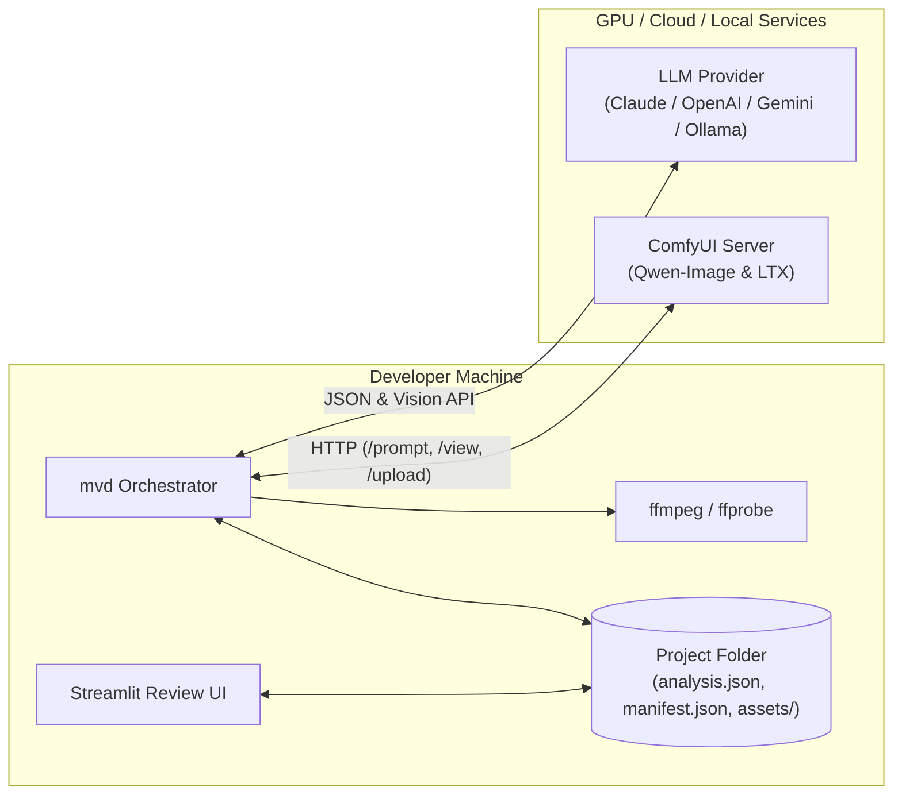

*Figure 1\. System context: what runs where and how the orchestrator reaches each service.*

## **Components and where they run**

| Component | Runs on | Role | If unavailable |
| :---- | :---- | :---- | :---- |
| `mvd` CLI and library | Developer machine | Orchestration, state, planning, quality gates, assembly. | Required. |
| `ffmpeg` and `ffprobe` | Developer machine | Audio slicing, frame extraction, clip conforming, final mux. | Required. `mvd validate` reports it. |
| ComfyUI | Remote cloud GPU or local | Runs the Qwen (`t2i`, `still`) and LTX (`lipsync`, `i2v`) workflows. | Required for generation. An unreachable server stops the run without using attempts. |
| LLM Provider (`anthropic`, `openai`, `gemini`, `ollama`, `openai_compatible`) | Cloud API or local server | Visual bible, shot direction, vision checks, prompt rewrites. | Optional. With `llm.enabled: false`, planning is rule-based and vision checks and prompt rewrites are off. |
| MediaPipe | Developer machine (CPU) | Commercially permissive (Apache-2.0) face detection, face framing, face presence, and mouth opening for the lip-sync check (`qc` extra, default `qc.face_backend: mediapipe`). | Optional (`qc` extra). Checks are recorded as `skipped`, or the run stops if `qc.on_missing_dependency` is `fail`. |
| InsightFace | Developer machine (CPU) | Optional multi-angle face-embedding identity checks (`insightface` extra, `qc.face_backend: insightface`; non-commercial research weights). | Optional (`insightface` extra). Off by default so runs are commercially permissive out of the box (`vision_character` checks identity instead). |
| faster-whisper | Developer machine (CPU) | Word timestamps for lyric alignment. | Optional (`align` extra). Lyric timing is estimated from vocal activity. |
| Streamlit | Developer machine | Browser review UI. | Optional (`ui` extra). Use `mvd status`, `mvd approve` and `mvd reject` instead. |

## **Module layers**

Dependencies point downward. The foundation layer (`models`, `config`, `project`, `errors`) knows nothing about the layers above it. External systems are reached through small interfaces (`LLMClient`, `FaceAnalyzer`, `MouthTracker`, and `ComfyClient` with an injectable HTTP transport). That is how the tests replace them.

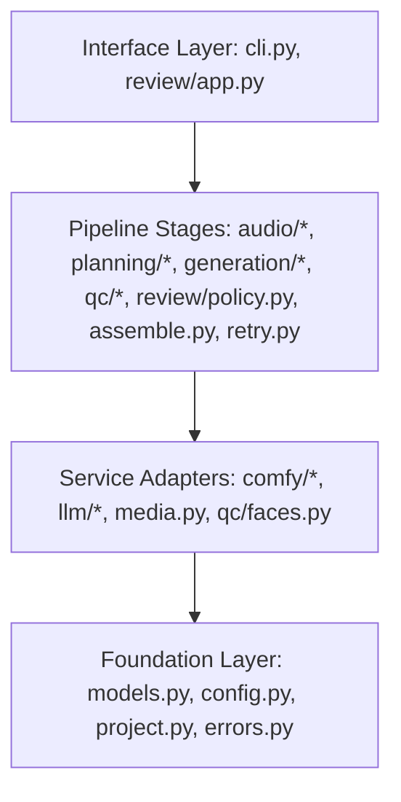

*Figure 2\. Module layers. A module may call modules in its own layer or below.*

# **Pipeline and commands**

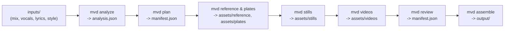

*Figure 3\. The pipeline and the file each stage writes.*

| Stage | Command | Reads | Writes | Notes |
| :---- | :---- | :---- | :---- | :---- |
| Set up | `mvd init <dir>` | Package templates | Project folder skeleton | Copies `project.yaml`, example bindings and starter inputs. |
| Check | `mvd validate`, `mvd llm-check` | `project.yaml`, workflows | Nothing | Checks `ffmpeg`, workflow bindings, ComfyUI ping, and LLM JSON + vision support. |
| Analyze | `mvd analyze` | Mix, vocal stem, drums, lyrics | `analysis.json` | No network access. |
| Plan | `mvd plan` | `analysis.json`, lyrics, style brief | `manifest.json` | Calls the LLM under `.run.lock`. Refuses to overwrite an existing manifest without `--overwrite`. |
| Reference | `mvd reference generate`, `mvd reference lock <image>` | `manifest.json` | `assets/reference/*`, `manifest.json` | Base sheet comes from `t2i`; later wardrobe state sheets are edits of the base sheet via `still`. Cuts 4 panels and updates the manifest under `edit_manifest()`. |
| Plates | `mvd plates generate`, `mvd plates lock <image> --set <name>` | `manifest.json` | `assets/plates/*`, `manifest.json` | Candidate empty-set images come from `t2i`. Locking records `plate` on the set under `edit_manifest()`. |
| Preflight | `mvd assets` | `manifest.json` | Nothing | Reports which wardrobe reference sheets and set plates are locked or missing. |
| Generate | `mvd run`, `mvd stills`, `mvd videos` | `manifest.json`, workflows | `assets/*`, `manifest.json` | Checks preflight assets, pings LLM/ComfyUI, holds `.run.lock`. `--shot` limits shots. |
| Review | `mvd review`, `mvd status`, `mvd approve`, `mvd reject` | `manifest.json` | `manifest.json` | Decisions use `project.edit_manifest()`. The UI is read-only while a run holds `.run.lock`. |
| Assemble | `mvd assemble` | `manifest.json`, mix, assets | `output/<title>.mp4` | Reads `manifest.json` without modifying it. `--force` builds a draft from whatever exists. |
| Utility | `mvd schema` | Models | `schemas/*.json` | Exports JSON Schema for both state files. |

Every command accepts `--project <folder>` (default: the current folder). `mvd -v <command>` turns on debug logging.

## **Project folder layout**

```
my-song/  
  project.yaml     configuration  
  inputs/          mix.wav, vocals.wav, optional drums.wav, lyrics.txt, style.md  
  workflows/       <name>.api.json and <name>.bindings.json for four workflows  
  analysis.json    written by mvd analyze  
  manifest.json    shot list and the full attempt history  
  .run.lock        present while a run, plan, or manifest edit is in progress  
  assets/  
    reference/     <state>_candidate_NN.png, locked <state>_sheet.png, and <state>/ panel crops  
    plates/        <set>_candidate_NN.png and locked <set>.png  
    audio_slices/  s001.wav, s002.wav ...  
    stills/        s001_a01.png ... (shot id, attempt number)  
    videos/        s001_a01.mp4 ...  
  output/          final and draft videos
```

Paths stored in the manifest are relative to the project root, so a project folder can move between machines. The application never deletes an asset. Every attempt stays on disk.

# **Data model**

`models.py` defines everything that is persisted. The classes are pydantic models with `extra="forbid"`, so a misspelled or unknown field is an error and not silently dropped.

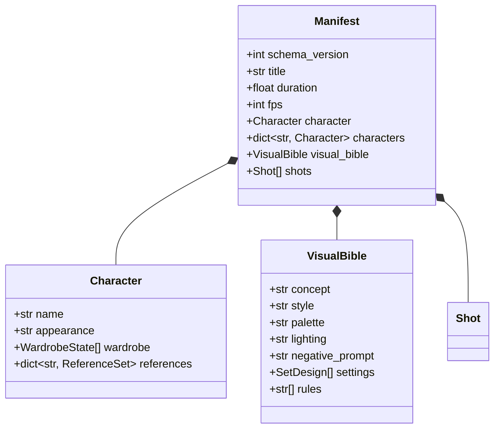

*Figure 4\. Manifest structure: the creative brief and the list of shots. A \[\] suffix marks a list.*

## **analysis.json**

| Field | Meaning |
| :---- | :---- |
| `duration`, `tempo_bpm` | Length of the mix in seconds and the detected tempo. |
| `beats[]`, `bars[]` | Beat times and bar start times in seconds. Bars are every `beats_per_bar` beats. |
| `bar_intensity[]` | Mean loudness of each bar, scaled so the loudest bar is 1.0. |
| `vocal_windows[]` | Spans where the vocal stem is active (`start`, `end`). |
| `lyric_lines[]` | Each lyric line with its `section`, `start`, `end` and `timing_source`: `aligned` (from word timestamps), `estimated` or `none`. |

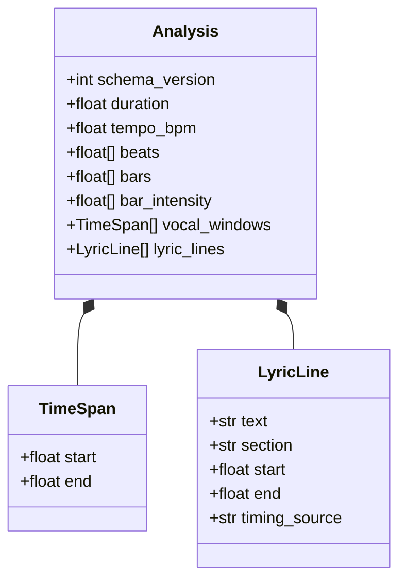

*Figure 5\. The analysis file.*

## **manifest.json**

The manifest holds the creative brief (`character` for solo projects, or `characters` keyed by id for duets/groups—with `Manifest.character` aliasing the primary cast entry in memory—plus `visual_bible`) and one `Shot` per time range. `Character` holds optional `name`, `appearance`, `wardrobe[]` (`WardrobeState`), and `references` (a dict mapping each wardrobe state id to its locked `ReferenceSet` of `sheet` and cropped `panels`). `VisualBible` holds `concept`, `style`, `palette`, `lighting`, `negative_prompt`, `settings[]` (`SetDesign` with optional locked `plate`), and `rules[]`.

| Shot field | Meaning |
| :---- | :---- |
| `id`, `index` | `s001`, `s002` ... and the zero-based position. |
| `start`, `end` | Time range in seconds, on bar lines. |
| `type`, `framing` | Shot type and one of `close_up`, `medium_close`, `medium`, `wide`. |
| `section`, `setting`, `wardrobe` | Song section, the name of a set in the bible, and the wardrobe state id worn in the first frame. |
| `character`, `characters`, `character_wardrobes` | Optional focal singer id, ordered list of visible character ids (two-shots/groups), and per-character wardrobe states for the shot. |
| `lyrics`, `intensity` | Lyric lines in the shot and mean bar intensity (0 to 1). |
| `still_prompt`, `motion_prompt` | The model's creative prompts. Set, plate notes, camera placement, character and style text are added at generation time. |
| `audio_slice`, `num_frames` | Slice path and time range with `head_handle`, and the frame count requested from LTX. |
| `still`, `video` | An `AssetState` each (see below). |
| `review` | Whether a person must look at the shot, why, and the decision. |

An `AssetState` holds `status` (`pending`, `passed` or `exhausted`), the list of `attempts`, `attempts_allowed`, the `selected_attempt`, and the fields that steer the next attempt: `prompt_override`, `param_overrides` and `director_note`. `accepted_by_reviewer` marks a still that a person accepted after it failed QC.

An `Attempt` records its number, strategy, seed, the exact prompt and params used, the output path, its `qc` report or an error string, and a timestamp. A `QCReport` holds `passed`, `score` and a `CheckResult` per check, each with `status`, `hard`, `score`, `weight`, `detail`, `fix_hint` and `metrics`. The metrics are the raw numbers (a correlation, a similarity) used for threshold calibration.

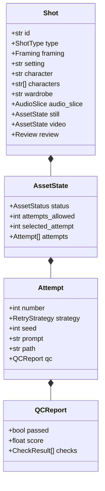

*Figure 6\. A shot, its assets, their attempts and the quality reports.*

## **Persistence and security rules**

* **Atomic writes.** `Project.save_manifest` writes a temporary file in the same folder and renames it over the target, so a crash never leaves a half-written file.

* **Saved after every attempt.** A run can be interrupted at any point and resumed.

* **Single writer and stale-lock recovery.** Planning (`mvd plan`) and generation (`mvd run`, `mvd stills`, `mvd videos`) hold `project.run_lock()` (`.run.lock`, created with `O_EXCL` and recording `{"pid", "host", "started"}`). CLI manifest-mutating commands (`reference lock`, `plates lock`, `approve`, `reject`) and the Streamlit UI use `project.edit_manifest()`, which acquires the lock, loads, mutates, and saves atomically. If a local process was killed and left `.run.lock` behind, `_clear_stale_lock()` probes the PID on the same host and removes the stale lock automatically. This describes `LocalStateStore` in `mvdirector/store.py`; a `StateStore` shared between workers must provide its own lock with expiry (see `docs/library.md`).

* **Path containment and safe identifiers.** `Project.path()` and `Project.rel()` reject absolute paths and any `..` traversal that resolves outside `project.root` with `ConfigError`. Workflow graph paths inside `*.bindings.json` are similarly checked against `project.root`. Identifiers (`Shot.id`, `Shot.wardrobe`, `WardrobeState.id`, `Character.references` keys, and LLM reply IDs) are validated against `SAFE_ID` (`^[A-Za-z0-9][A-Za-z0-9_-]*$`) at the model and generation boundaries so neither LLM outputs nor a hand-edited manifest can read or write files outside the project folder.

* **Schema versions.** `analysis.json` is version 1 and `manifest.json` is version 1. Field validators reject any other version (`!= MANIFEST_SCHEMA_VERSION`) with `ConfigError`. Multi-character projects store casts in `characters` (aliased onto `Manifest.character` in memory). When a later release changes the manifest format, bump `MANIFEST_SCHEMA_VERSION` and add an in-memory `mode="before"` migration so existing projects keep loading.

* **Schemas and examples.** `schemas/*.json` are exported with `mvd schema schemas`, and `examples/*.json` are filled-in samples. Automated tests fail if either drifts from the models.

# **Audio analysis**

`mvd analyze` (`audio/analysis.py` and `audio/lyrics.py`) needs no network. The signal-processing helpers are pure functions over numpy arrays, so they are tested without audio files.

1. Load the mix and the vocal stem as mono at 22,050 Hz with `librosa`.

2. Track beats with `librosa.beat.beat_track`, on the drum stem if one is configured and on the mix otherwise. Bars are every `beats_per_bar` beats (default 4), assuming the first beat is a downbeat. `librosa` has no downbeat detector, so the bar phase can be off by a beat or two.

3. Compute an RMS envelope per 512-sample hop. Bar intensity is the mean mix RMS per bar, scaled so the loudest bar is 1.0.

4. Find vocal windows: spans where the vocal-stem RMS is above \-30 dB relative to its peak. Gaps shorter than 0.6 s (breaths) are bridged and spans shorter than 0.3 s (stem bleed) are dropped.

5. Parse the lyrics. A line in `[square brackets]` is a section label. Every other non-blank line, including `(parenthesised adlibs)`, is a lyric line.

6. Get word timestamps from the JSON file named by `inputs.word_timestamps` if set, else from `faster-whisper` if installed, else none. The vocal stem is decoded with `librosa` at 16 kHz and passed to `faster-whisper` as samples, because its own decoder depends on a PyAV version that often conflicts. A transcription failure logs a warning and falls back to estimation.

7. Align lines to words. `difflib.SequenceMatcher` matches lyric tokens to transcribed tokens, so transcription mistakes never change the lyric text. A matched line takes the earliest start and latest end of its words (`aligned`).

8. Estimate the rest. Runs of untimed lines share the gap between their timed neighbours in proportion to text length. If no line was aligned, lines are spread across the vocal windows by length (`estimated`).

Weak points to know about: the bar phase assumption, vocal-stem bleed that marks instrumental passages as sung, and the lower precision of estimated lyric timing. Check `vocal_windows` and `lyric_lines` in `analysis.json` after a first run.

# **Planning and creative direction**

`mvd plan` combines deterministic timing from code with creative choices from the configured language model. The split keeps cut points, shot types and frame counts reproducible and testable, and leaves only judgment calls to the model.

## **Cutting the song into shots**

`planning/segmenter.py` turns the beat grid into a gap-free list of shots.

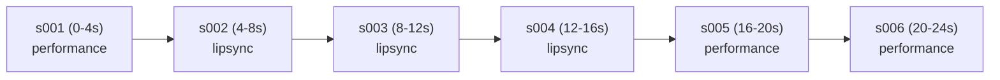

*Figure 7\. How a 24-second example song becomes shots, with video.max\_clip\_seconds set to 4\.*

1. Compute allowed bar steps: the subset of `(8, 4, 2, 1)` bars whose duration (`median_bar_length * n`) fits within `[video.min_clip_seconds, video.max_clip_seconds]` (defaults 1.5 s and 8.0 s).

2. Step through the bars:
   * **Fixed pacing (`video.dynamic_pacing: false`, default):** Cuts land at every `max_bars`-th bar on single-character songs; multi-character songs (`len(manifest.characters) > 1`) still snap early to lyric section boundaries (`snap_sections=True`) so adjacent singers never merge into one shot.
   * **Dynamic pacing (`video.dynamic_pacing: true`):** When `bar_intensity` has dynamic contrast, calm bars (`< 0.55`) hold for `max_bars`, medium bars (`0.55–0.80`) step at `max_bars // 2`, and peak chorus bars (`>= 0.80`) cut at `max_bars // 4`. If a new lyric section begins or intensity surges within a multi-bar window, the cut snaps early to that bar line.

3. Drop cut points that would leave a sliver shorter than `video.min_clip_seconds`, and split any span longer than `video.max_clip_seconds` into equal parts. With no beat grid, the whole song is split into equal parts.

4. Classify each shot. It is `lipsync` when at least `video.lipsync_min_vocal_fraction` (default 0.25) of it overlaps a vocal window, otherwise `performance`.

5. Attach lyrics (a line belongs to the shot that contains its midpoint), the mean bar intensity, and the song section in progress at the shot's midpoint.

6. Compute the audio slice, which is the shot plus `video.handle_seconds` on each side, and the frame count: the smallest `multiple * n + offset` (defaults `8n + 1`, the frame rule LTX expects) that covers the slice at the project frame rate.

## **Calls to the language model**

The application makes four kinds of model call. All go through `LLMClient.complete_json` (`llm/base.py`), which supports Anthropic, OpenAI, Gemini, Ollama, and OpenAI-compatible servers. It requests structured JSON, strips any `<think>` reasoning blocks, parses the reply and validates it against the target pydantic schema. If validation fails it sends the error back once and asks for a correction. A truncated reply at `max_tokens` fails immediately with guidance to raise `llm.max_tokens` or lower `llm.shots_per_request`. Images are re-encoded as JPEG with a longest side of 1,024 px before sending.

| Call | When | Input | Output | Prompt lives in |
| :---- | :---- | :---- | :---- | :---- |
| Visual bible | `mvd plan`, once | Style brief, section list, lyrics. | `concept`, `appearance`, `wardrobe[]`, `style`, `palette`, `lighting`, `negative_prompt`, `settings[]`, `rules[]`. | `planning/prompts.py` (`BIBLE_SYSTEM`) |
| Shot direction | `mvd plan`, once per `shots_per_request` (20) | Concept, rules, bible, wardrobe states, sets, the last four directed shots, and per shot: section, time, percent through the song, type, duration, intensity, lyrics. | Per shot: `type`, `framing`, `setting`, `wardrobe`, `still_prompt`, `motion_prompt`. | `planning/prompts.py` (`SHOTS_SYSTEM`) |
| Vision check | After each still or video attempt | Reference sheet, the image or five sampled frames, the shot specification (with framing-aware detail rules), appearance, wardrobe state and rules. | `spec_match`, `artifact_free`, `character_match`, `issues`, `fix`. | `qc/vision.py` |
| Prompt rewrite | Retry strategy `rewrite_prompt`, or a reviewer note | Current prompt, QC issues, fix hints and the reviewer note. | A new prompt. | `planning/prompts.py` (`REWRITE_SYSTEM`) |

## **Rules enforced in code**

The model's reply is advice that code constrains, so a poor reply cannot break the pipeline.

* A `lipsync` shot stays `lipsync`. Only shots with no sung vocal can become `broll`.

* A lip-sync shot is never framed wide. A wide framing is changed to `medium`.

* Small spelling variations in model replies (such as `"Close-up"` or `"B-roll"`) are normalized; meaningless values are rejected.

* A setting name is mapped onto a set in the bible (exact match, then a loose match, otherwise the first set, with a warning). That mapping is what attaches the set's description or locked plate to the shot's still prompt.

* Wardrobe only moves forward through the list of states (`planning.wardrobe_monotonic`, default `true`). If the model brings back an earlier costume, the shot keeps the current one and a warning is logged. An unknown state id keeps the current state.

* A shot's wardrobe state is what is worn in its first frame. A costume change can play out inside a clip, and the next shot then uses the new state.

* Shots the model leaves out (or a batch that fails direction) get rule-based direction, so the manifest is always complete.

## **How generation prompts are built**

* **Reference sheet prompts (`sheet_prompt`, `state_sheet_prompt`):** Request a four-panel studio sheet (`FRONT / SIDE / 3-QUARTER / FACE DETAIL`, with Panel 4 as a macro close-up) on a white seamless background with unretouched pore-level skin texture and no airbrushing or glass-skin idealization. Later wardrobe sheets are edits of the base sheet and deliberately omit facial descriptions so the edit model does not blend text with the reference face.

* **Set plate prompts (`plate_prompt`):** Combine the set description with `PLATE_CAMERA_LIMITATIONS` (enforcing a single tack-sharp focal plane at mid-depth, optical falloff, slight corner degradation, natural highlight bloom, and restrained off-focus texture) and the shared film grade.

* **Still prompt (`compose_still_prompt`):** The shot's `still_prompt` (or retry override), then `PLATE_NOTE` if a locked set plate is attached (or `Setting:` and the set's text description if not), then a face-visible note for lip-sync shots, then `CAMERA_PLACEMENT_NOTE` (camera in open floor space at human eye height, clear of solid furniture) and `The singer:` with the appearance and wardrobe state description (singer shots only), followed by the style, palette and lighting line.

* **Motion prompt (`compose_motion_prompt`):** The shot's `motion_prompt` (or override, describing physical handheld operator movement), a sentence about natural mouth movement in time with the vocal for lip-sync shots, and the style.

* **Negative prompt:** The bible's `negative_prompt` (augmented with `SHEET_NEGATIVE` or `PLATE_NEGATIVE` on preflight assets), sent to every workflow that binds it.

# **Preflight assets, generation and automatic regeneration**

Before generating shot stills, `generation/preflight.py` checks that all required wardrobe reference sheets and set plates are locked. Candidate rendering and RGB loading are shared in `generation/candidates.py` across `generation/reference.py` and `generation/plates.py`.

`generation/runner.py` holds the loop that produces and checks each shot asset. The sequence diagram shows one attempt. The flowchart after it shows the loop around it.

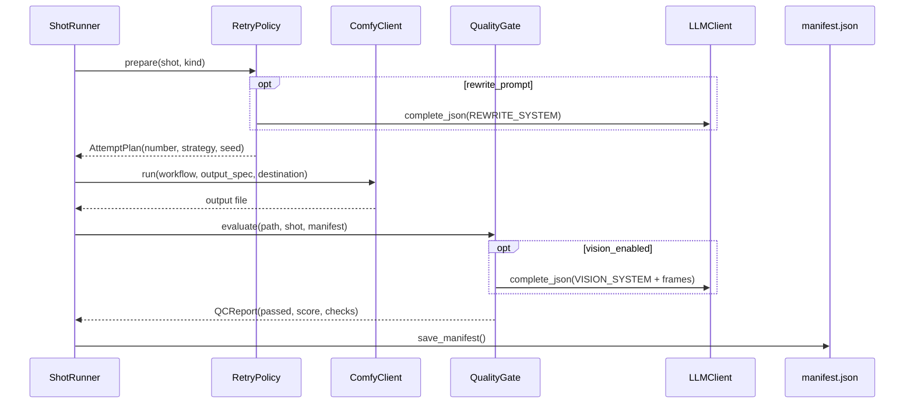

*Figure 8\. One generation attempt, from strategy selection to the saved manifest.*

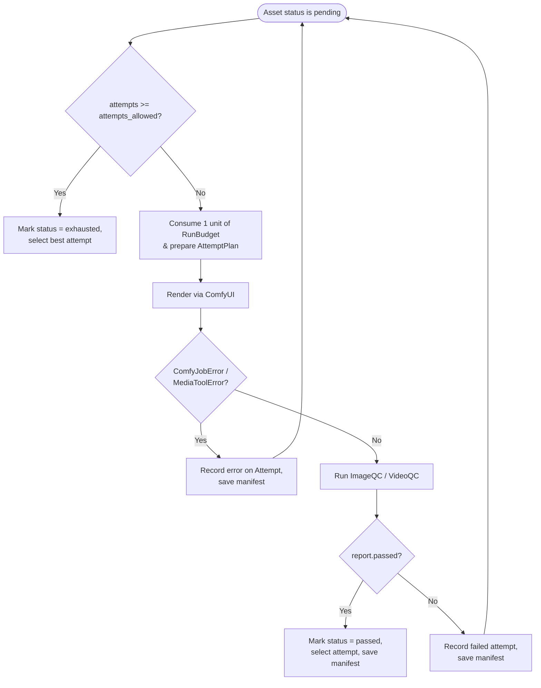

*Figure 9\. The loop that runs for each asset until it passes, runs out of attempts or the budget ends.*

## **Runner behavior**

* **Order and VRAM flushing.** All stills for the selected shots are processed first, then `ComfyClient.free_memory()` sends `POST /free` (`{"unload_models": true, "free_memory": true}`) to unload the image model from VRAM before all videos are processed.

* **Stills gate videos.** A video is generated only when its still has status `passed`, either by passing QC or by a reviewer accepting it.

* **Per asset.** While the status is `pending`, the runner stops with `exhausted` once attempts reach `attempts_allowed`. Otherwise it spends one unit of the run budget, asks the retry policy for a plan, generates, runs the quality gate and records the attempt.

* **Workflow and reference choice.** Singer stills use the `still` workflow with the front panel of the shot's wardrobe reference sheet (`reference_image`, when bound by the workflow; T2I-only models like Z-Image can omit the `reference_image` binding), plus optional `reference_profile`, `reference_three_quarter`, `reference_face`, and `set_image` (the locked set plate) when the workflow binds them. B-roll stills use `t2i`. Lip-sync clips use the `lipsync` workflow with the uploaded audio slice (receiving both `num_frames` and `duration` in seconds). Other clips use `i2v`.

* **Audio slices** are cut lazily with `ffmpeg` from the vocal stem (or the mix, per `video.lipsync_audio_source`) the first time a shot needs one.

* **Uploads and identity embeddings are cached** for the duration of a run.

* **Reviews are reset.** Before each new attempt the shot's review is cleared, since an earlier decision no longer describes it.

* **Saved after every attempt.** The manifest is written after each attempt and again when the run ends or fails.

## **Retry policy**

`retry.py` decides how each attempt differs from the ones before it.

| Situation | Strategy | Effect |
| :---- | :---- | :---- |
| First attempt | `initial` | The prompt as composed. |
| A reviewer left a note | `rewrite_prompt` | The LLM rewrites the prompt from the note and the last QC issues. The note is then consumed. |
| Every earlier attempt was a ComfyUI error | `new_seed` | There is no QC result to learn from yet. |
| Attempt 2 (default ladder) | `new_seed` | Same prompt, new seed. |
| Attempt 3 | `rewrite_prompt` | The LLM rewrites the prompt from the last failure's issues and fix hints. Without an LLM, the hints are appended to the prompt. |
| Attempt 4 and later | `adjust_params` | Applies `retry.adjust_params` (default: 40 steps) as parameter overrides. The last strategy in the ladder repeats. |

Seeds are derived from the project seed, shot id, asset kind and attempt number, so any attempt can be reproduced from the manifest. When attempts run out, the best attempt is kept as the selected one: attempts without a hard failure rank first, then the highest score. The ladder is configurable through `retry.strategies`.

## **Failure handling**

| Condition | Behavior |
| :---- | :---- |
| ComfyUI unreachable (`ComfyConnectionError`) | The run stops. No attempt is consumed. Progress is saved. |
| LLM unreachable before a run (`ping_llm`) | The run stops before any GPU time is spent. |
| Job rejected, failed or timed out (`ComfyJobError`), or an `ffmpeg` error | Recorded as an attempt with an error. The loop continues. |
| A quality check fails | The attempt is recorded with its report and the loop retries. |
| The vision API fails or rejects images | Vision checks are recorded as `skipped`. If the model rejects image input, or is unreachable 3 times in a row, vision checks disable for the rest of the run with one warning. |
| Run budget reached (`retry.max_generations_per_run`, default 300) | The run stops cleanly with a message. Progress is saved and a later run continues. |
| An optional library is missing | The affected checks are skipped, or the run stops when `qc.on_missing_dependency` is `fail`. |
| Another live run holds `.run.lock` | `ProjectLocked` is raised before any work starts. A stale lock from a dead local PID is cleared automatically. |

# **ComfyUI integration**

## **Workflow templates and bindings**

All image and video generation runs through ComfyUI, and the pipeline is not tied to any specific model release. Each of four logical workflows (`t2i`, `still`, `lipsync`, `i2v`) is a pair of files in the project's `workflows/` folder. `<name>.api.json` is a graph exported from ComfyUI with **Save (API Format)** (using either local open-weight nodes like Qwen, Z-Image, Krea, LTX, Wan, MOSS, or paid cloud API Partner Nodes like Nano Banana, Seedance, Grok, or P-H3 / MiniMax). `<name>.bindings.json` maps logical parameters onto node inputs in that graph. Strings in `bindings.defaults` also support `${ENV_VAR}` expansion (via `expand_env`, limited to `MVD_*`, `COMFY_*`, and names listed in `MVD_ALLOWED_ENV_VARS`) so paid API keys (e.g. `{"api_key": "${COMFY_SEEDANCE_API_KEY}"}`) never need to be stored in `.api.json` or `.bindings.json`.

```json
{  
  "workflow": "ltx_lipsync.api.json",  
  "inputs": {  
    "positive_prompt": [{"node": "6",  "field": "text"}],  
    "image":           [{"node": "20", "field": "image"}],  
    "audio":           [{"node": "21", "field": "audio"}],  
    "seed":            [{"node": "30", "field": "noise_seed"}],  
    "num_frames":      [{"node": "40", "field": "length"}],  
    "fps":             [{"node": "41", "field": "frame_rate"},  
                        {"node": "50", "field": "fps"}]  
  },  
  "required": ["positive_prompt", "image", "audio", "seed", "num_frames"],  
  "defaults": {},  
  "output": {"node": "50", "extensions": [".mp4"]}  
}
```

* `WorkflowTemplate.render(params)` deep-copies the graph and writes each parameter into every input it is bound to. Parameters set to `None` are skipped, and values in `defaults` apply beneath the supplied ones.

* A parameter with no binding is ignored, so one caller can serve workflows with different capabilities. A parameter listed in `required` must have a binding and a value, or rendering fails.

* One parameter can drive several inputs, as `fps` does above.

* `mvd validate` loads every workflow and reports bindings that point at a missing node or input, and detects a workflow exported in UI format instead of API format.

* `image`, `reference_image`, `reference_image_2` (optional secondary character panel on two-shots), `reference_profile`, `reference_three_quarter`, `reference_face`, `set_image` and `audio` receive the name of a file the pipeline uploaded to ComfyUI's input folder.

| Workflow | Used for | Parameters the pipeline sends |
| :---- | :---- | :---- |
| `t2i` | Base reference sheet candidates, set plate candidates and b-roll stills | `positive_prompt`, `negative_prompt`, `seed`, `width`, `height` |
| `still` | Singer stills edited from the reference sheet front panel, and sheets for later costumes | The `t2i` set plus `reference_image` (when bound; plus optional `reference_profile`, `reference_three_quarter`, `reference_face`, `reference_image_2`, `set_image`) |
| `lipsync` | Lip-sync clips | `positive_prompt`, `negative_prompt`, `lyrics`, `seed`, `image`, `audio`, `width`, `height`, `num_frames`, `duration`, `fps` |
| `i2v` | All other clips | The `lipsync` set without `audio` |

Retry overrides from `retry.adjust_params` (such as `steps`) are sent on later attempts and only take effect if the workflow binds them.

## **HTTP client**

| Operation | Endpoint | Notes |
| :---- | :---- | :---- |
| Ping | `GET /system_stats` | Used by `mvd validate` and before each run. |
| Free VRAM | `POST /free` | Unloads models and frees VRAM between the still phase and video phase. |
| Upload | `POST /upload/image` | Stores any file type, so it also carries audio. Files go into a per-project subfolder (`mvdirector/<slug>_<hash8>`) so concurrent runs do not clobber uploads. |
| Queue | `POST /prompt` | A 400 response or `node_errors` becomes a `ComfyJobError` that names the failing nodes. Retries only pre-dispatch connection failures, `429`, or `503` (never `ReadTimeout`/`500`) to avoid queueing duplicate GPU jobs. |
| Wait | `GET /history/<id>` | Polled every `comfy.poll_interval` (3 s) until the job completes or errors, with a timeout of `comfy.job_timeout` (1,800 s). |
| Download | `GET /view` | Takes the first output on the bound node whose extension matches the binding. Streams chunks into a `.part` temp file, rejects unsafe paths, and caps downloads at 512 MiB before atomic rename. |

Transport errors, 429 rate-limit responses and 5xx responses are retried three times with a 2 s, 4 s and 6 s pause (or the server's `Retry-After` header via `retry_delay()`), then raise `ComfyConnectionError`. Other 4xx responses raise `ComfyJobError`. Polling is used instead of a websocket because it works through hosted HTTP proxies and needs no reconnection logic. `comfy.headers` can carry an authorization header, and the base URL comes from `COMFY_URL`.

# **Quality control**

`ImageQC.evaluate` and `VideoQC.evaluate` return a `QCReport`. Each check returns a `CheckResult` with a status, an optional 0 to 1 score, a `hard` flag, a human-readable `detail`, a `fix_hint` that feeds the next attempt, and the raw `metrics`.

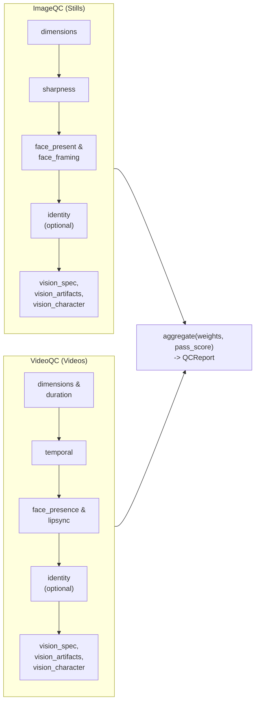

*Figure 10\. How a quality report is produced for stills and for clips.*

## **Still checks**

| Check | Hard | What it measures | Skipped when |
| :---- | :---- | :---- | :---- |
| `dimensions` | Yes | Aspect ratio within 3 percent of the target and height at least half the target. | Never. |
| `sharpness` | No | Variance of the Laplacian of a 512 px greyscale copy. 40 scores 0 and 150 scores 1\. | Never. |
| `face_present` | Yes | At least one face is found (singer shots). | No face analyzer. |
| `face_framing` | Lip-sync shots | Face height as a share of frame height meets the minimum for the framing: close-up 30%, medium close 18%, medium 9%, wide 3%. | No face analyzer. |
| `identity` | Yes | Cosine similarity of the face embedding to the shot's reference sheet (averaged across `face`, `front`, and `three_quarter` panels). Hard below 0.30, full score at 0.55. | No analyzer or no reference. |
| `vision_spec` | No | Vision LLM: the frame matches the framing, set, action and rules. Counts as failed below 0.30. | Vision off or API error. |
| `vision_artifacts` | Yes | Vision LLM: hands, limbs, faces, text and watermarks. Hard below 0.30. | Vision off or API error. |
| `vision_character` | Yes | Vision LLM, shown the full reference sheet: same person, correct costume for the shot's wardrobe state, marks on the correct side (framing-aware detail level). Hard below 0.40. | Vision off, API error, or b-roll. |

## **Video checks**

| Check | Hard | What it measures | Skipped when |
| :---- | :---- | :---- | :---- |
| `dimensions`, `duration` | Yes | Same size rule as stills. The clip must be at least head handle plus shot duration, minus 0.3 s. | Never. |
| `temporal` | Static or cut: yes | Median frame difference below 0.0008 is static. A peak above 0.25 is a cut. Otherwise a flicker score from the 95th percentile (0.03 good, 0.12 bad). | Single-frame clip. |
| `face_presence` | Yes | A face is tracked in at least 90 percent of frames. | Non-lip-sync shot, wide framing, no mouth tracker, or silent slice. |
| `lipsync` | Yes | Correlation between mouth opening and vocal loudness. Hard below 0.40, scored from 0.25 to 0.65. | Same as `face_presence`. |
| `identity` | Yes | Median similarity to the reference sheet over frames sampled every 0.5 s. Hard below 0.25, full score at 0.50. | No analyzer or reference, or b-roll. |
| `vision_*` | As for stills | Vision LLM on five frames sampled evenly across the clip, including morphing between frames. | As for stills. |

If a technical check (`dimensions` or `duration`) fails, only the technical results are returned, since every later measurement would be meaningless.

## **Scoring**

* Skipped checks are recorded for the audit trail but do not affect the result. Checks with no score (such as `dimensions`) decide only through their `hard` flag.

* `score = sum(score * weight) / sum(weight)` over the scored checks, using the weights in `qc.weights`.

* `passed = no hard failure and score >= qc.pass_score` (default 0.70).

* Raw values map to 0 to 1 with `linear_score(value, bad, good)`, which also handles lower-is-better metrics.

| Check | Default weight |
| :---- | :---- |
| `lipsync` | 3.0 |
| `identity`, `vision_artifacts`, `vision_character` | 2.0 |
| `vision_spec`, `temporal`, `face_framing` | 1.0 |
| `sharpness` | 0.5 |

## **Lip-sync measurement**

1. Track mouth opening per frame with MediaPipe Face Landmarker (Tasks API): the inner-lip gap divided by face height.

2. Compute the vocal RMS over each video frame's time window from the audio slice.

3. Interpolate frames where no face was found, and smooth both series with a three-frame moving average.

4. Compute the Pearson correlation for lags within plus or minus `qc.video.lipsync_max_lag_seconds` (0.125 s). Keep the best value (never below zero) and its lag.

5. Report face presence as the share of frames with a tracked face.

The measure assumes the mouth opens when the voice is loud. It works well on close and medium shots of clearly sung lines and is weaker on mumbled, heavily processed or very fast vocals. Treat it as a filter for obvious failures, backed by the vision check and human spot checks.

## **Calibration**

The thresholds are starting values. Generate a batch, label 20 to 30 clips good or bad by eye, compare the labels with the `metrics` stored on each check in `manifest.json`, and adjust the thresholds under `qc.image` and `qc.video` in `project.yaml` until the gate agrees with the labels. Every field and its default is in `config.py`.

# **Human review**

Quality checks and retries run the same way in both review modes. The mode only decides which finished shots a person must look at. `review/policy.py` holds all of the decision logic, and `review/app.py` is presentation only.

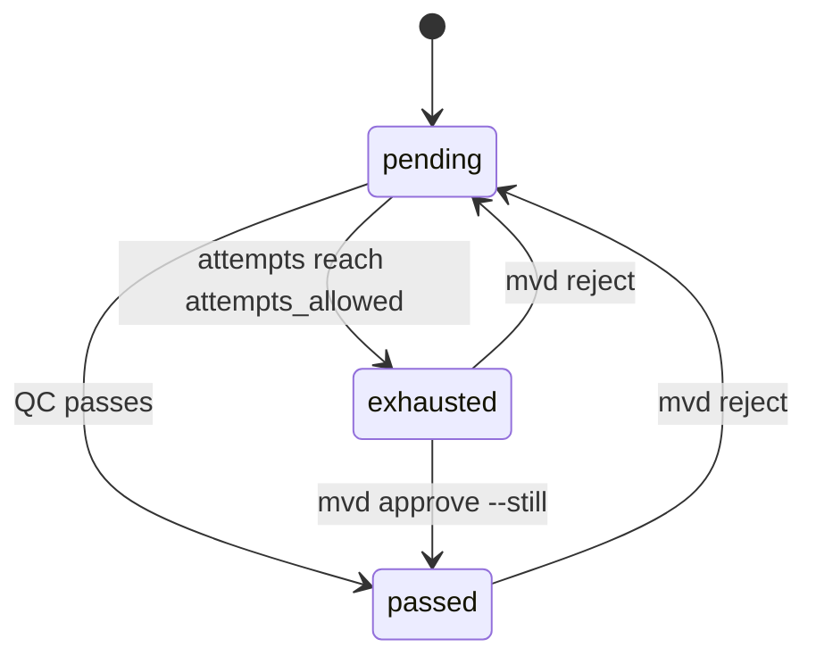

*Figure 11\. Asset status transitions for a still or a video.*

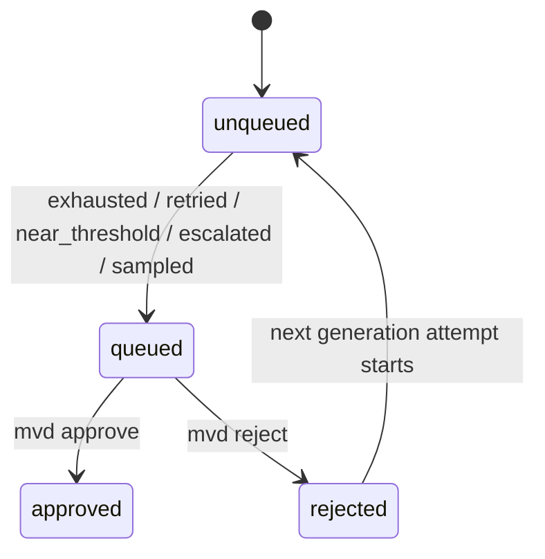

*Figure 12\. Shot review states.*

## **Review modes**

|  | `light` (default) | `strict` |
| :---- | :---- | :---- |
| Shots that ran out of attempts | Queued | Queued |
| Shots that passed QC | A sample is queued | Not queued |
| Assembly | Waits for decisions on every queued shot | Waits only for exhausted shots |

Set the mode with `review.mode` or override it for one command with `--review-mode light|strict`.

## **Why a shot is queued**

| Reason | Applies when |
| :---- | :---- |
| `exhausted` | The still or the video used all its attempts. Both modes. |
| `retried` | The still or the video needed more than one attempt. Light mode, `review.include_retried`. |
| `near_threshold` | The selected video's score is below `qc.pass_score` plus `review.near_threshold_margin` (0.05). Light mode. |
| `escalated` | A reviewer has rejected a shot of the same type. Light mode. |
| `sampled` | A deterministic hash of the shot id and project seed falls under `review.closeup_rate` (default 1.0, for close-ups) or `review.other_rate` (default 0.25). Light mode. |

Sampling is a hash and not a random draw, so the queue is stable between runs. `refresh_reviews` recomputes the queue from the manifest and never overwrites a decision that was already recorded, which is why switching modes in the middle of a project is safe.

## **Decisions**

| Action | CLI | UI button | Effect on the manifest |
| :---- | :---- | :---- | :---- |
| Approve | `mvd approve s004` | Approve | Records `approved`. The shot is ready for assembly. |
| Accept a still that failed QC | `mvd approve s004 --still` | Use this still | An exhausted still becomes `passed` with `accepted_by_reviewer`, so its video can be generated. |
| Redo the video | `mvd reject s004 -n "note"` | Redo video | The video returns to `pending` with `attempts_allowed` raised by `retry.max_attempts`, and the note becomes the direction for the next attempt. |
| Redo the still and video | `mvd reject s004 -n "note" --target still` | Redo still \+ video | Both assets return to `pending`. The note goes on the still. |

Rejecting a shot also adds its shot type to `escalated_types`, so every other shot of that type is queued from then on. Attempt history is kept, so the audit trail survives a rejection. A shot is ready for assembly when it has a selected video and either needs no review or has been approved. Decisions use `project.edit_manifest()` (acquiring `.run.lock`), and the UI is read-only while a run is writing.

# **Assembly**

`assemble.py` trims each clip to its shot, joins them and lays the original mix over the result.

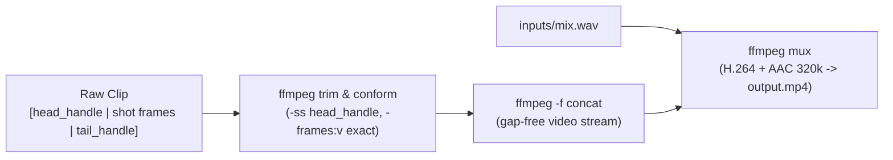

*Figure 13\. How clips with handles become a frame-exact timeline.*

1. Refresh the review queue, then check readiness. Every shot must be ready, or `--force` must be set.

2. Compute frame counts. Each shot gets `round(end * fps) - round(start * fps)` frames, so rounding never accumulates and the total equals `round(duration * fps)`.

3. Conform each clip with `ffmpeg`: skip `head_handle` seconds, resample to the project frame rate, repeat the last frame if the clip is slightly short, scale and pad to the target size, cut to the exact frame count and encode H.264 (CRF 16) without audio. In draft mode a shot without a video holds its still, or black if it has none.

4. Concatenate the clips with stream copy (using relative filenames in `clips.txt` without `-safe 0`), then mux the original mix as AAC at 320 kbps with `-shortest` and `+faststart`. Audio generated by LTX is never used, and `mvd assemble` never modifies `manifest.json`.

The default output is `output/<title>.mp4`. A forced build adds a `_draft` suffix.

# **Configuration reference**

Configuration lives in `project.yaml` and is validated by pydantic models in `config.py`. Unknown keys are errors. Only `comfy.base_url`, `comfy.headers`, `llm.base_url` and workflow `defaults` may reference environment variables as `${NAME}` or `${NAME:-default}`, and only `MVD_*`, `COMFY_*`, or names listed in `MVD_ALLOWED_ENV_VARS` are expanded; `llm.api_key_env` accepts the standard provider key names, `MVD_*`, or `MVD_ALLOWED_ENV_VARS` entries. Unrelated system and cloud credentials such as `AWS_*`, `GITHUB_*` and `SSH_*` are always rejected.

| Key | Default | Meaning |
| :---- | :---- | :---- |
| `title`, `seed` | `Untitled`, `1234` | Project name. Base for deterministic seeds and review sampling. |
| `inputs.*` | `inputs/mix.wav`, `vocals.wav`, `lyrics.txt`, `style.md` | Input files. `drums` and `word_timestamps` default to `null`. |
| `video.width`, `height`, `fps` | `1280`, `720`, `24` | Output size and frame rate. |
| `video.max_clip_seconds`, `min_clip_seconds` | `8.0`, `1.5` | Longest and shortest shot. |
| `video.handle_seconds` | `0.25` | Extra audio and video on each side of a shot. |
| `video.frame_multiple`, `frame_offset` | `8`, `1` | Frame count rule: `multiple * n + offset` (LTX `8, 1`; Wan/Hunyuan `4, 1`; MiniMax/exact `1, 0`). |
| `video.beats_per_bar` | `4` | Bar length in beats. |
| `video.cut_mode` | `bars` | `bars` cuts on musical bar lines; `phrases` cuts on vocal windows and lyric sections (e.g. for 5–15s MiniMax H3 clips). |
| `video.dynamic_pacing` | `false` | When `true`, cut faster on high-intensity bars and snap cuts to lyric section transitions. |
| `video.lipsync_min_vocal_fraction` | `0.25` | Share of a shot that must be sung to make it lip-sync. |
| `video.lipsync_audio_source` | `vocals` | Audio sent to the lip-sync workflow: `vocals` or `mix`. |
| `comfy.base_url` | `${COMFY_URL:-http://127.0.0.1:8188}` | ComfyUI address (local or remote HTTPS URL). |
| `comfy.headers` | `{}` | Extra HTTP headers, such as an authorization token. |
| `comfy.request_timeout`, `job_timeout`, `poll_interval` | `60`, `1800`, `3` (seconds) | HTTP timeout, maximum job time, history polling interval. |
| `comfy.workflows_dir`, `workflows` | `workflows`, `t2i` / `still` / `lipsync` / `i2v` | Workflows directory and logical workflow name to bindings file. |
| `llm.enabled` | `true` | Turn off for rule-based planning, no vision checks and no prompt rewrites. |
| `llm.provider`, `model` | `anthropic`, `claude-sonnet-5-5` | Provider (`anthropic`, `openai`, `gemini`, `ollama`, `openai_compatible`) and model name. |
| `llm.base_url`, `api_key_env` | `null`, `null` | Server URL (required for `openai_compatible`) and optional key env var override. |
| `llm.max_tokens`, `shots_per_request`, `timeout_seconds` | `8000`, `20`, `180` | Response limit, shots per direction call, and HTTP request timeout. |
| `llm.json_mode`, `context_tokens` | `auto`, `null` | JSON request format (`auto`, `off`, `object`, `schema`) and Ollama context window (default 16384). |
| `planning.wardrobe_monotonic` | `true` | Costume changes are one-way. |
| `reference.layout`, `width`, `height` | `row`, `null`, `null` | Four-panel sheet layout (`row` 2048x896 or `grid` 1536x1536). |
| `reference.candidates`, `panel_inset` | `4`, `0.012` | Candidate sheets per run and edge trim fraction when cutting panels. |
| `plates.candidates` | `3` | Candidate set plate images per set. |
| `qc.pass_score` | `0.70` | Minimum weighted score to pass. |
| `qc.vision_enabled` | `true` | Run the vision checks. |
| `qc.face_backend` | `mediapipe` | `mediapipe` (Apache-2.0, commercial-safe) or `insightface` (non-commercial research weights). |
| `qc.on_missing_dependency` | `skip` | `skip` records the check as skipped. `fail` stops the run. |
| `qc.weights` | See Scoring | Weight per check name. |
| `qc.image.*`, `qc.video.*` | See the check tables | Thresholds for every check. |
| `retry.max_attempts` | `4` | Attempts allowed per asset. |
| `retry.strategies` | `new_seed`, `rewrite_prompt`, `adjust_params` | The ladder applied from attempt 2\. The last entry repeats. |
| `retry.max_generations_per_run` | `300` | Total generations allowed in one run. |
| `retry.adjust_params` | `steps: 40` for stills and videos | Overrides applied by `adjust_params`. |
| `review.mode` | `light` | `light` or `strict`. |
| `review.closeup_rate`, `other_rate` | `1.0`, `0.25` | Share of passed shots queued in light mode. |
| `review.include_retried`, `include_near_threshold`, `near_threshold_margin` | `true`, `true`, `0.05` | Extra queue reasons in light mode. |

## **Command-line options**

| Option | Commands | Effect |
| :---- | :---- | :---- |
| `--project`, `-p` | All except `init`, `schema` | Project folder. Defaults to the current folder. |
| `-v` | Placed before the command | Debug logging. |
| `--shot`, `-s` | `run`, `stills`, `videos` | Limit work to a shot id. Repeatable. |
| `--skip-preflight` | `run`, `stills` | Generate stills even if reference sheets or set plates are missing. |
| `--review-mode` | `run`, `videos`, `status`, `review`, `assemble` | Override `review.mode` for this command. |
| `--overwrite` | `plan` | Replace an existing manifest and its history. |
| `--state` | `reference generate`, `reference lock` | Wardrobe state id (defaults to the first state). |
| `--character`, `-c` | `reference generate`, `reference lock` | Character id (for duets or groups; defaults to the primary character). |
| `--single` | `reference lock` | Lock a single portrait instead of splitting a four-panel sheet. |
| `--set` | `plates generate`, `plates lock` | Target set name in the visual bible. |
| `--count` | `reference generate`, `plates generate` | Number of candidate images to render. |
| `--skip-image` | `llm-check` | Test JSON output only; skip the test image probe. |
| `--note`, `-n` | `reject` | Required. Direction for the next attempt. |
| `--target` | `reject` | `video` (default) or `still`. |
| `--still` | `approve` | Accept an exhausted still instead of approving a video. |
| `--output`, `--force` | `assemble` | Output path, and build a draft from unfinished shots. |

# **Errors, logging and concurrency**

Every error the code raises on purpose derives from `MVDError` (`errors.py`). The CLI prints these without a traceback and exits with code 1\. Anything else is a bug and shows a traceback.

| Exception | Raised when | Handling |
| :---- | :---- | :---- |
| `ConfigError` | The config or schema version is invalid, an input file is missing, or a path escapes the project root. | CLI error. |
| `MediaToolError` | `ffmpeg` or `ffprobe` is missing or fails. | During generation it counts as a failed attempt. Elsewhere it is a CLI error. |
| `ComfyConnectionError` | ComfyUI is unreachable after retries. | Stops the run without using an attempt. |
| `ComfyJobError` | A job is rejected, fails, times out or yields no output. | Counts as a failed attempt. |
| `WorkflowBindingError` | A bindings file and its workflow disagree. | CLI error, shown by `mvd validate`. |
| `LLMError` / `LLMUnavailableError` | The API call fails or the reply is invalid twice. | Planning fails. Vision checks are skipped (and disabled after 3 consecutive unavailable errors). A prompt rewrite falls back to the fix hints. |
| `DependencyMissing` | An optional library is not installed. | The check is skipped, or the run stops if `qc.on_missing_dependency` is `fail`. |
| `BudgetExceeded` | The run reached `retry.max_generations_per_run`. | Clean stop with a message. |
| `ProjectLocked` | `.run.lock` is held by an active process (or another host). | CLI error. Stale locks from dead local PIDs are removed automatically. |

Logging uses the standard `logging` module under the `mvdirector` logger at `INFO`, with `DEBUG` available through `-v`. `httpx` logging is held at `WARNING`. Concurrency is a single-writer model: one generation run, or one decision command, writes the manifest at a time, and every write is atomic.

# **Development**

## **Setup**

The package requires Python 3.11 or later. On a Mac with Homebrew, use a virtual environment and pin the interpreter with `pyenv`. Do not install packages into Homebrew's Python with `--break-system-packages`.

```bash
brew install ffmpeg  
brew link ffmpeg             # only if brew reports it is not linked  
pyenv local 3.12.8  
python -m venv .venv && source .venv/bin/activate  
pip install -e ".[dev,ui,align]"  
pip install -e ".[qc]"       # may need: xcode-select --install  
export ANTHROPIC_API_KEY=...  
export COMFY_URL=http://127.0.0.1:8188  # or your remote ComfyUI HTTPS URL
```

Python 3.12 is a safer choice than the newest release, because MediaPipe and InsightFace often lack builds for it.

## **Checks**

```bash
pytest                        # about 40 seconds; needs ffmpeg  
ruff check . && ruff format --check .  
mypy  
mvd schema schemas            # after any change to models.py
```

## **Test suite**

| File | Covers |
| :---- | :---- |
| `test_audio.py` | Beat tracking, vocal windows, bar intensity, lyric parsing, alignment, estimation. |
| `test_planning.py` | Segmentation, dynamic intensity pacing, section snapping, frame rule, rule-based and model-directed manifests. |
| `test_direction.py` | Sections, bible fields, batch context, wardrobe continuity, prompt composition. |
| `test_references.py` | Four-panel reference sheet splitting, wardrobe state sheets, set plates, preflight checks. |
| `test_comfy.py` | Workflow rendering and validation, client upload, queue, wait, download and error cases. |
| `test_qc.py` | Scoring, hard failures, lip-sync mathematics, sharpness, still checks, multi-angle identity. |
| `test_vision.py` | What the vision judge is shown, framing-aware detail rules, and how its verdict becomes checks. |
| `test_llm.py` | Provider backends (Anthropic, OpenAI, Gemini, Ollama, OpenAI-compatible), JSON modes, `<think>` stripping. |
| `test_llm_server.py` | End-to-end socket tests against `FakeLLMServer` speaking OpenAI, Ollama and Gemini protocols. |
| `test_llm_resilience.py` | Pre-run LLM ping, vision auto-disable on text-only models or repeated timeouts (`mvd llm-check`). |
| `test_retry_review.py` | Strategy ladder, seeds, rewrites, review queue, decisions. |
| `test_pipeline.py` | Runner behavior, the video gate, assembly, and a full run against a fake ComfyUI with real `ffmpeg`. |
| `test_transcription.py` | The `faster-whisper` path and its fallback. |
| `test_schemas.py` | Committed schemas, examples, config template, schema version bounds, path containment, safe identifier & env-var validation, stale lock recovery, and `edit_manifest`. |

# **Extending the application**

| Task | Where | Steps |
| :---- | :---- | :---- |
| Add a quality check | `qc/image.py` or `qc/video.py` | Return a `CheckResult`. Set `hard`, and a score with `linear_score`. Add its weight to `qc.weights` and thresholds to the config model. Add a test. |
| Change the face or mouth backend | `qc/faces.py`, `qc/factory.py` | Implement `FaceAnalyzer` or `MouthTracker` and construct it in the factory. Check the library's license first: InsightFace's pretrained models are for non-commercial research. |
| Add a retry strategy | `models.py`, `retry.py` | Add a `RetryStrategy` value, handle it in `RetryPolicy.prepare`, and allow it in `retry.strategies`. |
| Use another model provider | `llm/` | Subclass `ChatBackend` (`_send`), add a `ProviderInfo` entry in `llm/factory.py`, and return it from `build_llm`. |
| Add or change a workflow | `workflows/` | Export the API JSON, write the bindings, run `mvd validate`. A new logical workflow name also needs a `comfy.workflows` entry and a selection in the runner. |
| Add a manifest field | `models.py` | Give it a default, regenerate the schemas (`mvd schema schemas`), update the example, and add a migration validator if it replaces an older field. |
| Change prompts | `planning/prompts.py`, `qc/vision.py` | Test structure with the fake clients. Real model behavior needs a manual run. |

# **Known limitations and risks**

* **Not yet run with live services.** ComfyUI with real workflows, live LLM APIs, InsightFace, MediaPipe and `faster-whisper` were not exercised end to end.

* **Quality thresholds are uncalibrated.** Defaults are starting values. The lip-sync measure is a filter for obvious failures and is weaker on fast, mumbled or heavily processed vocals.

* **Bar phase and shot length.** Bars assume the first beat is a downbeat. With `video.dynamic_pacing: false`, shots are a fixed number of bars; with `video.dynamic_pacing: true`, shot length scales with bar intensity and snaps to section labels, but cuts still land on bar lines rather than mid-bar lyric phrases. If cuts feel a beat off, edit `bars` in `analysis.json` and run `mvd plan --overwrite`.

* **Sheet panels are cut by position.** The image model is asked for four equal panels and `split_sheet` cuts the image into equal parts. Inspect `assets/reference/<state>/` after locking.

* **Multi-image editing depends on the workflow.** Supplying both `reference_image` and `set_image` to Qwen-Image-Edit requires a workflow that binds both inputs and follows the two-image `PLATE_NOTE` instruction.

* **Stem bleed.** Suno stems are AI-separated. Bleed in the vocal stem can mark an instrumental passage as sung. Check `vocal_windows` if shot types look wrong.

* **Cost scales with retries.** Each vision call sends up to six images, and every retry adds GPU time and API usage. `retry.max_generations_per_run` caps one run.

* **Sequential generation.** One ComfyUI server works through one queue.

* **`mvd plan --overwrite` discards generation history.** Edit `manifest.json` by hand to change direction for individual shots.

* **Licensing.** By default (`qc.face_backend: mediapipe`), all QC checks use Apache-2.0 MediaPipe and your configured LLM (`vision_character`), which is safe for commercial and monetized projects. InsightFace's pretrained `buffalo_l` models (`qc.face_backend: insightface`) are released for non-commercial research use only.